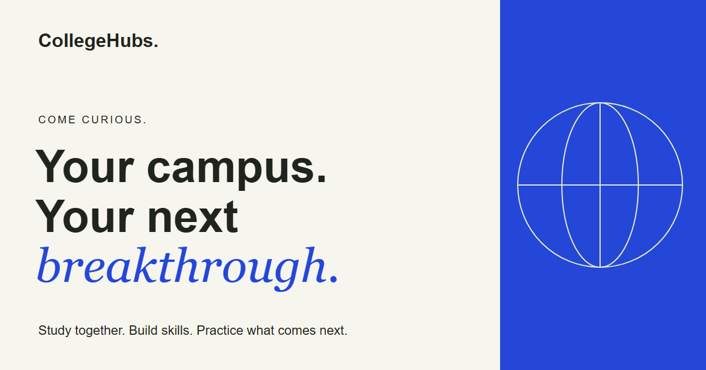
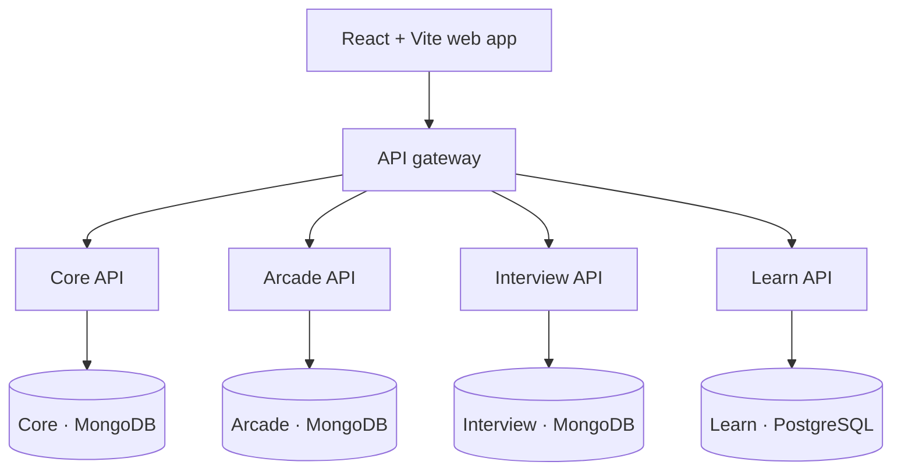

<p align="center">
  
</p>

<h1 align="center">CollegeHubs</h1>

<p align="center">
  <strong>A shared home for campus conversations, collaborative study, and everyday skill growth.</strong>
</p>

<p align="center">
  <a href="https://collegehubs.pages.dev">Explore the app</a> ·
  <a href="#features">Features</a> ·
  <a href="#getting-started">Getting started</a> ·
  <a href="#architecture">Architecture</a> ·
  <a href="CONTRIBUTING.md">Contributing</a>
</p>

---

CollegeHubs brings a student's college community and practice tools into one workspace. Discuss a subject with classmates, work through a timed Study Room, follow a learning roadmap, prepare for an interview, or take on a quick Arcade challenge. Your dashboard connects these activities through progress summaries, achievements, and **Aura**, the platform's shared reward system.

College Hubs keep conversations, resources, membership, and rankings scoped to the right campus. The responsive interface shares one account, navigation, and college identity across every feature.

## Features

### Campus, connected

- **College membership:** password accounts with mailbox verification, Google sign-in, and explicit Google account linking when configured.
- **Subject channels:** real-time conversations, syntax-highlighted code, resource links, questions, threaded replies, and accepted answers.
- **Search and sharing:** find channel content and keep useful learning resources close to the discussion.
- **College themes:** a shared visual identity across the dashboard and feature pages, with layouts for desktop and mobile.

### Study Rooms

Turn a channel conversation into a focused study session. Rooms provide a shared task, timed individual work, code submissions, peer review, and submission comparison. Saved session state supports returning to the activity, while server checks control participation and rewards. Submitted code is displayed for review; it is never executed.

### Learn

Build foundations through structured roadmaps in **Data Structures & Algorithms, Web Development, Machine Learning, Backend Development, and DevOps**.

- Self-assessment and learning preferences help you choose a starting point.
- Topic readings, prerequisite checks, and an accessible roadmap list guide the next step.
- Checkpoint quizzes and test-out assessments save results and unlock eligible topics.
- Versioned curricula preserve existing progress and offer explicit path upgrades.
- Completion summaries and remediation suggestions help you revisit weak areas.
- Contextual tutor guidance uses templates by default, with optional local inference when configured.
- Selected weak skills can become practice topics for a new Interview session.

### Interview practice

Prepare with private resumes, focused questions, and a record of your practice.

- Upload a text-based PDF resume and manage its extracted text privately.
- Create five-question sessions with provider-free practice or configured AI assistance.
- Save answers, resume an unfinished session, and review session history and reports.
- Filter history and manage session and resume lifecycles.
- Request optional live feedback on a saved answer when streaming is enabled.
- Read questions aloud and dictate answer drafts using supported on-device browser speech features.

Voice availability depends on the browser and installed speech support. AI feedback and assessments are practice aids; live feedback does not change saved scores or award Aura.

### Arcade

Short challenges make practice easy to fit between classes. Four ranked games are implemented:

| Game | The challenge |
| --- | --- |
| **NumberGuess** | Find a hidden number within ten saved guesses. |
| **MathAmplitude** | Solve arithmetic against a 60-second clock. |
| **Sorting Complexity** | Trace bubble-sort comparisons and swaps, then identify its complexity. |
| **Spot the Bug** | Read code and identify bugs across five questions. |

The Arcade also includes a daily challenge and saved results. The server validates outcomes and reward eligibility; replaying an activity cannot duplicate its reward.

### Your progress, in one place

The dashboard and progress page bring together Learn, Arcade, Interview, and campus activity. Continue unfinished work, inspect achievements, view Aura history, and compare college rankings. Optional Codeforces integration supports ownership review and statistics. External statistics and reward bonuses have separate activation controls.

### Schedules that stay useful

- Browse cached contest schedules, including an optional authenticated Clist integration.
- View academic events by subject and month, with source and freshness labels.
- Export academic events as an `.ics` file.
- Connect optional Google Calendar sync to a dedicated CollegeHubs academic calendar, then disconnect it from the app.

## Architecture

**One React application. Four independent APIs. One npm workspace repository.**

The frontend uses a same-origin API gateway. Core owns accounts, college membership, and the authoritative Aura ledger. Each feature service owns its storage and accepts scoped access from Core; services do not read one another's databases.



| Layer | Technology |
| --- | --- |
| Web | React, React Router, Vite, TypeScript/JavaScript, Tailwind CSS |
| APIs | Node.js, Express, shared service contracts |
| Real-time channels | Socket.IO |
| Storage | MongoDB with Mongoose; PostgreSQL for Learn |
| Optional integrations | Google sign-in and Calendar, Brevo mail, Groq/local inference, coding-platform and contest APIs |
| Deployment | Cloudflare Pages and its API gateway; four Render services |

Saved activity and reward delivery are separate. If Core is temporarily unavailable, a completed module result can remain saved with Aura pending and retry delivery later. An unavailable optional service does not prevent Core from serving its own features.

## Getting started

### Prerequisites

- **Node.js 24.12 or newer** and npm.
- A **MongoDB replica set** for Core. Arcade and Interview each need their own database and credentials if enabled.
- **PostgreSQL** if Learn is enabled.

### 1. Install the workspace

```sh
git clone https://github.com/sahtiwk/CollegeHubs.git
cd CollegeHubs
npm ci
```

Run installs from the repository root; the active workspaces share one lockfile.

### 2. Configure local services

Create a private `services/core/.env` using the [configuration reference](docs/configuration.md) and [development guide](docs/development.md). Core requires `MONGO_URI`, `JWT_SECRET`, and `ALLOWED_ORIGINS`. The local launcher enables Core sessions for the web app.

Use `http://localhost:5173` consistently as the local browser origin. Provision the college registry with `npm run provision:hubs -w @collegehubs/core` after confirming the intended database. The bundled registry currently enables the exact `cvr.ac.in` domain; joining a Hub requires the configured membership verification flow.

To add a module, configure its private workspace `.env`, provision its scoped Core credentials, and add it to Core's `ENABLE_MODULES`. The [deployment guide](deploy/README.md) explains the signing keys, service credentials, and matching origins. Learn also requires explicit database setup or migration as described in the development guide.

Environment templates are intentionally absent. Keep credentials in ignored local files, and use the documented setting names. Only public browser settings belong in `apps/web/.env.local`; a `VITE_` prefix exposes a value to the browser.

### 3. Start the app

```sh
npm run dev
```

Open **http://localhost:5173**. The launcher starts the web app, Core, and only the modules listed in `ENABLE_MODULES`.

| Workspace | Local port | Responsibility |
| --- | --- | --- |
| `apps/web` | `5173` | Shared interface and development gateway |
| `services/core` | `5000` | Identity, campus collaboration, Aura, schedules |
| `services/arcade` | `5001` | Games, attempts, daily challenges |
| `services/interview` | `5002` | Resumes, sessions, practice reports |
| `services/learn` | `5003` | Roadmaps, readings, assessments, learning progress |
| `packages/contracts` | — | Shared validation, manifests, and service contracts |

Individual launch commands are also available: `dev:web`, `dev:core`, `dev:arcade`, `dev:interview`, and `dev:learn`.

## Development and verification

| Command | Purpose |
| --- | --- |
| `npm run build` | Build the web app and Learn service; check Core, Arcade, and Interview. |
| `npm run test:identity` | Verify mailbox, onboarding, and return-navigation behavior with disposable fixtures. |
| `npm run test:sessions` | Verify account session, refresh, and revocation behavior. |
| `npm run test:design` | Check shared design tokens and contrast rules. |
| `npm run test:deployment` | Check deployment configuration and gateway boundaries. |
| `npm run test:guards` | Run cross-service guards against the explicitly configured integration fixture. |
| `npm run test:migrations` | Verify migrations and restore behavior using disposable local databases. |

GitHub Actions runs clean installation, workspace builds, and the self-contained identity, session, design, and deployment checks. Full cross-service and migration verification additionally needs the local PostgreSQL and MongoDB fixtures documented in the [development guide](docs/development.md). A skipped integration check is incomplete verification.

Ordinary startup does not reset or migrate stored data. Use the [migration and restore runbook](docs/transition-restore.md) for existing databases; demo setup commands are for explicitly disposable databases only.

## Availability and configuration

The [hosted app](https://collegehubs.pages.dev) is a demo on free infrastructure. APIs can sleep, take time to wake, or reach provider quotas. Feature availability depends on enabled services and integration settings; the repository may contain improvements ahead of the hosted deployment.

Google authentication, verification email, Calendar sync, AI assistance, external statistics, and authenticated contest providers require their own configuration. Local/provider-free practice is supported; no model weights ship in the repository. College registry membership does not imply institutional endorsement. Rankings are scoped to a college.

## Documentation

| Guide | What you will find |
| --- | --- |
| [Development](docs/development.md) | Local setup, databases, fixtures, and verification |
| [Configuration](docs/configuration.md) | Environment names and service ownership |
| [Deployment](deploy/README.md) | Hosting, service provisioning, and gateway configuration |
| [Demo walkthrough](docs/demo.md) | A guided tour of the app |
| [Academic calendars](docs/academic-calendar.md) | Reviewed events, exports, and managed sync |
| [Release record](docs/transition-release-evidence.md) | Dated acceptance results and current limitations |
| [Migration and restore](docs/transition-restore.md) | Preserving data through schema changes |
| [Contributing](CONTRIBUTING.md) | Contribution and validation expectations |
| [Security](SECURITY.md) | Reporting a vulnerability privately |

License terms are described in [LICENSE](LICENSE).
