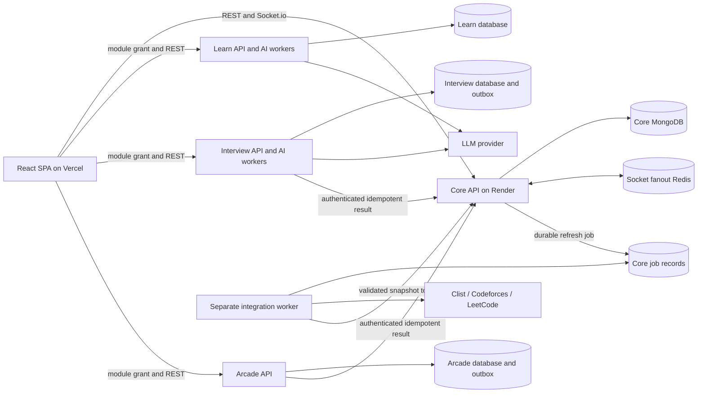

# CollegeHubs codebase gap analysis

## 1. Executive Summary

**Verified (seen in code):** This checkout is branded **SocialStream**, a developer social feed, not an implemented CollegeHubs collaboration platform (`README.md`, `index.html`, `src/pages/Aboutpage.jsx`, both package manifests). It contains a React/Vite frontend and one Express/Mongoose backend. Registration, password login, a Google access-token login path, posts, likes, editable profiles, college-dependent colors, a global leaderboard, and manually refreshed coding statistics have implementations. This is static verification of code paths, not proof of successful production operation.

**Verified (seen in code):** Hub membership, subject channels, message history/search, Socket.io, Prism, Study Rooms, AI learning, interviews, Arcade, and durable Aura event processing are **NOT FOUND** in the inspected source/manifests. The only models are `server/models/User.js` and `server/models/Post.js`. `college` is a freely editable string; it does not isolate queries. `server/routes/userRoutes.js` exposes profile updates and Aura refresh without authentication. `server/services/auraService.js::updateUserAura` overwrites points that `server/routes/postRoutes.js` awards for posting.

**Inferred — verdict:** Evolve the existing code, with a targeted rewrite of Aura accounting and substantial new domain modules. A whole-application rewrite would discard useful authentication plumbing, React presentation, REST wiring, and persistence conventions. Retaining these does not make the flagship collaboration implementation small.

**Inferred — approximately 20% of target functionality exists.** An explicit, subjective equal-feature estimate is: feature 1 = 40%, 2 = 0%, 3 = 0%, 4 = 0%, 5 = 30%, 6 = 35%, 7 = 15%, 8 = 40%; average = 20%. These are reusable functional slices, not production readiness, measured test coverage, or effort completion. Security, tenancy, and reliability deficiencies reduce readiness further. No complete target feature is marked DONE merely because its UI is present.

**Verified — audit boundaries:** Only `changes.md` was created. No package installation, builds, servers, migrations, seeds, API requests, database inspection, or deployment actions were performed. Initial Git status already showed modifications to `package-lock.json` and `server/package-lock.json`; these are pre-existing. Ignored dependencies/build output were excluded. Environment files were inspected for names only. Exact FR1–FR7/NFR1–NFR5 definitions and the original paper/report are **NOT FOUND**; section 3 explicitly uses provisional mappings rather than inventing authoritative requirement wording.

**Reading convention:** “Verified” means observed in code or repository inventory, including scoped negative search results. “Inferred” means a consequence, architectural judgment, estimate, or proposed change. All future paths, contracts, payloads, numerical limits, diagrams, and roadmap items below are **Inferred/proposed**, not descriptions of existing implementation. NOT FOUND means absent from the inspected repository, not necessarily absent from other repositories or deployed infrastructure.

## 2. Current State Snapshot

**Verified — annotated inventory** (repository-relative paths; exhaustive inspected-file list in section 14):

```text
C:/socialstream/
  package.json                 React/Vite scripts and dependencies
  package-lock.json            npm lockfile; internals excluded
  vite.config.js               React plugin; development port configuration
  tailwind.config.js           theme extensions and source scanning
  postcss.config.js            Tailwind/autoprefixer
  vercel.json                  SPA fallback rewrite only
  index.html                  SocialStream title and src/main.jsx entry
  README.md, .gitignore        frontend instructions and exclusions
  src/
    main.jsx                  React root, GoogleOAuthProvider, BrowserRouter
    App.jsx                   /, /about, /login, /register, /leaderboard, /contests
    api.js                    Axios base URL and localStorage bearer interceptor
    index.css                 Tailwind directives and global styles
    pages/                    six route components listed above
    components/               feed/cards, sidebars, onboarding/profile modals
    utils/collegeThemes.js    substring-to-theme lookup
  server/
    package.json              Express process, nodemon, destructive sample seed
    package-lock.json         second npm lockfile; internals excluded
    index.js                  middleware, DB connection, mounts, calendar, listen
    middleware/auth.js        JWT verification and current User lookup
    models/                   User.js, Post.js only
    routes/                   authRoutes, googleAuthRoutes, userRoutes, postRoutes
      backendaurafix.js       unattached example/pseudocode, not a working router
    services/auraService.js   three external fetchers plus direct User score write
    seed.js                   deletes/recreates one sample account
    README.md, .gitignore     backend setup and exclusions
  .env, .env.local            ignored; variable names only inspected
  server/.env                ignored; variable names only inspected
  .git/, .vercel/, dist/, node_modules/  metadata/output/dependencies excluded
```

**Verified:** One Git checkout contains two npm packages, not a configured npm-workspaces monorepo (`package.json`, `server/package.json`). Frontend source is JavaScript/JSX with ES module imports; backend uses CommonJS JavaScript. Separate npm lockfiles exist. Other repositories/services cannot be inferred from this checkout. AGENTS.md, Dockerfiles, Compose, CI workflows, Render configuration, test files/configuration, lint configuration, TypeScript configuration, and environment examples were **NOT FOUND** in the non-ignored inventory.

**Verified — scripts:** Root `package.json` defines `dev: vite`, `build: vite build --debug`, and `preview: vite preview`. `server/package.json` defines `dev: nodemon index.js`, `start: node index.js`, and `seed: node seed.js`. There is no combined root start script or workspace orchestration. None of these scripts was executed.

| Area | Verified actual implementation and evidence | Target comparison / Inferred change |
|---|---|---|
| UI/build | React 18 dependency range, Vite 5 range, React Router 6, Tailwind 3, lucide-react (`package.json`, `vite.config.js`, `tailwind.config.js`, `src/index.css`) | Matches foundation; actual resolved versions not audited from lockfiles. Most newer screens use extensive inline styles. |
| HTTP | Axios in both packages; frontend bearer interceptor (`src/api.js`) | Keep transport; add timeouts, typed/validated contracts, consistent error handling. |
| API | Express 4 range, Mongoose 8 range, Node entry (`server/package.json`, `server/index.js`) | Matches runtime foundation. Runtime Node version is not pinned in manifests. |
| Realtime/code | Socket.io and Prism dependencies/imports **NOT FOUND** (`package.json`, `server/package.json`, `src/components/PostCard.jsx`) | Both need implementation; plain text posts are not code-sharing chat. |
| Storage | Mongoose connection using MONGO_URI; two schemas (`server/index.js`, `server/models/*`) | MongoDB implemented; Atlas hosting, backup settings, encryption configuration and transaction topology are unverified. |
| Deployment | Vercel SPA rewrite (`vercel.json`), backend start script (`server/package.json`) | Compatible building blocks, not evidence of live Vercel/Render deploys. |

**Verified — environment names:** `.env` contains `VITE_API_URL`, `VITE_GOOGLE_CLIENT_ID`; `.env.local` contains those names plus `VERCEL_OIDC_TOKEN`; `server/.env` contains `PORT`, `MONGO_URI`, `JWT_SECRET`, `GOOGLE_CLIENT_ID`. No values are reproduced or assessed. `server/.env.local` is absent. Source references the two VITE names in `src/api.js`/`src/main.jsx` and the four backend names in `server/index.js`, authentication modules and `server/seed.js`. VERCEL_OIDC_TOKEN is not referenced by application source. A present local name does not prove valid configuration or production configuration. Socket adapter, Clist, LLM and interservice configuration names are **NOT FOUND** in source.

**Verified — frontend behavior:** `src/main.jsx` mounts providers; `src/App.jsx` declares six routes without a shared route guard or catch-all. Components use local `useState`/`useEffect` and props, not a central auth or query store. Login/Register save a JWT and user JSON to localStorage. `Dashboard` checks cached user identity and requests a public profile; it does not validate a session through `/me`. `api.js` attaches the stored JWT but has no response interceptor or timeout. Onboarding accepts custom college text; `getCollegeTheme` maps substrings to palettes and is consumed by Dashboard, Contests and Leaderboard. The `iit` test precedes `iiit`, so IIIT names match IIT first. Client-side college filtering in `Leaderboard::collegeEntries` occurs after a global top-50 response, excluding eligible college users outside that global slice.

**Verified — API inventory:**

| Existing route | Implementation | Current guard and behavior |
|---|---|---|
| GET /api/health | `server/index.js` | Public static success, no DB readiness check. |
| POST /api/auth/register, /login | `server/routes/authRoutes.js` | Public, presence checks, bcrypt comparison, seven-day JWT. |
| POST /api/google/auth | `server/routes/googleAuthRoutes.js` | Google `getTokenInfo`, email match/create, app JWT. No explicit returned audience/email-verification check in application code. |
| POST /api/google/calendar | `server/index.js` | No app authentication; forwards supplied Google token to Calendar. Google still authorizes that token; this is not an unrestricted write to arbitrary calendars. |
| PUT /api/users/onboarding | `server/routes/userRoutes.js` | `authenticate`; changes current user and arbitrary college string. |
| GET /api/users/leaderboard | same | Public global top 50, no Hub filter. |
| GET /api/users/:username | same | Public full user document excluding password, including email. |
| PUT /api/users/:username | same | No authentication/ownership guard; updates named user's allowed profile/handle fields. |
| POST /api/users/:username/refresh | same | Public; external requests then destructive score recomputation. |
| POST /api/posts | `server/routes/postRoutes.js` | Authenticated; inserts post then separately increments author by 50. |
| GET /api/posts | same | Public, all posts, no pagination or Hub constraint. |
| PUT /api/posts/:id/like | same | Authenticated, no tenant check, document read/modify/save toggle. |

**Verified — layering and reliability:** Routes directly validate, query models and shape responses; there are no controllers/repositories. `auraService` mixes provider calls, calculation and persistence. Google Calendar logic is embedded in server bootstrap. JWT generation is duplicated. `authenticate` reloads a User, which is useful for future membership enforcement, but all auth modules have a hardcoded secret fallback. Passwords are bcrypt-hashed at cost 12 by `User`'s save hook, not reversibly encrypted; hashing is the correct mechanism to retain. OAuth creates a required password using Math.random and matches identities by email; Google subject is returned but not stored. Logs are console calls; structured/request-correlated logging and a central error handler are **NOT FOUND**. Rate limiting, request schemas and update validators are **NOT FOUND**. CORS allows every origin (`server/index.js`).

**Verified — quality/deployment limits:** Neither manifest defines tests or lint scripts; automated coverage reports are **NOT FOUND**, and coverage was not measured. `server/index.js` calls listen without awaiting DB connection; the health endpoint can report success before DB readiness. Actual hosts, tiers, regions, cold starts, TLS policies and production traffic are unknown. Responsive implementation is incomplete: Dashboard uses fixed 280/300px sidebars in one flex row, has no corresponding responsive breakpoints, and never calls `setIsMobileMenuOpen(true)` (`src/pages/Dashboard.jsx`, `src/index.css`). Mobile clipping is an **Inferred** risk, not a browser-tested finding.

## 3. Gap Analysis Table

**Verified:** Exact numbered FR/NFR definitions are NOT FOUND in either README or source inventory and were not included in the supplied task. **Inferred:** The provisional FR/NFR labels below cover the supplied minimum-baseline themes; their numbering must be reconciled with the original report. Statuses assess these explicitly stated proxy scopes only, not compliance with unseen wording. Evidence cells distinguish observations from proposed “What's needed” work.

| Requirement | Status | Evidence (file paths) | What's needed |
|---|---|---|---|
| Target 1: automatic college Hubs, auth, identity, isolation | PARTIAL | Verified: JWT/OAuth paths in `server/routes/authRoutes.js`, `googleAuthRoutes.js`; themes in `src/utils/collegeThemes.js`; only free-text college in `server/models/User.js`; Hub **NOT FOUND**. | Canonical colleges, verified membership assignment during auth, scoped data/API/socket access, centralized theme tokens. |
| Target 2: subject channels, persistent searchable messages | MISSING | Verified: `server/models/Post.js` is a global feed post; channels/messages/search routes **NOT FOUND** in `server/routes/` and `src/App.jsx`. | Default channels per Hub, message schema, paginated history and tenant-filtered search. |
| Target 3: Socket.io messaging and Prism code | MISSING | Verified: dependencies/imports **NOT FOUND** in both manifests/source; `PostCard` renders a paragraph with pre-line whitespace. | Socket transport, durable messages, escaped syntax-highlighted code blocks and acknowledgments. |
| Target 4: synchronized Study Rooms and comparison | MISSING | Verified: room/session/submission models, routes and events **NOT FOUND** in `server/`; pages **NOT FOUND** in `src/App.jsx`. | Authoritative deadline, durable drafts, atomic close, reconnect snapshots, review display, integrity controls. |
| Target 5: Aura weighted events, bonuses, college leaderboard, badges | CONFLICTS WITH TARGET | Verified: `auraService::updateUserAura` replaces total with external formula; `postRoutes` increments +50; `userRoutes` global top 50; `User` has streak/achievement fields with no live award path. | Replace accounting with versioned ledger and idempotent events; preserve external bonus separately; scoped leaderboard and award rules. |
| Target 6: academic calendar and contest/stat integration | PARTIAL | Verified: `Contests::load` calls Codeforces and mixes mocks; `server/index.js` Calendar export; LC/CF stats in `auraService`; Clist and academic-event model **NOT FOUND**. | Server ingestion/cache, honest stale fallback, calendar ownership and channel associations. |
| Target 7: independent Core, /learn, /interview, /arcade | CONFLICTS WITH TARGET | Verified: one backend process (`server/index.js`); service packages/routes/UI **NOT FOUND**; frontend/backend separation is not domain microservices. | Separate deployable services with owned data, independent failure budgets, authenticated result delivery. |
| Target 8: progress dashboard and upcoming CF/LC contests | PARTIAL | Verified: `Dashboard`, `AuraCard` show saved totals; `RightSidebar` uses static contests/rankings. | Real progress/history and shared contest API; show freshness, pending scores, correct Hub rank. |
| FR1 — provisional: registration/login and protected APIs | PARTIAL | Verified: auth routes and bcrypt exist; profile mutations unguarded in `userRoutes`. | Verify exact FR1 text; close auth gaps and complete session lifecycle. |
| FR2 — provisional: college identity and automatic Hub routing | PARTIAL | Verified: `OnboardingModal`, `collegeThemes`, `User.college`; automatic membership **NOT FOUND**. | Verify FR2; canonical identity and verified automatic assignment. |
| FR3 — provisional: subject channel messaging/history | MISSING | Verified: models/routes limited to users/posts; channel implementation **NOT FOUND**. | Verify FR3; persistent scoped chat. |
| FR4 — provisional: formatted code sharing | MISSING | Verified: `PostCard` plain text; Prism/code schema **NOT FOUND**. | Verify FR4; language metadata and safe highlighting. |
| FR5 — provisional: timed collaborative coding/peer review | MISSING | Verified: `server/index.js`, `src/App.jsx` contain no Study Room entry points. | Verify FR5; complete Study Room vertical slice. |
| FR6 — provisional: Aura and college leaderboard | CONFLICTS WITH TARGET | Verified: external overwrite in `auraService`, global query in `userRoutes`, frontend-only filter in `Leaderboard`. | Verify FR6; ledger, college queries and achievement processing. |
| FR7 — provisional: calendar/integrations/progress | PARTIAL | Verified: `Contests`, `Dashboard`, `auraService`; academic calendar and automated worker **NOT FOUND**. | Verify FR7; durable ingestion and real dashboard data. |
| NFR1 — provisional: low API/WebSocket latency | PARTIAL | Verified: some indexes in both models; unbounded posts query, request-time external refresh; sockets/benchmarks **NOT FOUND**. | Verify NFR1; bounded queries, worker isolation, agreed latency SLOs and measurements. |
| NFR2 — provisional: multi-Hub/concurrent-room scalability | MISSING | Verified: no Hub/session models or socket adapter; global queries in `postRoutes`/`userRoutes`. | Verify NFR2; tenant indexes, fanout and multi-instance recovery/load tests. |
| NFR3 — provisional: secure storage and access | PARTIAL | Verified: bcrypt and JWT in `User`/auth middleware; unguarded profile writes and fallback signing secret. | Verify NFR3; authorization, validation, secret fail-fast, privacy and infrastructure verification. |
| NFR4 — provisional: responsive college-branded UI | PARTIAL | Verified: themes work by code path; fixed Dashboard sidebars and inaccessible drawer opener. | Verify NFR4; adaptive layout and keyboard/mobile checks. |
| NFR5 — provisional: reliability, reconnect, service isolation, fallbacks | PARTIAL | Verified: provider catches in `auraService`/`Contests`; zeros/mocks are returned; reconnect and independent services **NOT FOUND**. | Verify NFR5; durable state, truthful cache, timeout budgets and independent failure tests. |

## 4. Keep / Refactor / Rewrite / Delete

**Inferred — proposed disposition only; nothing in this table has been implemented or deleted.** Evidence refers to verified files/functions above.

| Module/folder | Disposition | Justification and boundary |
|---|---|---|
| Vite/Tailwind/PostCSS configs, `src/main.jsx` | Keep | Target-compatible build/provider foundation; no framework replacement needed. |
| `src/App.jsx`, `src/api.js` | Refactor | Add auth/Hub layout, feature routes, endpoint normalization, timeout/error handling. |
| `src/pages/Login.jsx`, `Register.jsx` | Refactor | Keep forms; use shared auth state, validated session flow and responsive layout. |
| `src/utils/collegeThemes.js`, `OnboardingModal.jsx` | Refactor | Preserve palettes; replace substring identity/free-form membership with canonical server data. |
| `Feed.jsx`, `PostCard.jsx` | Refactor | Preserve REST feed UI, add tenancy/pagination and shared code renderer; build chat as a distinct domain. |
| `Dashboard.jsx`, `Sidebar.jsx`, `AuraCard.jsx`, `EditProfileModal.jsx` | Refactor | Keep presentation; fix responsive behavior, ownership-aware edits, stale state and fake progress. |
| `RightSidebar.jsx`, `AuraTicker.jsx` | Rewrite data plumbing | Static examples must become verified events and shared API data; visual shells can stay. |
| `Leaderboard.jsx`, `Contests.jsx` | Refactor | Move filtering and provider orchestration server-side; replace simulated schedules and ranks. |
| `Aboutpage.jsx`, `README.md`, `server/README.md`, `index.html` | Refactor | Correct SocialStream/CollegeHubs branding and unsupported claims once product scope is settled. |
| `server/index.js` | Refactor | Separate app composition, startup, calendar controller, socket server and health/readiness. |
| `server/routes/*Routes.js`, `middleware/auth.js` | Refactor | Keep endpoint behavior where useful; centralize token issuance and enforce ownership/tenant filters. |
| `server/models/User.js`, `Post.js` | Refactor | Preserve identities/post content and bcrypt hook; migrate tenancy and score projection explicitly. |
| `server/services/auraService.js` | Rewrite accounting; extract fetchers | Existing provider parsing is reusable only after validation/timeout/failure fixes; total overwrite must end. |
| `server/routes/backendaurafix.js` | Delete after archival in Git | Unimported snippet with undefined router/auth/model variables and top-level await; not deployed logic. Actual route already differs (+50 versus snippet +10). |
| `server/seed.js` | Refactor | Delete/recreate behavior and hardcoded sample credential are unsuitable for production; use guarded development fixtures. |
| Unused imports/constants/dependencies | Delete after verification | `axiom`/`googleapis` have no source imports; unused `CVR_LOGO_URL`, `RANK_LABEL`, `useMemo`, `useCallback` are present. Remove with later lint/build checks, not speculative package churn. |

## 5. Architectural Changes Required

**Verified — starting constraint:** There are no AI/Arcade implementations to extract. The practical extraction is provider access from `auraService` into a worker and business logic out of routes/bootstrap. `/learn`, `/interview`, `/arcade` are new services. Direct User imports in `auraService`, `postRoutes` and auth routes couple identity, scoring and provider access; client localStorage and global queries couple UI to the current global model.

**Inferred — retain `server/` as Core initially.** Core owns identity/membership, Hub routing, feed, messages, Study Room state and sockets, peer answers, calendar records, Aura ledger and score projections. Keep Core MongoDB transactions within this ownership boundary. Extract controllers/services/repositories incrementally, without moving every file into a new monorepo layout first.

**Inferred — domain services:** `services/learn/` owns resource generation, curated results and restricted hints; `services/interview/` owns interview sessions, answers, rubric evaluation and immutable results; `services/arcade/` owns challenges, attempts and validated game outcomes. Each gets its own process, package, deployment, concurrency limits, database credentials, readiness and release lifecycle. Shared `packages/contracts/` contains transport schemas only, never Mongoose models or runtime imports from Core.

**Inferred — communication:** Browser routes `/learn`, `/interview`, `/arcade` load frontend modules calling their separate HTTPS API origins. Core issues short-lived audience-specific module grants containing `sub`, `hubId`, membership version, scope, `aud`, `iss`, `exp`, `jti`; services verify signing keys and only accept scoped operations. Recheck membership when accepting returned results; document a maximum grant revocation delay. Service-to-Core callbacks use a distinct service identity token with result-only scopes, issuer/audience/expiry checks and unique event IDs. A browser can never submit a score directly. Interview/Arcade persist result and outbox together, then retry REST delivery to Core. Core acknowledges only after durable deduplicated commit.

**Inferred — isolation:** Core chat/feed/Study Room requests never wait for an LLM, contest provider or module health probe. AI jobs return 202, have bounded queues, per-user quotas and provider timeouts; the UI shows pending/unavailable without blocking navigation. Results eventually affect Aura. Core-owned ingestion workers run separately from its HTTP/socket process, with bounded DB connections and provider concurrency. Optional hints use a separate Learn connection and must not touch the room timer path. An overloaded provider or worker must not exhaust Core process resources.

**Inferred — data ownership recommendation:** Use separate logical databases and credentials per service on one managed MongoDB cluster initially, with Core owning all authoritative Aura/membership data. This costs less and simplifies operations but leaves shared-cluster resource and outage coupling; it is logical isolation, not complete infrastructure isolation. Enforce pool/resource budgets; move AI/Arcade to separate clusters if the availability objective requires stronger independence. Database-per-service forbids cross-service collection writes and joins; use immutable IDs and versioned events instead. A single shared schema would be easier initially but undermines independent migrations and failure isolation. Do not attempt distributed transactions across services; use transactional outboxes, deduplication and reconciliation.

**Inferred — independent scaling:** Scale Core by socket connections/message rate, with a compatible Redis fanout adapter and persistent Mongo session state. Scale ingestion workers by queue lag; AI workers by provider budget and queue depth; Arcade by request/game load. Separate deployments need runtime/engine pinning, per-service environment scopes, origin allowlists, health/readiness endpoints, metrics, rollback procedures and deploy smoke checks. Vercel serves the SPA; Core and service processes are proposed Render deployments. Actual hosting tier/WebSocket/adapter support must be validated before selecting configuration; no live infrastructure was inspected.



## 6. New Things To Create

**Inferred — implementation inventory.** Every path below is proposed; none is created by this audit. Paths retained under `server/` minimize migration churn. Model fields/indexes follow in section 7; socket event payloads follow in section 8. File sets explicitly list each planned file rather than implying existing modules.

| Proposed files | Purpose | Inputs → outputs / contracts |
|---|---|---|
| `server/app.js`, `server/config/env.js`, `server/config/database.js` | Testable app composition and fail-fast startup | Validated environment → configured Express app/ready DB; `index.js` awaits readiness then listens. |
| `server/controllers/authController.js`, `server/services/authService.js`, `server/services/tokenService.js` | Consolidate register/login/OAuth and session issuance | Credentials or verified Google identity → safe user/session; add GET `/api/me`, POST `/api/auth/logout`. |
| `server/routes/moduleGrantRoutes.js`, `server/services/moduleGrantService.js`, `server/models/ModuleGrant.js` | Bind module work to authorized users, Hubs and purposes | POST `/api/module-grants` with `{module:"interview",purpose:"session",requestId:"g1"}` → short-lived grant and grantId; optional roomId for hints; never accept arbitrary audience/scope. Persist grant binding/expiry and unique request key; serve public verification keys through a documented JWKS endpoint. |
| `server/middleware/validate.js`, `tenant.js`, `serviceAuth.js`, `errorHandler.js`, `rateLimit.js`; `server/lib/logger.js` | Input schemas, membership boundary, trusted callbacks, consistent errors/limits/logs | Request and verified principal → scoped context or `{error:{code,message,requestId}}`; never log tokens/code by default. |
| `server/models/College.js`, `Hub.js`, `Membership.js`, `AuthIdentity.js`, `AuthSession.js` | Canonical identity and session state | Verified identity → one active college membership and default Hub; unique constraints in section 7. |
| `server/routes/hubRoutes.js`, `server/controllers/hubController.js`, `server/services/hubService.js`, `server/repositories/tenantRepository.js` | Automatic assignment and scoped reads | GET `/api/me/hub` → `{hub,theme,channels}`; only approved college mappings, no client-selected tenant trust. |
| `server/models/Channel.js`, `Message.js`; `server/routes/channelRoutes.js`, `server/controllers/channelController.js`, `server/services/messageService.js` | Subject channels/history/search and code blocks | GET `/api/hubs/:hubId/channels`; GET `.../channels/:channelId/messages?cursor=&q=` → `{items,nextCursor}`; membership precedes queries. |
| `server/models/StudyRoom.js`, `StudyParticipant.js`, `StudyDraft.js`, `Submission.js`, `PeerReview.js`; `server/routes/studyRoutes.js`, `server/controllers/studyController.js`, `server/services/studyService.js`, `server/workers/studyDeadlineWorker.js` | Durable room state machine, drafts, closure and review | POST `/api/hubs/:hubId/study-rooms` with `{channelId,problemId,durationSeconds,requestId}` → room; GET `/api/study-rooms/:id` snapshot and `/submissions` after closure; POST `/reviews` after membership checks. |
| `server/models/Problem.js`; `server/routes/problemRoutes.js` | Versioned shared problem statements | GET `/api/hubs/:hubId/problems` → safe problem metadata; room stores immutable problem version. |
| `server/models/Answer.js`; `server/routes/answerRoutes.js`, `server/services/answerService.js` | Accepted peer answers, distinct from likes | POST `/api/messages/:id/answers` `{body}`; PUT `/api/answers/:id/accept` → accepted answer and trusted Aura event; only question owner/moderator, no self-award. |
| `server/models/AuraEvent.js`, `AuraBalance.js`, `AuraRuleSet.js`, `AchievementAward.js`, `DailyParticipation.js`; `server/services/auraLedgerService.js`, `achievementService.js` | Auditable weighted scoring and awards | Trusted domain fact → unique ledger entries/projection update; no public “add points” endpoint. |
| `server/routes/auraRoutes.js`, `server/controllers/auraController.js` | Explainable progress and scoped ranking | GET `/api/me/progress`; GET `/api/hubs/:hubId/leaderboard?cursor=` → ranked public projections and scoring version. |
| `server/models/ExternalAccount.js`, `ExternalSnapshot.js`, `IntegrationJob.js`; `server/workers/integrationWorker.js`, `server/integrations/codeforces.js`, `leetcode.js`, `clist.js`, `providerClient.js` | Verified handles, asynchronous refresh and defensive adapters | POST `/api/me/stats/refresh` → `202 {jobId}`; provider response → normalized snapshot with freshness/error status. |
| `server/models/Contest.js`, `CalendarEvent.js`; `server/routes/calendarRoutes.js`, `server/controllers/calendarController.js`, `server/services/calendarService.js` | Shared contests plus academic schedule | GET `/api/hubs/:hubId/calendar?from=&to=&channelId=`; authorized POST academic event; GET `/api/contests`; authenticated calendar export replaces inline handler. |
| `server/models/OutboxEvent.js`, `server/models/InternalResult.js`, `server/workers/outboxWorker.js`, `server/routes/internalResultRoutes.js` | Reliable broadcasts/callback ingestion | POST `/internal/v1/interview-results`, `/arcade-results`, `/external-snapshots` → stored result/duplicate acknowledgment; service-specific scopes. InternalResult stores service, eventId, semantic result key, grantId, hubId, userId, validated payload, checksum and processing status; unique service/eventId and semantic result keys; processing-status index for pending awards. |
| `server/realtime/index.js`, `auth.js`, `channelHandlers.js`, `studyHandlers.js`, `eventStore.js`; `server/models/RealtimeEvent.js` | Socket handshake, authorization, persisted event sequence and fanout | `/core` namespace, channel/study events in section 8; success only after DB commit. |
| `src/auth/AuthProvider.jsx`, `src/components/ProtectedRoute.jsx`, `src/layouts/HubLayout.jsx`, `src/theme/CollegeThemeProvider.jsx` | Shared verified session and college shell | `/api/me` and `/api/me/hub` → guarded routes/theme tokens/navigation. |
| `src/pages/Channel.jsx`, `src/components/ChannelList.jsx`, `MessageList.jsx`, `MessageComposer.jsx`, `CodeBlock.jsx`, `AnswerThread.jsx` | Persistent subject chat and accepted answers | API/socket messages → text and Prism token rendering; composer emits `{kind,body,code:{language,source}}`. |
| `src/pages/StudyRoom.jsx`, `src/components/StudyEditor.jsx`, `StudyTimer.jsx`, `SubmissionComparison.jsx`, `PeerReviewPanel.jsx`, `HintPanel.jsx` | Timed session and review UX | Snapshot/deadline/draft ack → editor, save state, countdown, post-close side-by-side code and reviews; hints independently unavailable. |
| `src/realtime/client.js`, `src/hooks/useChannel.js`, `useStudyRoom.js`, `useProgress.js`; `src/components/ProgressHistory.jsx`, `AcademicCalendar.jsx` | Socket lifecycle and shared real data | Verified session/cursors → reconnect, cache updates, freshness indicators and calendar/progress views. |
| `src/pages/Learn.jsx`, `Interview.jsx`, `Arcade.jsx`; `src/api/moduleClients.js`, `src/components/ModuleBoundary.jsx` | Independently loaded module screens | Audience-specific grant → service REST requests; bounded errors/pending state local to each module. |
| `services/learn/package.json`, `src/index.js`, `src/routes.js`, `src/worker.js`, `src/models/LearningJob.js`, `src/models/LearningResource.js`, `src/policies/hints.js`, `src/integrations/llm.js` (all relative to `services/learn/`) | New Learn deployable and constrained hints | POST `/v1/resources` `{topic,level,channelId}` → `202 {jobId}`; GET `/v1/jobs/:id` → cited resources/explanation; POST `/v1/hints` with room-scoped grant and current attempt → bounded hint or unavailable. |
| `services/interview/package.json`, `src/index.js`, `src/routes.js`, `src/worker.js`, `src/models/InterviewSession.js`, `src/models/InterviewResult.js`, `src/models/OutboxEvent.js`, `src/integrations/llm.js` (relative to service) | New interview service | POST `/v1/sessions` `{topic,difficulty}` → `{sessionId,question}`; POST `/v1/sessions/:id/answers` `{answer,requestId}`; POST `.../finish` → 202; GET result → score/rubric; outbox delivers Core result. |
| `services/arcade/package.json`, `src/index.js`, `src/routes.js`, `src/models/GameSession.js`, `src/models/GameResult.js`, `src/models/OutboxEvent.js`, `src/services/verifyAttempt.js` (relative to service) | New logic-game service with server validation | POST `/v1/games/:gameId/sessions` → challenge/expiry; POST `/v1/sessions/:id/complete` `{moves,requestId}` → verified result; never accept client points. |
| `services/interview/src/outboxWorker.js`, `services/arcade/src/outboxWorker.js`; each service's `src/middleware/auth.js`, `src/config/env.js` | Independent callback retry loops and local auth/config boundaries | Stored result/outbox → signed Core callback and durable delivery acknowledgment; invalid grants/config fail closed. No imports of Core runtime or models. |
| `packages/contracts/package.json`, `auth.schema.json`, `message.schema.json`, `study.schema.json`, `aura.schema.json`, `module-result.schema.json`, `external-snapshot.schema.json`, `openapi.yaml`, `socket-events.md` | Versioned schemas and contracts | Shared JSON shapes → validation and contract tests, no DB models. |
| `render.yaml`, `services/learn/.env.example`, `services/interview/.env.example`, `services/arcade/.env.example`, `server/.env.example`, `.env.example`, `.github/workflows/ci.yml` | Separate deploys/config and CI | Runtime/env declarations → independently deployable services; example files contain names/placeholders only. |
| `server/migrations/001-hub-backfill.js`, `002-aura-ledger.js`, `003-indexes.js` | Resumable, later-approved migration tooling | Dry-run inventory and checkpoints → reviewed mapping/reconciliation report; no destructive seed reuse. |

**Inferred — configuration contract:** Keep existing names while validating them. Add Core `ALLOWED_ORIGINS`, `REDIS_URL`, `JWT_ISSUER`, `JWT_AUDIENCE`, signing-key references, `LEARN_API_URL`, `INTERVIEW_API_URL`, `ARCADE_API_URL`, `SERVICE_JWKS_URL`, `CLIST_API_KEY`, `CLIST_USERNAME`, provider timeout/concurrency and feature-flag names. Each service needs its own `PORT`, `MONGO_URI`, `ALLOWED_ORIGINS`, `CORE_API_URL`, issuer/audience/key references; AI services alone receive `LLM_PROVIDER`, `LLM_MODEL`, `LLM_API_KEY`, `LLM_TIMEOUT_MS`. Frontend gets public `VITE_SOCKET_URL`, `VITE_LEARN_API_URL`, `VITE_INTERVIEW_API_URL`, `VITE_ARCADE_API_URL`. Never put private credentials in VITE-prefixed variables. Confirm provider-required names against the selected provider before implementation.

**Inferred — example REST contracts** (IDs illustrative, authenticated identity authoritative):

```json
{
  "method": "POST", "path": "/api/hubs/h1/study-rooms",
  "body": {"channelId":"c1","problemId":"p1","durationSeconds":1800,"requestId":"r1"},
  "response": {"id":"s1","hubId":"h1","status":"waiting","version":1}
}
```

```json
{
  "schemaVersion":1,"eventId":"interview:i1:final:v1",
  "sessionId":"i1","userId":"u1","hubId":"h1",
  "score":82,"maxScore":100,"rubricVersion":"technical-v1",
  "completedAt":"2026-09-28T12:00:00Z"
}
```

**Inferred:** The second payload goes only from Interview to `/internal/v1/interview-results`. Core verifies service scope, granted session/user/Hub binding, score bounds and unique result identity, then maps score to Aura using server rules. Repeated identical results return the original acknowledgment; different payloads for the same ID return conflict and an audit event. Arcade follows the same pattern with `gameSessionId`, game/rules version and verified outcome. External snapshots include provider, account binding version, source timestamp, metrics and checksum; obsolete handle refreshes cannot overwrite a newly linked account.

**Inferred — Aura design:** Store immutable versioned domain events and an independently replaceable external bonus projection:

```text
activityPoints = sum(event.quantity * event.weightApplied)
externalBonus = sum(latest validated provider bonus for each verified account)
auraTotal = activityPoints + externalBonus
```

**Inferred:** Initial rule set: `study.completed=25`, `answer.accepted=15`, `code.shared=5`; these implement the target examples. Configure daily participation, interviews and Arcade separately with bounded awards; do not silently retain the existing +50-per-post incentive. Persist `ruleVersion`, `weightApplied`, qualification evidence and `sourceId` on every award. Version changes apply prospectively unless an explicit replay migration is approved. Award code sharing only once per eligible persisted snippet with abuse caps; rendering alone never earns points. Only a valid participation/submission policy earns Study completion. Accepted-answer reversals produce compensating ledger entries, not edits to history.

**Inferred:** Ingest a trusted event with `{eventId,hubId,userId,type,sourceId,quantity,occurredAt}`. Transactionally validate eligibility, insert a uniquely keyed AuraEvent, update AuraBalance and insert outbox event. Deduplicate both transport event ID and semantic source award `(hubId,userId,type,sourceId)` so a retry with a new request ID cannot farm points. Room closure can emit one award per participant in bounded batches; each participant's award is independently atomic and reconciliation handles interrupted batches. Daily participation is unique per Hub/user/local college date. Badges use deterministic rules and unique `(hubId,userId,badgeKey,ruleVersion)` awards.

**Inferred:** Provider refresh only replaces its validated bonus component and updates total by the calculated delta; it never resets activity points. A failed fetch retains last good data and freshness status. Example: two qualified rooms (50), one accepted answer (15), three eligible snippets (15), external bonus (100) yield 180. A duplicate event yields no change; a provider timeout preserves 180 and marks the relevant bonus stale. Interview mapping is an explicit product rule, not an invented fixed conversion.

**Inferred:** Leaderboard queries start with authenticated `hubId`, use `{hubId:1,total:-1,userId:1}`, keyset pagination and deterministic tie ordering. Return public fields, `asOf` and score version. Personal rank requires a scoped count/rank calculation, not filtering global top 50. Cache per-Hub leaderboard projections with bounded invalidation; Mongo remains authoritative. Rank titles, progression and daily gain derive from configured rules/ledger, replacing hardcoded UI gains.

## 7. Data Model Changes

**Verified — complete current schema inventory:**

| Model | Existing fields/relations | Existing indexes and gaps |
|---|---|---|
| `server/models/User.js::userSchema` | username, email, password (select false), fullName, bio, profilePicture, college, onboardingComplete; githubHandle, leetcodeHandle, codeforcesHandle; auraPoints, rankTitle; stats.leetcode.easy/medium/hard/ranking; stats.codeforces.rating/maxRating/rank; stats.github.totalCommits/stars/followers; currentStreak, lastActiveDate; achievements array of title/dateEarned/icon; timestamps and Mongoose identity/version fields. | Unique username/email declarations plus explicit same-field indexes; descending auraPoints index. No college/membership FK, provider subject, event ledger or history of bonus snapshots. Indexes declared in code are not proof of indexes deployed in MongoDB. |
| `server/models/Post.js::postSchema` | content; author ref User; likes array of User refs; createdAt plus timestamps and Mongoose identity/version fields. | createdAt descending and author indexes. No Hub, channel, language/source structure, length limits or search index. Likes grow inside the post. |

**Verified:** No tenant isolation by database, collection or query filter exists in these models/routes. No Mongoose transactions are used. Streak/achievement schema fields and seed examples do not implement awarding. `fetchGitHubStats` returns repository count/followers; stored GitHub stats lack repository count, and the update stores only followers. `fetchLeetCodeStats` sums every returned difficulty count; **Inferred:** if the provider response includes both `All` and individual difficulty rows, that aggregate is double-counted. The provider response was not fetched during this audit.

**Verified — current Aura formula:** `server/services/auraService.js::updateUserAura` hardcodes `LeetCodeSolved * 10 + CodeforcesRating * 2 + GitHubRepos * 50`, then `$set`s `User.auraPoints`. `server/routes/postRoutes.js::POST /` separately hardcodes `$inc: { auraPoints: 50 }`. Configurable weights, accepted-answer/code-sharing/Study Room rewards, external-bonus separation and rank-title/streak update logic are NOT FOUND. Each provider handle falls back to the app username, without ownership verification. These are not the target's weighted internal-event sum plus external bonus.

**Inferred — schema/index plan:** All tenant-domain queries include `hubId` from authorized context, including ID lookups, populate targets, search, exports and socket replay. Collection-per-college is unnecessary; use shared Core collections with mandatory tenant fields and query guards. Global provider contest metadata is deliberately global; academic events and progress are not.

| Proposed schema/path | Required fields and relations | Indexes / invariants |
|---|---|---|
| `College.js`, `Hub.js` | College slug/name, verified domains, explicit theme tokens/timezone; Hub collegeId, defaultChannelVersion | Unique college slug, unique verified domain mapping where unambiguous, unique Hub collegeId. |
| `Membership.js`, altered `User.js` | userId, hubId, status, verification method/time, membership version; User primaryHubId and safe profile | Unique active membership per user under one-college policy; unique `(hubId,userId)`; `(hubId,status,userId)`. College transfer must revoke old access; no free text mutation of membership. |
| `AuthIdentity.js`, `AuthSession.js` | provider, subject, userId; session token hash/version, expiry/revocation; optional password for OAuth-only accounts | Unique `(provider,subject)`; session expiry TTL; compare expiry in code too. Preserve existing bcrypt hashes. |
| altered `Post.js` | hubId required; bounded body and optional code block; existing author/timestamps preserved | `(hubId,createdAt:-1,_id:-1)`, `(hubId,author,createdAt:-1)`; validate author membership. Later split likes into `server/models/PostLike.js` with unique `(hubId,postId,userId)` if volume warrants. |
| `Channel.js`, `Message.js` | Channel hubId/slug/title/type; Message hubId/channelId/authorId/kind/body/code language+source/clientMessageId/seq | Unique `(hubId,slug)`; unique `(hubId,channelId,seq)` and `(hubId,authorId,clientMessageId)`; `(hubId,channelId,createdAt:-1,_id:-1)`; tenant-scoped text search index on body/code text with query caps. |
| `Problem.js`, `StudyRoom.js` | Problem hubId/version/statement/allowedLanguages; room hubId/channelId/hostId/problem snapshot/status/startAt/endAt/version/closeReason | `(hubId,status,endAt)` for due rooms; `(hubId,channelId,createdAt:-1)`; bounded duration/participants; immutable start/deadline/problem after start. |
| `StudyParticipant.js`, `StudyDraft.js`, `Submission.js` | Room/user/hub identity; join eligibility; draft revision/source/language/savedAt; final source/hash/sealedAt/submittedAt | Unique `(hubId,roomId,userId)` per collection; draft revision CAS; final submission immutable after close. Empty participants get explicit no-submission status. |
| `PeerReview.js`, `Answer.js` | Review room/submission/reviewer/body; answer questionMessageId/author/body/acceptedBy/acceptedAt | Unique review per `(hubId,submissionId,reviewerId)` if one review policy; one accepted answer per question enforced transactionally/partial unique index. No self-award. |
| `AuraEvent.js`, `AuraBalance.js`, `AuraRuleSet.js` | Ledger principal/type/source/quantity/weight/ruleVersion; balance activity/external/total/version; rule weights/caps/effective time | Unique event ID and semantic award key; unique `(hubId,userId)` balance; rank index; unique rule version; score history index `(hubId,userId,occurredAt:-1)`. |
| `AchievementAward.js`, `DailyParticipation.js` | badge/rule evidence; participation dayKey/timezone | Unique award key above; unique `(hubId,userId,dayKey)`; bounded retention for ancillary activity details. |
| `ExternalAccount.js`, `ExternalSnapshot.js`, `IntegrationJob.js` | user/provider/handle/verifiedAt/bindingVersion; normalized metrics/bonus/fetchedAt/status/errorCode; job lease/retry/status | Unique active `(userId,provider)` binding; `(provider,handle,fetchedAt:-1)` snapshot; unique request/dedup key; `(status,nextAttemptAt)` worker scan. Define whether one handle may belong to multiple users. |
| `Contest.js`, `CalendarEvent.js` | provider IDs, title/start/end/url/fetchedAt; academic event hub/channel/start/end/timezone/creator | Unique `(provider,externalId)`; start-time index; `(hubId,channelId,startAt)` academic index. Public contests are linked into channel views without duplicating private data. |
| `OutboxEvent.js`, `RealtimeEvent.js` | source/event ID, payload, retry status; Hub/stream/seq/type/payload | Unique event ID; `(status,nextAttemptAt)`; unique `(hubId,streamId,seq)`; replay retention TTL with snapshot fallback. |
| Service-owned models in section 6 | Learn jobs/resources; Interview sessions/results/outbox; Arcade sessions/results/outbox include userId/hubId/grant binding/version | Unique final result per session/rules version; job-status indexes; retention policies for code, answers and generated content; no references requiring cross-database populate. |

**Inferred — migration sequence:** Inventory counts, orphan authors, duplicate normalized emails/handles, missing colleges and legacy score distributions in a future dry run. Snapshot/backup first. Create canonical colleges with a reviewed alias map; free-text college and email domain alone are insufficient evidence of verified membership. Keep unmatched users unassigned with a verification flow; do not create a catch-all shared tenant. Map old posts to the author's verified Hub only after reviewing original publication intent and college-transfer ambiguity; quarantine ambiguous posts. Add nullable fields, backfill in resumable batches, deploy tenant-enforced reads, then make tenant fields required and build validated indexes. Never expose missing-hub records through an unfiltered fallback.

**Inferred — Aura migration:** Existing activity/external contributions cannot be reconstructed reliably because refresh overwrites the total and no ledger exists. Freeze legacy recomputation, preserve original `auraPoints` as an audited snapshot, and choose explicitly between a capped/versioned legacy-credit event or a disclosed reset. Do not fabricate historical Study Room awards. Reconcile every user's ledger/projection before switching reads; retain rollback snapshots. Apply new unique indexes only after duplicate checks. Migrations are idempotent, checkpointed and separate from `server/seed.js`, whose delete/recreate behavior can orphan posts if used against real data.

## 8. Real-Time Layer Plan

**Verified:** Current Socket.io events, rooms, namespaces, adapter, handshake auth, timer authority and reconnect state recovery are all **NOT FOUND** (`server/index.js`, both manifests, `src/`). `Contests::useCountdown` is a browser contest countdown, not a synchronized Study Room timer. Feed updates only the submitting browser's React state (`Feed::handleSubmitPost`).

**Inferred — namespace and authorization:** Add `/core` with verified session handshake. Server-controlled rooms: `hub:h1`, `hub:h1:channel:c1`, `hub:h1:study:s1`, and `user:u1`. Every join, write, replay and review checks current membership and object tenant ownership; clients cannot emit an arbitrary room string to subscribe. Presence is ephemeral; messages/drafts/deadlines are durable. Expired/revoked sessions and membership changes evict connections. Avoid global broadcasts of tenant payloads.

| Proposed event / direction | Example input or output | Server rule / handler |
|---|---|---|
| `channel:join` client→server | `{channelId:"c1",afterSeq:41,requestId:"r1"}` | `channelHandlers.js`: authorize, join, return snapshot or bounded replay. |
| `message:send` client→server | `{channelId:"c1",clientMessageId:"m1",kind:"code",code:{language:"javascript",source:"const n = 1;"}}` | Validate size/language; persist/deduplicate before ack `{ok:true,messageId:"db1",seq:42}`. |
| `message:created` server→channel | `{eventId:"e42",seq:42,message:{id:"db1",authorId:"u1",kind:"code"}}` | Outbox fanout; client deduplicates by event/message ID. Full message includes bounded code/body. |
| `study:join` client→server | `{roomId:"s1",lastVersion:3,requestId:"r2"}` | `studyHandlers.js`: verify eligibility; return room snapshot and only caller's draft while active. |
| `study:start` client→server | `{roomId:"s1",expectedVersion:3,requestId:"r3"}` | Host-only waiting→active CAS; server assigns startAt/endAt. No client deadline. |
| `study:state` server→room/caller | `{roomId:"s1",status:"active",version:4,serverNow:1790596800000,endAt:1790598600000}` | Versioned authoritative state; only permitted fields sent per lifecycle stage. |
| `study:draft:save` client→server | `{roomId:"s1",revision:7,expectedRevision:6,language:"javascript",source:"...",requestId:"r4"}` | Persist only caller's draft before deadline; ack revision and server savedAt. Reject old/conflicting revisions. |
| `study:submit` client→server | `{roomId:"s1",draftRevision:7,requestId:"r5"}` | Persist early final intent; reference an acknowledged revision, never trust client submit time. |
| `study:sync` client→server | `{roomId:"s1",lastVersion:4,lastSeq:12}` | Return snapshot/cursor and serverNow after reconnect; reconcile stale editor state. |
| `study:closed` server→room | `{roomId:"s1",status:"review",version:5,submissionIds:["sub1"],serverNow:1790598600100}` | Emit after atomic close marker; results API now permits comparison. |
| `study:review:created` server→room | `{roomId:"s1",submissionId:"sub1",reviewId:"rev1",seq:14}` | From committed REST review/outbox, not an unvalidated broadcast. |
| `aura:updated` server→user | `{hubId:"h1",total:180,version:8,eventId:"a8"}` | Private progress update; invalidate relevant Hub leaderboard cache. |
| `leaderboard:updated`, `calendar:updated` server→Hub | `{hubId:"h1",version:8}` | Invalidation only; client refetches scoped projections. |

**Inferred — Study Room flow:** Create waiting room → authorized students join → host starts once → server persists absolute deadline → clients autosave individual solutions against one shared problem → deadline closes and seals all acknowledged drafts → participants view side-by-side syntax-highlighted submissions → peer reviews and eligible Aura awards. This interprets collaboration as synchronized individual solutions, consistent with side-by-side submissions. A shared co-edited document would additionally require a CRDT/OT protocol and explicit product approval of that scope.

**Inferred — timer correctness:** Browser countdown is `max(0,endAt-(clientNow+estimatedOffset))`; periodic lightweight time synchronization estimates offset, and server time remains authoritative for writes. Timeouts are wake-up hints, not state. Use a persisted state transition with a room version and database-side deadline predicate/transaction conflict mechanism for draft writes versus closure. A read-then-write deadline check alone is insufficient under races. The deadline worker scans overdue active rooms on startup and periodically. Only one CAS winner closes; others return the committed state. Cap room size so bounded finalization is feasible; stage `closing` and use idempotent per-participant sealing if necessary before exposing `review`.

**Inferred — integrity/reconnect:** Reconnect reauthenticates and rechecks membership, joins only permitted rooms, then replays persisted events after a cursor or supplies a fresh snapshot if retention expired. Client retains unsent editor text locally and labels it unsaved; it cannot truthfully guarantee recovery of keystrokes never received by the server. After deadline, unsent code remains local and is not retroactively awarded. Server-acknowledged drafts survive process restart. Handle multiple tabs with revision conflicts and an explicit active-editor policy. Hide peers' code until closure; freeze problem/deadline; log lifecycle anomalies. These measures preserve session integrity but cannot prove absence of external assistance.

**Inferred — scale-out:** Redis fanout does not replace durable state or application replay. Select an adapter/version only after testing its recovery behavior; maintain DB replay regardless. If HTTP long-polling is enabled, configure session affinity; if WebSocket-only, test fallback/network constraints explicitly. Bound payloads, autosave frequency, room size and event retention; batch presence, not countdown broadcasts every second per client. Graceful drain rejects new joins, preserves acknowledged writes, and tells clients to reconnect. Redis outage causes visible realtime degradation/retry; REST state remains accessible. Define acceptable fanout lag and reconcile dropped notifications from durable state.

## 9. External Integration Plan

**Verified — current integrations:** `auraService` calls LeetCode GraphQL, Codeforces user.info and GitHub users; CF/GitHub have eight-second timeouts, LeetCode has none. Errors return zeros and `updateUserAura` persists them. Requests run concurrently via Promise.all but occur on the public refresh request path. No cache, periodic ingestion, retries or rate-limit coordination are implemented. `Contests::load` calls CF contest.list directly from each browser with six-second timeout; non-CF mocks remain even when CF succeeds. `server/index.js` exports supplied contests to Google Calendar without timeout or request idempotency. Clist, actual CodeChef stats/contest fetches, LLM providers, and automated analytics jobs are **NOT FOUND**.

**Inferred — adapter contracts and controls:**

| Integration | Required adapter/output | Proposed failure behavior |
|---|---|---|
| Clist.by | `server/integrations/clist.js`: normalized contest provider ID, title, source, UTC start/end, original URL | Server-side credentials, paginated ingestion and schema validation; initial 15-minute refresh target. Last-good cache with fetchedAt/stale/source, never fabricated dates. Verify current access/API contract before implementation. |
| Codeforces | `codeforces.js`: normalized profile/rating; contest list as alternate schedule source | Bounded timeout/concurrency and shared request budget; dedup contests across Clist/CF by stable mapping; provider errors preserve prior data. |
| LeetCode | `leetcode.js`: difficulty counts and ranking from validated response | Select aggregate OR sum disjoint difficulties, never both; reject malformed/GraphQL error responses. Verify supported access method/terms and provider availability; avoid promising an official stable endpoint from existing comments. |
| CodeChef | Optional `server/integrations/codechef.js` if scope is retained | Current code only labels mock contests. Prefer Clist contest metadata initially; stats bonus remains disabled until a permitted, verified API and weighting policy are established. |
| GitHub | Optional `server/integrations/github.js` extracted from existing fetcher | Outside stated target bonus scope; preserve only if approved. Repository count is not commit activity. Define verified account binding and avoid silent username fallback. |
| Google Calendar | Existing route moved into calendar service | App auth, explicit Google-account link/consent, validated event IDs/dates, least privilege, bounded timeout; idempotency record/provider dedup to avoid duplicates on retry. Never log token-bearing provider objects. |
| Learn LLM | `services/learn/src/integrations/llm.js` | Provider adapter, validated output, source provenance, bounded tokens, queue length and cost. Cache by topic/level/curriculum/model/prompt version; exclude private code from shared cache keys/results. |
| Interview LLM | `services/interview/src/integrations/llm.js` | Separate budgets/workers and rubric validation; store job state and result before delivery. Timeout/429 yields pending/deferred or failed evaluation, not zero score or blocked Core. |

**Inferred:** Normalize responses into `{status,data,fetchedAt,source,errorCode}`; distinguish absent/unlinked account, genuine zero, stale data, rate limiting and unavailable provider. Start with configurable one-hour stats refresh, per-account dedup and explicit manual cooldown; quotas determine final cadence. Retry only retryable failures, at most three attempts with exponential backoff/jitter and bounded total deadline; honor Retry-After. Do not retry invalid credentials/schema failures without intervention. Open per-provider circuit breakers after repeated failures, use last-good snapshots, and report queue lag/staleness. Provider calls never run in room/message handlers.

**Inferred — hints-only:** A room grant binds user, Hub, room/problem version, permitted hint level and expiry. Provide one conceptual hint per step with a strict quota; pass minimum context, treat student content as untrusted, validate output and disallow full-code solutions. Prompt wording alone cannot guarantee “never full solutions”; combine staged curated hints, constrained output and adversarial evaluation, falling back to curated hints/unavailable when enforcement is uncertain. Hints are optional and do not extend timers, auto-submit code, or become prerequisites for participation.

## 10. Security and Reliability Fixes

**Inferred — priorities based on verified source findings; impact has not been demonstrated against a running service.**

| Priority | Verified evidence and concrete risk | Required fix / acceptance condition |
|---|---|---|
| P0 | `userRoutes::PUT /:username` has no auth; another user's profile/handles can be targeted. Refresh also lacks auth. | Replace self mutations with `/me` or enforce authenticated ownership; 401 anonymous, 403 other user; rate-limit refresh and enqueue jobs. |
| P0 | JWT modules contain fallback signing secret; it is used when configuration is absent. | Remove fallback, fail startup, centralize issuance/verification, pin issuer/audience/algorithm policy; rotate/revoke affected sessions if fallback was deployed. Never reproduce the value. |
| P0 | Global posts, likes and leaderboard plus free-form college assignment (`postRoutes`, `userRoutes`, `User`) contradict tenant isolation. | Authenticated Hub-scoped query boundary everywhere; negative tests for guessed IDs, search, pagination, export, socket join/replay and membership change. |
| P1 | `googleAuthRoutes` has no explicit audience/email_verified comparison, persists no subject, auto-links by email, uses Math.random for password. | Implement verified identity flow and explicit audience/issuer/expiry/email policy; persist provider subject; OAuth-only accounts do not need a synthetic password; deliberate linking flow. Library-level behavior was not inspected, so no exploit claim is made. |
| P1 | `authRoutes` checks presence only; profile update queries accept untyped values, with no runValidators. | Schemas for scalar types, lengths, email normalization, ObjectIds, handles and date bounds; reject query-shaped objects; handle duplicate-key and cast failures as appropriate 4xx. |
| P1 | `GET /users/:username` returns email and nonpublic profile fields. | Separate `/me` DTO from public projection; authenticate college-visible profiles; never serialize full User by default. |
| P1 | `auraService` overwrites totals; post insert and reward are separate writes. | Ledger/projection transaction with semantic idempotency, outbox and reconciliation; provider failure never destroys earned points. |
| P1 | localStorage JWT lasts seven days; no logout/revocation/refresh route (`Login`, `authRoutes`, `api.js`). | Central session lifecycle, short-lived access plus revocable refresh/session design; prefer secure HttpOnly refresh cookies with explicit cross-origin/CSRF policy; clear state on expiry. |
| P1 | Wildcard CORS, no rate limiter/security headers; calendar proxy unguarded (`server/index.js`). | Allowlist legitimate frontend origins, endpoint/user/IP budgets, payload limits and headers; app-authenticated calendar actions. CORS is not an authorization replacement. |
| P1 | LeetCode/Calendar requests have no timeout; public refresh amplifies upstream calls. | Worker isolation and bounded deadlines/retries/circuit breakers; redact provider errors and secrets. |
| P1 | `server/seed.js` embeds a sample credential and deletes/recreates a user. | Guard to development/test, remove fixed credentials, require explicit seed opt-in; inspect whether that account was ever deployed before remediation. |
| P1 | No readiness dependency check and listen runs before connection completion (`index.js`). | Await DB readiness; separate `/health/live` and `/health/ready`; graceful shutdown; AI health must not determine Core readiness. |
| P2 | `Post.find()` unbounded; likes use read/modify/save with unbounded arrays. | Indexed keyset pagination, bounded payloads and explicit idempotent like/unlike operations; concurrency tests and optional normalized like collection. |
| P2 | `Contests` invents future dates; `RightSidebar`, `AuraTicker`, `Dashboard::NOTIFS`, `AuraCard` show static gains/events. | Remove mock production data; distinguish empty/error/stale states; use real API data and timestamps. |
| P2 | `Dashboard` fixed layout, unreachable drawer opener, search has no handler; placeholder controls in `PostCard`/`Feed`/`Sidebar`. | Fix layout/accessibility; implement intended controls or label/remove unavailable actions; do not imply search/comment/repost functionality exists. |
| P2 | Console-only logs, no tests/CI or deploy specs in inventory. | Request IDs, sanitized structured logs, metrics for queue lag/provider failures/socket lag/score reconciliation; CI and separate service smoke checks. |

**Inferred:** Verify Atlas transport/encryption/backups, Render/Vercel runtime configuration and recovery procedures operationally later. This source review cannot certify secure infrastructure. For future code rendering, escape source before highlighting; avoid unsanitized HTML from user/LLM output. No code execution is required by this target; if added later it needs a separately isolated sandbox, never `eval` in Core.

## 11. Phased Implementation Roadmap

**Inferred:** Estimates are relative engineering size (S: contained change, M: several coordinated changes, L: substantial domain work), not calendar promises. Keep old usable features running behind flags; every phase has a deployable checkpoint and rollback path. Prevent new collaboration rollout until authorization/tenancy gates pass.

| Phase | Goal and concrete tasks | Dependencies / effort | Definition of done |
|---|---|---|---|
| 0 | Stabilize existing app: protect self mutations, fail-fast auth config, normalize validation, central error handling; capture baseline tests; replace misleading mock status. Record exact FR/NFR wording when available. | None; M | Registration/login/feed/profile still function in tests; anonymous/other-user mutation rejected; no secret fallback; no claimed compliance with missing requirements. |
| 1 | Establish identity/tenant boundary: College/Hub/Membership, `/me`, verified assignment, default channels, theme provider, dry-run migration and scoped feed/leaderboard. | 0; L | Two-college isolation tests pass; unassigned legacy records hidden; deterministic college palettes; current feed remains runnable. |
| 2 | De-risk Study Rooms early: HTTP/socket bootstrap, one room/problem, durable drafts/deadline, close CAS, reconnect snapshot and minimal comparison UI behind flag. Test restart and two Core instances now. | 1; L | Two clients see same deadline; acknowledged draft survives restart; concurrent workers close once; late writes rejected; other Hub denied. Existing feed remains available. |
| 3 | De-risk service split before full AI build: create three small service processes/contracts/grants/outboxes and a durable deduplicating result inbox, plus independent UI boundaries; stub provider evaluation with controlled outputs. Extract integration-worker seam. Do not award module points until phase 5. | 0–1; M, can proceed alongside phase 2 | Stop/slow/rate-limit every module while exercising the existing feed and phase-2 room slice; duplicate signed results create one pending result; separate deploy smoke checks pass. Repeat isolation against full chat after phase 4. |
| 4 | Complete baseline collaboration: real persistent channel messages/search, Prism, room lifecycle/reviews/accepted answers, mobile shell, reliable replay and moderation rules. | 2; L | Full channel→room→comparison/review flow survives disconnect; scoped search/history work; keyboard/mobile usability verified. |
| 5 | Replace Aura and integrations: ledger/rules/projections, badges/daily participation, safe legacy migration, CF/LC/Clist workers/cache, academic calendar and real dashboard. | 1, 3, 4; L | Score replay reconciles; duplicates/outages preserve points; college leaderboard includes users outside old global top 50; no fabricated contest fallback. |
| 6 | Implement Learn/Interview/Arcade in isolated deployments; hints policy/evaluation, real interview rubric and authenticated score delivery, validated game outcomes. | 3, 5; L | Modules usable independently; only trusted outcomes affect Aura; provider failure stays local; hints tests meet agreed release threshold. |
| 7 | Production hardening: load/failover tests, observability, backup/restore drill, secrets/retention configuration, accessibility, documentation and phased rollout. | 2–6; L | Agreed traffic/SLO tests pass; restore and rollback demonstrated in staging; signed-off exact FR/NFR matrix and deploy runbooks. |

## 12. Testing Plan

**Verified:** Tests, test scripts, coverage reports and CI configuration are NOT FOUND in the inspected checkout. No tests/builds were executed because the request prohibits state-mutating operations. The following are **Inferred future tests**, not results.

| Phase / proposed path | Test type | Critical assertions |
|---|---|---|
| 0: `server/tests/auth.test.js`, `profile-authorization.test.js` | Unit + integration against isolated test DB | Password hash/compare, invalid/expired JWT, missing configuration, anonymous and other-user mutations, malformed scalar/object payloads, public DTO excludes email. Mock Google token metadata including wrong audience/unverified email/subject collision. |
| 1: `server/tests/tenant-isolation.test.js`, `src/tests/college-theme.test.jsx` | Integration + component | CVR versus NIT data separation across every route; missing Hub denied; college alias/IIIT correctness, verified assignment and migration ambiguity quarantine. |
| 2: `server/tests/study-state.test.js`, `study-sockets.test.js` | State-machine unit + real socket integration | Two clients and reconnect; clock skew; deadline boundary race; duplicate start/submit; out-of-order drafts; multi-tab conflict; disconnected participant at expiry; crash before/after ack; duplicate worker closure; unauthorized review/code access. |
| 3: `tests/contracts/module-results.test.js`, `tests/resilience/module-isolation.test.js` | Contract + failure injection | Wrong audience/service scope, stale grants, replay/conflicting event ID, result retry across Core outage, invalid Hub binding, queue overflow and provider hangs; AI process termination does not block Core. |
| 4: `src/tests/channel.test.jsx`, `study-review.test.jsx`, `tests/e2e/collaboration.spec.js` | Component + browser E2E | Safe highlighted source, persistent searchable history, replay dedup, participant-only review after closure, acceptance permissions; mobile widths, keyboard focus and reduced-motion behavior. |
| 5: `server/tests/aura-ledger.test.js`, `integrations.test.js`, `migrations.test.js` | Unit/property + transaction integration | Weighted sum, semantic idempotency, concurrent awards/external refresh, reversal, daily timezone boundaries, badge dedup, provider failures preserve prior bonus, LC aggregate rows not double-counted, migration rerun/rollback and projection reconciliation. |
| 5: `tests/e2e/dashboard.spec.js` | E2E | User below global top 50 appears in correct college leaderboard; stats freshness visible; academic event scoped; calendar retry avoids duplicates; empty/error states truthful. |
| 6: `services/learn/tests/hints.test.js`, `services/interview/tests/scoring.test.js`, `services/arcade/tests/attempts.test.js` | Unit + adversarial/service integration | Hints resist full-solution requests and prompt injection, private context not leaked, malformed LLM JSON rejected, rubric version preserved, browser cannot forge score, repeated/game-expired attempts handled. |
| 7: `tests/load/core-sockets.js`, `tests/resilience/recovery.test.js` | Load + fault + operational drills | Concurrent Hubs/rooms, fanout delay, DB/Redis interruption, restart/drain, duplicate delivery, worker starvation, queue backlog, backup/restore and rollback. |

**Inferred — measurement gate:** Agree concurrent users/rooms/message rate and deployment region first. Provisional staging targets: p95 durable message acknowledgment below 300 ms, p95 non-provider Core API below 500 ms, active-client countdown discrepancy below one second under specified network conditions. Treat these as proposals, not achieved guarantees. Measure with providers healthy, delayed, failing and rate-limited; compare Core latency/error rate and event-loop lag. Require zero acknowledged-draft loss and zero duplicate Aura awards in the fault suite. Track branch coverage for authorization/state transitions rather than claiming a whole-project percentage from file count.

## 13. Risks and Open Questions

**Verified — documentation/code mismatches:**

| Claim/source | What the inspected code actually supports |
|---|---|
| Supplied task calls project CollegeHubs | `README.md`, package names, HTML title and UI say SocialStream. Confirm whether this is the intended foundation/repository. |
| Supplied team claim: MERN/JWT/Google OAuth done | Foundation and code paths exist; unguarded mutations and incomplete identity checks prevent treating secure auth as finished. |
| Supplied team claim: MongoDB schema design done | Only User/Post schemas exist; target Hub/channel/session/snippet/ledger schemas are absent. Atlas deployment is unverified. |
| Supplied team claim: dynamic identity system done | College color lookup exists; membership assignment/isolation do not. Free text is not a tenant identity. |
| Supplied team claim: baseline Aura done | Two conflicting write paths exist; seed-only streak/badge examples do not implement progression. |
| Supplied team claim: Vercel/Render deployed | `vercel.json` supports SPA routing; live deploys and Render config are NOT FOUND/unknown. Local `.vercel` presence is not proof. |
| Supplied “still to do”: sockets, service embeddings, hints, automated analytics | Confirmed NOT FOUND in source. Manual CF/LC/GitHub refresh exists and should not be mistaken for the automated pipeline. |
| `README.md` says responsive sidebar behavior | Current `Dashboard` uses fixed sidebars and no opener for its mobile drawer. |
| `Aboutpage::FEATURES` describes shareable public profile and live feed | `src/App.jsx` has no public profile route; `Sidebar` button has no action; Feed uses a one-time GET plus local writes. |
| `Aboutpage` says real-time progress, commit tracking and three contest feeds | No socket/polling pipeline; GitHub repository count drives the formula; LC/CodeChef contest cards are static fallbacks in `Contests`. |
| `OnboardingModal::COOKING_MESSAGES` says handles are syncing | `handleContinue` only updates onboarding; animation does not call provider refresh. |
| `server/README.md` lists MONGO_URI/PORT setup | Auth also needs JWT_SECRET/GOOGLE_CLIENT_ID; frontend needs VITE configuration. Documentation is incomplete. |

**Inferred — source-document inconsistencies supplied by the user:** The original documents are unavailable, so the following records the task's description, not independent inspection of those documents. Treat paper microservices + AI + Arcade as the final target; treat single MERN + Socket.io baseline as an intermediate phase. CodeChef is mentioned alongside a primarily LeetCode/Codeforces bonus requirement; decide whether it is contest metadata only or a scored account integration. GitHub is present in this code but not required by the stated target. “Encrypted passwords” should mean password hashing, which this code already implements. A Core that contains chat/feed/Study Rooms/Aura remains one failure domain even after AI extraction; decide whether that meets the intended isolation requirement.

**Inferred — decisions needed before implementation:**

1. Supply exact FR1–FR7 and NFR1–NFR5 wording; provisional numbering in this report must not become an invented compliance claim.
2. Define college verification for institutional versus personal email, shared domains, guests and transfers. Does one student ever belong to multiple Hubs? Proposed active membership assumes one primary college.
3. Confirm whether Study Rooms share a problem with individual drafts or require true simultaneous co-editing. Define room host/moderator powers, late join policy, disconnect-at-deadline behavior and qualification for completion awards.
4. Define peer review/answer acceptance, reversals, daily participation timezone, reward caps, interview-score conversion and Arcade limits. Confirm legacy Aura treatment before migration; original contributions are not recoverable from current totals.
5. Define handle ownership verification and whether external metrics are cumulative current value or one-time achievement bonuses. Do not award arbitrary third-party handles supplied by an unverified user.
6. Identify intended service repositories if implementations exist elsewhere; none were visible here. Provide deploy ownership/config evidence before claiming Vercel/Render/Atlas readiness.
7. Agree provider access, quotas, allowed data retention, score fairness and hints enforcement. No provider was called, API access contract validated, or model selected in this audit.
8. Agree expected college count, concurrent room participants, recovery objectives and acceptable stale-data windows. Costs and timing cannot be estimated credibly from source alone.
9. Decide who creates academic events/default channels and moderates abuse without requiring manual server setup by ordinary students. Define uploads/notes storage if “sharing notes” includes files rather than links/text.
10. Define whether public/global profiles/leaderboards remain in scope despite the college-isolation requirement. Private Hub data must never become global by default.

**Inferred — principal delivery risk:** The attractive existing dashboard overstates backend completeness. The highest-risk new behavior is correct deadline closure/recovery and exactly-once scoring effects over at-least-once delivery. The highest-risk current defect is missing authorization. These justify the roadmap order rather than starting with AI presentation.

## 14. Appendix

**Verified — inspection manifest:** All paths below were read, including style/JSX sections; larger frontend reads were supplemented with smaller reads where tool output was truncated. Environment files were processed only to emit variable names. Repository inventory used Git tracked paths and ignore-respecting `rg --files --hidden`; source searches excluded dependency trees, lockfile internals and build output. No external source was needed to establish repository facts. Proposed provider/hosting contracts remain implementation-time verification items.

```text
C:/Users/sathw/.codex/attachments/66d2947a-e107-4815-be39-b7438b2a2b84/Pasted text.txt

C:/socialstream/.gitignore
C:/socialstream/README.md
C:/socialstream/package.json
C:/socialstream/vite.config.js
C:/socialstream/tailwind.config.js
C:/socialstream/postcss.config.js
C:/socialstream/vercel.json
C:/socialstream/index.html
C:/socialstream/src/main.jsx
C:/socialstream/src/App.jsx
C:/socialstream/src/api.js
C:/socialstream/src/index.css
C:/socialstream/src/utils/collegeThemes.js
C:/socialstream/src/pages/Login.jsx
C:/socialstream/src/pages/Register.jsx
C:/socialstream/src/pages/Dashboard.jsx
C:/socialstream/src/pages/Leaderboard.jsx
C:/socialstream/src/pages/Contests.jsx
C:/socialstream/src/pages/Aboutpage.jsx
C:/socialstream/src/components/Sidebar.jsx
C:/socialstream/src/components/RightSidebar.jsx
C:/socialstream/src/components/Feed.jsx
C:/socialstream/src/components/PostCard.jsx
C:/socialstream/src/components/OnboardingModal.jsx
C:/socialstream/src/components/EditProfileModal.jsx
C:/socialstream/src/components/AuraTicker.jsx
C:/socialstream/src/components/AuraCard.jsx
C:/socialstream/server/.gitignore
C:/socialstream/server/README.md
C:/socialstream/server/package.json
C:/socialstream/server/index.js
C:/socialstream/server/middleware/auth.js
C:/socialstream/server/models/User.js
C:/socialstream/server/models/Post.js
C:/socialstream/server/routes/authRoutes.js
C:/socialstream/server/routes/googleAuthRoutes.js
C:/socialstream/server/routes/userRoutes.js
C:/socialstream/server/routes/postRoutes.js
C:/socialstream/server/routes/backendaurafix.js
C:/socialstream/server/services/auraService.js
C:/socialstream/server/seed.js

Names only:
C:/socialstream/.env
C:/socialstream/.env.local
C:/socialstream/server/.env

Report created and re-read:
C:/socialstream/changes.md
```

**Verified — exclusions and unavailable material:** `package-lock.json` and `server/package-lock.json` were inventoried and fingerprinted solely for preservation, not analyzed internally. `.git/` internals, `.vercel/` contents, ignored build/dependency directories and ignored operational logs were intentionally not inspected. No attempted source file read failed. `server/.env.local`, AGENTS.md, original research paper/project report, FR/NFR definitions, tests/coverage artifacts, CI/Docker/Render configuration, and other service repositories were NOT FOUND in scope. Live database data/indexes and deployment configuration were not accessed; absence from the checkout is not proof that infrastructure does not exist.

**Verified — completion scope:** This report covers all eight target features, seven provisional FR rows and five provisional NFR rows, current schemas/routes/integrations and the requested change plan. The report was re-read against the requested sections. SHA-256 comparisons confirmed all tracked files unchanged from the audit baseline, including both already-modified lockfiles. Git status shows only `changes.md` newly added beyond those pre-existing modifications. Only documentation was produced; implementation has not begun.
