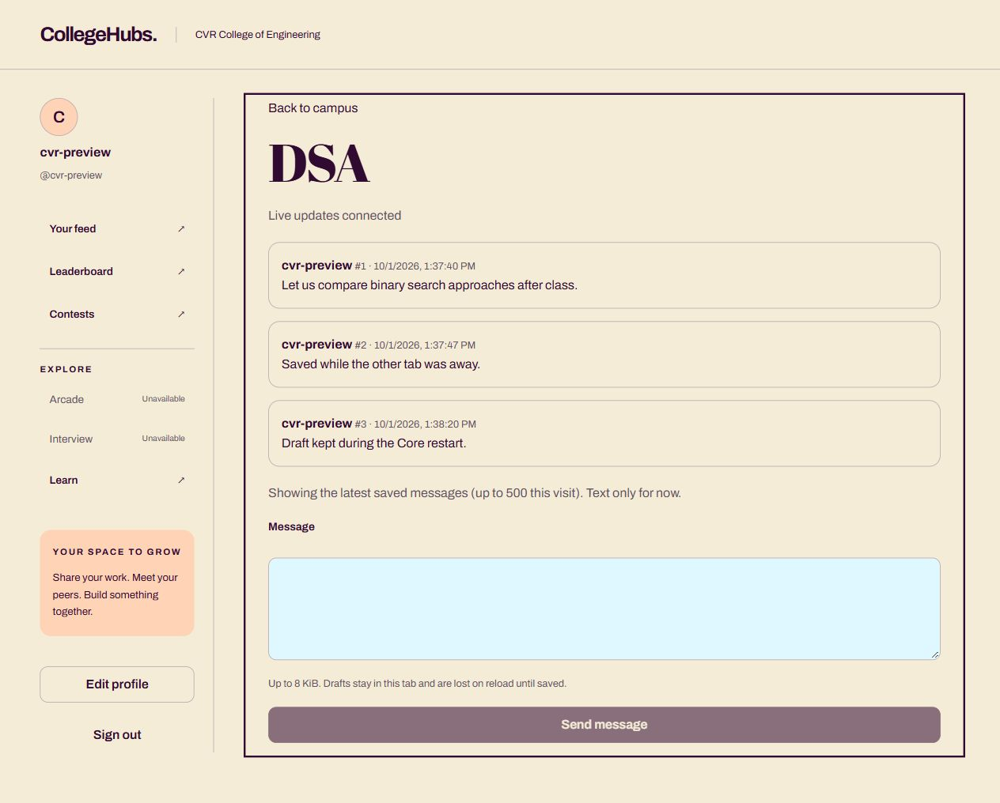
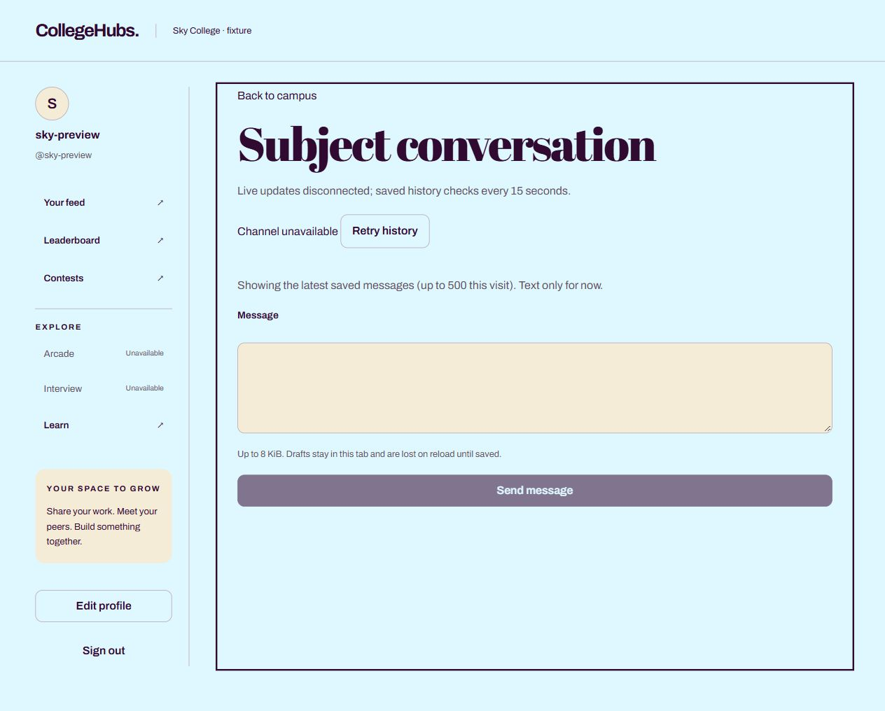

# P4.1 — durable channels and authenticated sockets

Local PASS, 2026-10-01. P4.2 rich messages/resources/answers remain unimplemented. No hosted deployment or push was performed.

## Implementation

Core owns Message documents. Unique indexes enforce `(hubId, channelId, seq)` and `(hubId, authorId, clientMessageId)`. One majority-committed Mongo transaction increments the channel sequence and saves the message. Identical retries return the original row; changed text/type/channel for the same send ID returns 409. Aborted transactions leave no sequence hole. Startup explicitly creates collections/indexes before accepting traffic; Mongo must be a replica set. No reset/backfill of existing data is performed.

`GET /api/channels/:id/messages` returns `{hubId, channelId, title, items, latestSeq, hasMore}`. Default: newest 50, ordered ascending. `afterSeq` pages forwards for recovery; `beforeSeq` pages backwards; use only one direction, with `limit` 1–50. Unknown/non-scalar selectors are rejected. All queries derive Hub from current verified membership. Foreign, archived and missing channels return 404. Missing-Hub rows cannot match.

`POST /api/channels/:id/messages` accepts only `{clientMessageId,type:"text",text}`. IDs are 16–80 ASCII letters/digits/underscore/hyphen (browser uses UUID); text is nonblank, at most 8 KiB UTF-8, trimmed on persistence/replay comparison. Result: `{message,duplicate}` with 201 new / 200 replay. Message DTO contains ID, Hub/channel/author IDs, author-name snapshot, client ID, sequence, type/text and UTC creation timestamp; no email. New attempts are limited to 30/min/user in this single Core process; restart resets this abuse brake. Messages award no Aura.

Socket.IO shares Core's HTTP listener at `/socket.io`, namespace `/core`. The handshake takes `auth.token`; exact allowed Origin is required for polling and WebSocket. Current User/Hub/College and token membership are checked on connection, each operation, and before delivery to each recipient. Token expiry disconnects idle clients. Server-generated channel rooms accept no client room names; one operation at a time and one subscribed channel per socket. Events: `channel:join` / `channel:sync` accept channel ID and history selectors; `message:send` accepts channel ID plus the POST body. Acknowledgements use the REST DTO or `{error:{code,message,retryable}}`; sends acknowledge only after commit. `message:created` contains the persisted message. Duplicate sends do not rebroadcast. Redis/presence/multiple Core replicas are outside this phase.

The SPA has a minimal text conversation under the existing shell, reached from Subject spaces. `useChannel` treats socket events as recovery signals and reads authoritative REST pages, advancing only through contiguous persisted sequences. It deduplicates IDs/sequences, catches up on reconnect/focus and every 15 seconds while visible (including a lost final broadcast), and aborts/discards stale route requests. Latest 50 load initially; memory is bounded to 500 messages per visit. Older history remains accessible through the API. Socket auth is cleared on logout/account switch and sockets are disposed on route exit. Failed sends retain their client ID for explicit retry; no automatic mutation replay. Unsaved drafts are tab-local and lost on reload, as the UI explains.

## Verification

- G1 failing assertion first: concurrent send expected 200/201 but the old server returned `CORE_ROUTE_NOT_FOUND` (404).
- Full G1/G2/G3: **60 passed, 0 failed, 0 skipped**, using real ephemeral Mongo replica-set transactions and the existing disposable PostgreSQL session database. Latest fixture report: `.local/p32-guards.tap`; retained phase copy `.local/p41-guards.tap`.
- Added G1 checks: five concurrent identical sends -> one ID; altered replay ->409; six distinct concurrent sends -> contiguous sequences; bounded forward pagination; invalid/array selectors; foreign read/write/join/sync denial; foreign Origin and invalid token denial; committed broadcast to peer, disconnected-peer history recovery, expiry disconnect/reconnect refusal, changed membership refusal; browser merge deduplication and foreign/gapped cache rejection.
- `npm run build`: Vite production bundle, Core syntax check and Learn TypeScript pass. Scoped diff whitespace review passes.
- Actual browser tabs: CVR DSA message #1 delivered to second tab; second tab left the channel while #2 was saved; Core process stopped/restarted while the same Mongo stayed alive; returning tab recovered both. Original tab retained its draft during the outage, reconnected, and saved it as #3. Reload recovered all three once.
- Separate browser origin/session (`127.0.0.1` vs `localhost`, both explicitly allowed only by the local fixture): Sky account opened the CVR channel URL and saw no messages/title, `Channel unavailable`, disabled send. Socket foreign operations are independently asserted in G1.
- Desktop screenshot visually checked for shared palette, shell, readable text and labeled composer. The browser viewport override did not change the measured 1265px viewport, so no new 360px/mobile acceptance is claimed for P4.1.

## Configuration and limits

Set browser-visible `VITE_CORE_SOCKET_ORIGIN` to the direct Core HTTPS origin (no path) at frontend build time. Local development defaults to `http://localhost:5000`; fixture injects `http://localhost:5183`. Missing production socket origin leaves REST sending/history available. Core `ALLOWED_ORIGINS` must include the exact frontend origin. Do not route sockets through Pages Functions; no new secret/provider account is required.

Run the existing `scripts/p32-fixture.cjs` with explicit `GUARD_LEARN_DATABASE_URL`. Its `guards` command supplies the local Mongo URI, app origin and ephemeral `GUARD_CORE_SIGNING_SECRET` for expiry tests without logging secrets. `stop-core` / `start-core` preserve the fixture database; `quit` discards ephemeral Mongo and stops child services. Reset's collection allowlist now includes messages, preserving its existing refusal of real-domain/unknown data.

Hosted websocket/cold-start acceptance remains P11 work. LocalStorage Core tokens, single-process rate limits, finite browser history, and free-host sleeping remain disclosed MVP limits. Existing dependency advisories recorded in P3.2 are not resolved by this phase. Socket delivery is best effort; database history repairs loss, following [Socket.IO delivery guarantees](https://socket.io/docs/v4/delivery-guarantees/).
