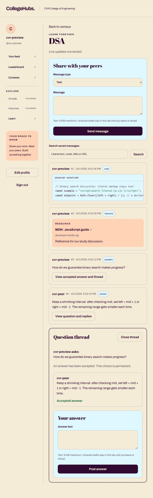
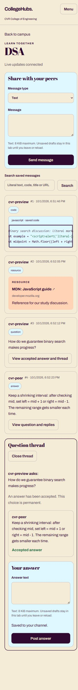

# P4.2 — code, resources and answer threads

Local PASS, 2026-10-01. P5 is not started. No hosted deployment, provider account, paid dependency or push was required.

## Delivered behavior

The existing `/channels/:id` route now uses `Channel.jsx`, `MessageList`, `MessageComposer`, `CodeBlock`, `ResourceCard` and `AnswerThread` inside the same authenticated Hub shell. Text, code, resources, questions and replies share P4.1's durable sequence/idempotency boundary. The original text-only preview component was replaced; old text messages remain readable without migration.

Composer validation is shared with Core through `@collegehubs/contracts/channel.cjs`. Text/questions/answers have an 8 KiB UTF-8 limit; literal code has a 32 KiB limit and preserves its whitespace. Ordinary request JSON remains capped at 64 KiB, so heavily escaped content may hit that transport bound first. Resource titles are at most 160 UTF-8 bytes, URLs 2,048; links must parse as HTTPS, contain no embedded credentials/control characters/spaces, and are rendered with `noopener noreferrer`. Core never fetches link previews. Notes may be empty. Browser validation is convenience; Core repeats all checks.

Code uses a small bounded lexical tokenizer and React text/span nodes, with allowlisted languages: plaintext, JavaScript, TypeScript, Python, JSON, HTML, CSS, Java, C++ and SQL. This is lightweight lexical coloring, not a compiler or complete grammar parser. No HTML strings, `dangerouslySetInnerHTML`, evaluation, iframe preview, dynamic grammar download or source execution. Colors use the existing Hub tokens. Code blocks are keyboard-focusable with their own horizontal scrollbar; the page stays within the mobile viewport.

`GET /api/channels/:id/messages?q=...` adds case-insensitive **literal** matching across text/title/URL. Search is 1–120 UTF-8 bytes, regex-escaped, scoped by current Hub/channel, limited to 50 results/page, and bounded by a 2-second Mongo query deadline. `beforeSeq` pages older results; live recovery still uses unfiltered contiguous history. Search/older-history views are explicitly labeled snapshots, with a return-to-live control. Unknown/array selectors fail closed. Thread paging uses the same sequence index plus `questionId`.

`GET /api/messages/:questionId/thread` returns the scoped question, at most 50 replies, and the accepted answer even when outside the current page. It accepts `afterSeq` or `beforeSeq`, and `limit`. Answers can only reference a question in the same Hub/channel. `POST /api/messages/:questionId/accepted-answer` accepts only `{answerId}`. Only the question author may accept another author's answer from that exact question. Transactional contention permits one winner; the same answer retry returns success, a different later choice returns 409, self/non-owner attempts return 403, hidden foreign/mismatched objects return 404. There is no unaccept/edit endpoint.

Committed acceptance emits authenticated `message:updated`. The live hook refreshes recent persisted history and thread views, including periodic repair for lost update events; reconnect/reload retain accepted state. Opening a thread moves keyboard focus to its heading. Older replies have a return-to-latest control. Composer states distinguish unsaved, saving, saved and unconfirmed delivery; uncertain retries preserve the original client ID. Editing clears an earlier saved notice. Unsaved drafts remain tab-local and are not promised across route exit/reload.

## Native facts and P6 boundary

Core now saves `NativeFact` in the **same Mongo transaction** as a new code/resource contribution or accepted answer. Stable event IDs, unique business keys, source IDs and occurrence/day fields provide the P6 integration seam. Code uses a conservative NFKC/whitespace-normalized source hash; resource keys canonicalize URL query order and omit fragments. Same user's normalized same-day repeats retain their messages but create one contribution fact. Answer acceptance is unique for its answer without a daily reset. Day keys use Asia/Kolkata. This suppresses simple repeats, not arbitrary semantic plagiarism.

Startup creates its indexes; guarded demo reset recognizes `nativefacts` while retaining all existing target/synthetic-data checks. No retained data was reset. No new environment variables are required.

**Live Aura scoring remains inactive.** Facts have `rules_inactive` status; chat does not claim points. An internal `applyNativeFact(fact, session)` composition hook is exercised only by G3 fixture code. P6 must supply canonical rules/ledger/cap logic using that same session, return the matching receipt, and establish prospective activation/reconciliation policy. There is no browser or environment switch, public reward endpoint, or automatic historical award. Duplicate facts never invoke the scorer again. A failed scorer aborts the message/sequence or acceptance, fact and fixture balance together.

## Verification

- G1 first failed against the old API: a typed code contribution returned 400 `INVALID_INPUT` instead of 201.
- Final G1/G2/G3 run: **63 passed, zero failed, zero skipped**, using the ephemeral Mongo replica set and disposable PostgreSQL fixture. `.local/p4.2-guards.tap` retains the phase report. No live LLM/provider was called.
- G1 covers literal search, UTF-8 boundaries, unsafe URLs, allowlisted fields/languages, scoped threads, self/non-owner/foreign-question rejection, identical acceptance retries and competing-answer races. Existing HTTP/socket/grant/Hub isolation guards remain passing.
- G3 covers concurrent send replay, normalized code/resource duplicates, one accepted-answer fact, inactive live scoring, and injected scoring failure rollback of all domain/fact/balance writes. Fixture weights test atomicity only, not P6 policy activation.
- `npm run build` passes Vite production build, Core syntax validation and Learn TypeScript. The browser walkthrough caught and fixed linked CommonJS development loading by explicitly prebundling the shared contract, per [Vite's linked-dependency guidance](https://vite.dev/guide/dep-pre-bundling.html). Production and development were both checked.
- Demo2: two distinct CVR accounts (`preview` and `peer`) used DSA in separate localhost/127.0.0.1 browser sessions. Code containing ``, a titled HTTPS resource, a question and a peer answer saved and propagated. The author accepted the peer answer; both clients showed the permanent accepted state, which survived reload.
- Reload plus literal search found the code exactly. DOM inspection showed two highlighted keyword spans and **zero script elements inside the code block**. Markup remained text. A Sky account opening/searching the CVR channel saw `Channel unavailable`, empty results and disabled send.
- At a configured **360×800** browser viewport, the document's usable width and scroll width were both 345px (15px scrollbar); no page overflow. The code block had 270px visible width vs 899px content. Tab moved focus from Search to `PRE`; Right moved its scroll offset from 0 to 40. Screenshot width is 360px. Viewport override was reset afterward.
- P4.1's saved/reconnect/restart transport remains in use; its regression guards continue to pass. Draft editing clears the saved-state notice. Documentation and scoped diff review completed; existing unrelated audits/screenshot were not staged.

## Reproduce / limits

Use `docs/development.md` and the existing `scripts/p32-fixture.cjs`; it now creates the additional same-Hub `peer@cvr.ac.in` account with the same disposable fixture password. Run `guards` for all three guard areas. Use an exact separately allowed local origin for independent browser storage; this fixture allows localhost and 127.0.0.1 on port 5182. These are ephemeral local accounts, never deployment credentials.

Free-host readiness/WebSocket cold-start testing remains P11 work. Existing dependency advisories, Core localStorage tokens, single-process rate limits, 500-message live memory cap and finite history pages remain unchanged. Search can return retryable unavailable on a large/slow collection; no full-text search service or new infrastructure was introduced.
