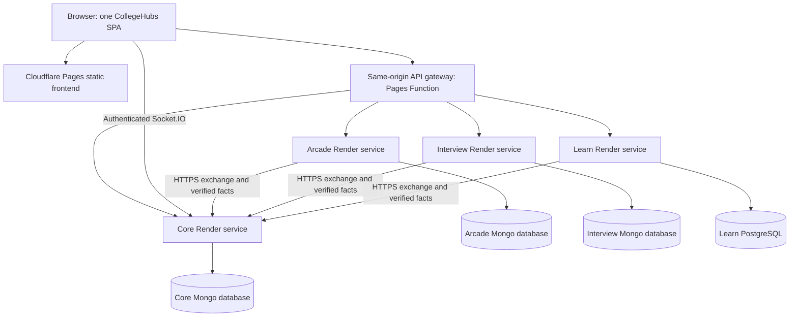
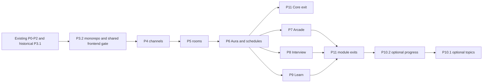

# CollegeHubs MVP implementation plan

Revision: 2026-09-30. **One monorepo, one integrated React application, four independently deployable backend services. Free plans only.**

This document replaces the previous independent-frontend plan throughout. It is the authority for future execution. `changes.md` and `modules.md` remain historical source audits; their old frontend/deployment recommendations do not override this revision. The architecture rewrite was planning-only. P3.2 implementation has now relocated source and activated the confirmed CVR registry; current evidence and remaining acceptance are in `docs/learn-spike.md`. No accounts or hosted services were created.

## Confirmed decisions

- The user confirmed **`cvr.ac.in`**, mapped to CVR College of Engineering. That exact app-registry domain is now active in P3.2; only disposable fixture provisioning has been executed. This is not proof of mailbox possession, institutional endorsement or permission to change college DNS. No implicit subdomain/substring matching.
- Integrate useful SocialStream, Digital Arcade, AI Interviewer and MargaAI source into **one persistent frontend shell**: one router, sidebar, login, profile, Hub context and theme. No embedded sites, separate frontend launches or full-document feature handoffs.
- Core, Arcade, Interview and Learn remain separate backend processes, each with its own data, build/start artifact and independent deployment. A monorepo does not merge their runtime or database authority.
- Core alone owns engagement Aura, college ranking and shared streak. Modules store raw results and send verified completion facts.
- Preserve phase IDs P0–P11, MVP feature limits and G1–G4 as the only automated guard areas. Execute one requested sub-phase at a time.
- Reuse rights were accepted in the earlier plan. Preserve notices, including Interview MIT and content/asset/font attribution. Generate/import permitted curriculum; human review is allowed, manual authorship is not required.
- No paid hosting, paid API fallback, purchased domain, subscription upgrade or temporary-credit dependency. Free accounts/keys can be necessary; quotas and availability remain bounded.

## Fonts and colors

Use freely licensed **Abril Fatface** for large headings and **Archivo** for body/labels/controls, retaining font notices. Do not require commercial Abril Display.

| Role | Color |
|---|---|
| Primary text / plum | `#310A31` |
| Main background / cream | `#F4ECD6` |
| Accent / peach | `#FFD3B6` |
| Raised surface / pale sky | `#DFF7FF` |

Shared CSS variables (`--accent`, `--background`, etc.) cover accent, secondary, background, surface, surfaceRaised, text, textMuted, border, success, warning and error. CVR uses this palette. Synthetic contrasting Hub fixtures prove isolation. Every integrated feature adopts basic shared styling immediately; deeper graph/chart refinements may follow in P10.

## Status and next execution boundary

Existing `docs/p0.1-evidence.md` through available `docs/p3.1-evidence.md` record historical work, not acceptance of this revised architecture.

| Work | Disposition |
|---|---|
| P0.1–P1.2 | Retain security, Hub identity/provisioning, shell/theme; relocate and revalidate in P3.2. CVR registry activation is now authorized. |
| P2.1 | Retain one-use grants, RS256 checks and issuance binding; replace browser form/navigation handoff with in-SPA API bootstrap. |
| P2.2 | Retain event validation, deduplication, caps, ledger and pending recovery; server-to-server delivery still applies. |
| P3.1 | Historical Next/PostgreSQL session spike passed locally. Reuse security logic, port its HTTP boundary in P3.2; Next rendering is not the target. |
| P3.2 | **Local PASS (2026-10-01):** monorepo/shared SPA/Learn API, 57 passing G1-G3 checks, browser/mobile/theme/outage evidence, and free-only deployment files. Hosted verification remains pending. See `docs/learn-spike.md`. |
| P4.1 | **Local PASS (2026-10-01):** durable sequenced text messages, authenticated sockets, history recovery, 60 passing G1–G3 checks and two-client/restart/foreign-Hub walkthrough. See `docs/p4.1-evidence.md`. |
| P4.2 | **Local PASS (2026-10-01):** typed code/resources/questions/answers, literal search, immutable acceptance, transactional native facts, 63 passing G1–G3 checks and Demo2/mobile evidence. Scoring remains P6-gated. See `docs/p4.2-evidence.md`. |
| P5.1-P6.2 | Complete locally; phase sections link to verification evidence. Hosted acceptance remains pending. |
| P7.1 | **Local PASS (2026-10-06):** independent Arcade API, integrated NumberGuess, canonical daily receipt and pending recovery. See `docs/p7.1-evidence.md`. |
| P7.2 | **Local PASS (2026-10-07):** three validated ranked games, shared catalogue, prospective rules and receipt/recovery evidence. See `docs/p7.2-evidence.md`. |
| P8.1-P8.2 | **Local PASS:** independent Interview resume and practice/report journeys; real Groq Free and canonical receipt evidence. See `docs/p8.1-evidence.md` and `docs/p8.2-evidence.md`. |
| P9.1 | **Implemented; automated/API checks PASS (2026-10-07), browser acceptance pending.** Scoped SQL/API extraction, integrated learner pages and fresh-schema proof. Browser tool policy verification prevented visual checks. See `docs/p9.1-evidence.md`. |
| P9.2 | **Local PASS (2026-10-08):** versioned DSA/Web assessments, server grading/unlocks, durable Core facts, 101 passing guards, shared-theme quiz/history and recovery evidence. See `docs/p9.2-evidence.md`. |
| P10 | Future feature work; execute only the requested sub-phase. |
| P11.1 | **Complete for the deployed password-login MVP (2026-10-10):** four Free Render APIs, Pages SPA/gateway, hosted module receipts and Core restart recovery; 101 local guards passed. See `docs/p11.1-evidence.md` for scope and limitations. |
| P11.2 | **Complete for the password-login MVP (2026-10-11):** release docs/About live, 101 guards passed, four isolated browser sessions/two rooms recovered and closed once; scoped evidence and limits in `docs/release-evidence.md`. |

**P9.2 is implemented and locally verified.** Browser access is restored; current Learn observations are recorded in `docs/p9.2-evidence.md`, while the historical P9.1 checklist retains any unperformed checks. P10.2 is now implemented and locally verified; see `docs/p10.2-evidence.md`. Its new hosted read credentials are not activated yet. Next optional feature development is P10.1; P11.1/P11.2 retain their existing scoped hosted evidence. Preserve migrated source and historical evidence; do not restart P0.

## Tier map

| Tier | Scope | Honest exit |
|---|---|---|
| 1 — Core | Existing P0/P1/P2; revised P3.2 foundation; P4/P5/P6; P11 checks | CVR Hub, four channels, persistent code/resources, Study Rooms, native Aura/streak/ranking and truthful schedules. No completed-module claim. |
| 2 — Integrated modules | P7/P8/P9 after P3.2, P11 for each release | Same frontend; three ranked games, REST Interview, DSA/Web Learn, canonical rewards and demonstrated backend isolation. |
| 3a — Presentation | P10.2 | Consolidated progress and refined graph/chart styling. Shared shell/theme/login already exist. |
| 3b — Extensions | P10.1 and explicitly activated stretch | Claim only individually completed extensions. |

P7/P8 do not wait for P9 feature completion. Learn extraction failure may block Learn while other verified features ship; that is a partial release, not complete Tier 2.

# Part A — Architecture and contracts

## A1. Target monorepo and source migration

Paths are relative to `C:/socialstream`. They are target paths, not existence claims. Keep original source until replacement is verified.

```text
apps/web/
  src/app/                   # One router and route boundaries
  src/auth/                  # Core context and module bootstrap
  src/theme/                 # One HubThemeProvider
  src/components/            # Shared shell and controls
  src/features/arcade/        # Ported games
  src/features/interview/     # Ported candidate journey
  src/features/learn/         # Ported graph/resources/quiz
  functions/api/[[path]].ts  # Thin Pages API gateway
  public/_routes.json        # Invoke Functions for API paths only
services/core/               # Identity, Hubs, chat, Study, Aura
services/arcade/             # Game validation and persistence
services/interview/          # Candidate API and evaluation
services/learn/              # HTTP API and PostgreSQL; no Next pages
packages/contracts/          # Versioned DTOs, schemas, pure token helpers
scripts/                     # Local orchestration, guarded setup
deploy/                      # Per-service build/container configuration
legacy/                      # Temporary inactive source reference
tests/guards/                # G1–G4 only
docs/
package.json                 # npm workspaces/root commands
package-lock.json            # One active workspace lock
render.yaml                  # Released free web services
compose.yaml                 # Optional local independent services
```

Workspaces: `apps/*`, `services/*`, `packages/*`. Every service has its own manifest and deployable artifact. Shared packages contain contracts/pure helpers, never another service's DB model, connection or business service. No runtime imports across services. Contract changes rebuild affected consumers but must preserve compatible independent rollout.

One frontend React/ReactDOM pair, router and CSS pipeline. Start from Core's React 18/Tailwind 3 baseline; inspect and reconcile Learn React 19/Tailwind 4, Three and Recharts peers while porting. Do not force incompatible peers or mount several apps. Add TSX/type-check support as needed. Learn backend TypeScript compiles separately; Core/Interview can retain JavaScript conventions. Pin supported Node/npm after package checks.

Implement root `dev`, `dev:web`, `dev:core`, `dev:arcade`, `dev:interview`, `dev:learn`, matching `build:*`, and `test:guards`. One command starts separate processes; a module crash must not kill siblings. Native Node with local Mongo replica set/PostgreSQL remains supported on Windows; Compose is optional, not a paid-tool prerequisite.

| Source | Target / adaptation |
|---|---|
| Root `src/`, `public/`, HTML/Vite/Tailwind config | `apps/web/`; preserve Core shell/auth/theme/pages. |
| `server/` | `services/core/`; update script/guard imports without changing working domain behavior. |
| Arcade `code and stuff/src/games/NumberGuess.tsx`, `MathAmplitude.tsx` | `apps/web/src/features/arcade/games/`; replace local result authority with Arcade API. |
| Arcade catalogue/assets | Feature folder and namespaced `apps/web/public/arcade/`; remove nested router/navbar/browser OpenAI. |
| Interview frontend resume/interview pages and selected components | `apps/web/src/features/interview/`; replace auth store, Axios setup and global styles. |
| `AI-Interviewer-main/backend/src/` | `services/interview/src/`; strip active local auth/admin/jobs/Redis/Cloudinary branches. |
| Learn `SkillGraph.tsx`, `RoadmapView.tsx`, `NodePopover.tsx`, optional `ForceGraph3D.tsx` | `apps/web/src/features/learn/components/`; adapt Next imports and lazy-load heavy rendering. |
| Learn dashboard/onboarding/module/quiz pages | `apps/web/src/features/learn/pages/`; separate server work into APIs. |
| Learn services/db/relevant lib/data/scripts | `services/learn/src/` and `services/learn/scripts/`; translate Next handlers into HTTP controllers. |
| Existing `packages/contracts/` | Keep, package properly, version bootstrap changes. |
| Superseded entry points and unique unported source | `legacy/{digital-arcade,ai-interviewer,margaai}/` after verified extraction; excluded from builds/workspaces/deployments. |

Do not concatenate lockfiles. Preserve unrelated changes, record dependency decisions, generate/review the workspace lock. Historical locks can stay under legacy but cannot drive active installs. No blanket deletion of imported source or notices.

## A2. Runtime and routing



Free-host communication uses **public authenticated HTTPS**, not Render private services. Backends authorize direct-origin requests too. Gateway code has no business logic, DB, PDF parser or LLM; Core does not proxy all feature requests.

| Request | Destination |
|---|---|
| `/`, `/channels/:id`, `/study/:id`, `/leaderboard`, `/contests` | Core screens in shared SPA. |
| `/arcade/*`, `/interview/*`, `/learn/*` | Lazy routes in the same SPA; shell stays mounted. |
| `/api/arcade/*`, `/api/interview/*`, `/api/learn/*` | Corresponding service, preserving complete prefix. |
| Other `/api/*` | Core, preserving current Core paths. |
| Socket.IO `/socket.io`, namespace `/core` | Direct configured Core HTTPS/WSS origin, outside Pages Functions in MVP. |

Module prefixes precede Core fallback. Unknown APIs return JSON 404, never SPA HTML. UI fallback excludes missing scripts/assets. Next `_next`/RSC and separate frontend origins are retired. Local Vite uses the same map: web 5173, Core 5000, Arcade 5001, Interview 5002, Learn 5003. Each backend has `/health/live` and `/health/ready`.

Gateway origins are configured/allowlisted, never caller URLs. Preserve method/body/query, multiple Set-Cookie headers and needed auth/CSRF fields. Strip caller-supplied service/proxy-identity headers; forward only selected module cookies and never Core's browser bearer token to a module. No automatic credentialed redirect to arbitrary hosts. Stream bounded uploads; API responses are no-store. Convert upstream non-API cold-start HTML/network errors to retryable JSON where possible; clients reject unexpected content types too.

`apps/web/public/_routes.json` invokes Functions only for `/api` and `/api/*`. Configure API exhaustion fail-closed; prove no HTML-success fallback. Static traffic bypasses Functions. [Cloudflare routing](https://developers.cloudflare.com/pages/functions/routing/)

## A3. One login, separate service authorization

Keep the existing required-secret Core JWT flow: pinned algorithm/issuer/audience, approximately 24-hour lifetime and current User/Hub checks. Browser localStorage and lack of global stolen-token revocation remain disclosed demo risks. No Clerk account or Interview password system in the active app.

Retain P2 trust using **in-place JSON bootstrap**:

1. On feature entry, GET `/api/<module>/session`; compare returned subject/Hub/membershipVersion with current Core context before displaying private data.
2. Missing/expired/mismatched session: POST `/api/<module>/auth/start` returns random state and sets a short-lived HttpOnly state cookie. Require exact app Origin and bounded state creation.
3. SPA POSTs `/api/auth/module-grants` with Core bearer auth, module/state. Core returns a one-use grant, hashed at rest, valid 60 seconds. No grant/state in URLs, persistent browser storage or logs.
4. SPA POSTs grant/state to `/api/<module>/auth/callback`. The module validates state cookie/Origin, exchanges server-to-server using its credential, verifies Core RS256 locally and persists a hashed opaque session.
5. Return JSON, not navigation. Set a unique Secure/HttpOnly/SameSite=Lax host-only cookie at `/api/<module>`, expiring no later than the signed credential (at most 15 minutes). Expose safe identity/theme/CSRF only, never module JWT/service key.
6. Mutations require session, exact Origin and session-bound CSRF. Module membership revocation can lag until short expiry; Core rechecks current membership on grants and rewards.

Warm only the selected service before minting a grant. If startup consumes its lifetime, restart with new state/grant; never extend/replay it. Secure may be omitted only in explicit localhost HTTP mode. Any retained return-path field permits only local feature paths.

Logout attempts CSRF-protected deletion of established module sessions, clears Core credentials/subject-Hub caches and disconnects sockets. An unavailable module may retain a cookie until expiry; disclose that limit. On account switch, clear/rebootstrap mismatched sessions before access, discard old in-flight responses and remount private routes. No infinite auth loops or automatic unsafe mutation replay.

G2 retains `tests/guards/module-grants.test.js`, adding JSON bootstrap, cookie paths, account-switch and gateway checks while preserving all RS256 issuer/audience/kid/algorithm/time/replay/Hub rejection.

## A4. Hub and theme boundaries

Core owns College/Hub/Channel/User. Activate exact `cvr.ac.in`; other real colleges remain inactive and A/B fixtures synthetic. Password-domain match sets `membershipVerified=false`. Google verification checks issuer/audience/expiry/stable subject and verified email; collisions use the existing-account path, not silent linking. Unknown domains stay onboarding-only with no default Hub.

Provision one Hub and **DSA, Web Development, Machine Learning, Competitive Programming** channels transactionally/idempotently with unique keys. Assignment retry uses stored email/registry. `getUserHubs`/`requireHubAccess` remains the replaceable membership seam; one Hub/user now. Display college text never authorizes access.

Derive Hub from verified context on every tenant query/populate/SQL join/cursor/search/cache. Private records also require owner/participant identity. Missing-Hub tenant records are hidden; explicit system records and onboarding User are the exceptions. Server-built socket rooms authorize every join/operation and expiry.

One `apps/web/src/theme/HubThemeProvider.jsx` applies escaped names, allowlisted hex tokens and configured HTTPS logo origins. Public branding cache key: Hub+themeVersion. Private cache key: subject+Hub+membershipVersion. Reject foreign theme bindings, clear on logout/switch and discard stale requests. Modules use the shared frontend theme, not new providers/global stylesheets.

## A5. Data ownership and durable results

| Owner | Data / invariants |
|---|---|
| Core Mongo | User/College/Hub/Channel/Post; Message; Problem/StudyRoom/StudySolution/PeerReview; ModuleGrant/ServiceCredential; AuraEvent/Balance/RuleSet/DayCounter/DailyActivity; Contest/CalendarEvent. |
| Arcade Mongo | ModuleSession; GameSession with private challenge, ordered actions, owner/Hub/rulesVersion, immutable raw result/event/receipt. |
| Interview Mongo | ModuleSession, Resume extracted text, Interview question snapshot, Session answers/revisions/evaluation lease/report/event; Core subject, no local User/password. |
| Learn PostgreSQL | Learner unique Core subject+Hub; scoped nodes/content/quiz bank; unique learner-node state; handoff/session; quiz attempts; first node completion; provider cache/budget. No local Aura/streak or required vector extension. |

Use one Atlas Free cluster with **three logical databases and three restricted database users**; Learn has a separate Neon project. Shared physical Mongo failure affects all three owners: no infrastructure-isolation claim. No cross-service DB queries/distributed transactions. SQL constraints preserve Hub consistency; never guess Clerk-to-Core mappings.

Retain P2.2 envelope `{schemaVersion,eventId,userId,hubId,source,type,value,occurredAt,metadata}`. Server-created metadata includes sourceId/accessJti/domainVersion and type facts. Source-scoped credentials, retained issuance and current membership bind events. Browser scores are never authoritative. Same ID/payload returns original receipt; changed payload conflicts; new ID for the same business fact cannot reaward; cap-zero receipts are terminal.

Commit result+immutable pending event together in the module DB, then make a bounded Core POST. Sleeping/down Core yields **Saved; Aura pending**. Retry unchanged facts on authorized result read or service-only manual reconciliation with backoff/bounded pages. Keep the 30-day issuance-binding retry policy without extending credentials. Occurrence must fall within the bound access lifetime; renew authorization for the same owner before long-running completion creates its fact.

No required scheduler, paid worker, Redis, broker or delivery SLA. Learning reset never deletes Core award uniqueness. Only explicitly confirmed/allowlisted disposable demo DBs may be reset; real data requires separate mapping/backfill planning.

### Required indexes and consistency

- Core: unique college/domain/Hub/channel keys; Post author+clientPostId; Message Hub+channel+seq and Hub+author+clientMessageId; StudySolution Hub+room+user; PeerReview Hub+solution+reviewer; due-room status/endAt index.
- Aura: unique eventId and semantic business key; Balance Hub+user; global user+day+timezone-policy day/activity keys; rank Hub+total descending+user. Transactions update receipt, counters and balance together.
- Module sessions: unique session hash, expiry checked explicitly (TTL cleanup is not authorization); subject/Hub/issuance/CSRF binding. Arcade action seq replay is idempotent or conflicts.
- Interview: owner+Hub on references; evaluation CAS/lease; immutable completed report/event. Learn: scoped foreign keys, unique learner-node and first mastery per learner/node/curriculum version, immutable attempt question snapshot/finalization.

## A6. API and realtime contracts

Errors: `{error:{code,message,retryable}}`; 401 invalid auth, 403 forbidden/unassigned, 404 hidden foreign object, 409 state/replay conflict, 413 oversize, 429 with Retry-After, 503 unavailable. UTC timestamps, bounded validated scalar inputs. Preserve working Core compatibility routes while consolidating callers.

| Route family | Contract |
|---|---|
| Core `/api/auth/{register,login}`, `/api/google/auth`, `/api/me`, `/api/me/assignment/retry` | One identity; users cannot set membership/verification/rewards. |
| Core `/api/users/:username`, `/api/posts`, `/api/hubs/:hubId/{theme,channels,leaderboard}` | Same-Hub safe DTOs, own mutations, keyset pagination; no other-user email. |
| Core `/api/channels/:id/messages`, `/api/messages/:questionId/accepted-answer` | Sequenced text/code/resource/question/answer; idempotent clientMessageId; immutable other-author acceptance by question owner. |
| Core `/api/study-rooms` and `/:id/{join,start,draft,submit,submissions,reviews}` | Server lifecycle, participant/host guards, revisioned durable drafts and post-close comparison. |
| Core `/api/me/{aura,progress}`, `/api/contests`, `/api/hubs/:hubId/calendar` | Canonical points/streak, scoped rank, truthful cached schedules. |
| Core `/api/auth/module-grants`, `/api/auth/module-grants/exchange`, `/api/aura/events` | Existing trust/events; exchange/event submission require service authority. |
| Modules `/api/<module>/auth/{start,callback}`, `/api/<module>/session` | A3 bootstrap, GET safe identity/CSRF, DELETE session. |
| Arcade `/api/arcade/games`, `/sessions`, `/sessions/:id/{actions,complete}`, `/me/activity` | Server challenges, ordered inputs/owned results; no posted-score completion. |
| Interview `/api/interview/resumes`, `/resumes/upload`, `/resumes/:id` | PDF upload/list/owned deletion; extracted text only, null file URL. |
| Interview `/api/interview/interviews`, `/interviews/:id/generate`, `/sessions`, `/sessions/:id/answers/:questionId`, `/sessions/:id/complete` | Five frozen questions, saved revisioned answers, leased evaluation, immutable report or explicit failure. |
| Learn `/api/learn/dashboard/{graph,domains,stats,milestones}`, `/learner/{intake,init-graph}` | Owned DSA/Web enrollment and graph; no global personal-node leakage. |
| Learn `/api/learn/quiz/{attempts,answer,next,finalize}` | Public issued questions; answers/IDs only; eligibility/server grading/theta/immutable result. |
| Learn `/api/learn/nodes/:id`, `/recommendation`, `/tutor/fast`, `/profile/path` | Authorize enrollment before resource work; template explanation; owned reset preserves reward history. |
| Modules `/api/<module>/integration/{pending-results,reconcile}` | Service-only bounded recovery. |
| P10 Core `/api/me/module-progress`, `/weak-skills`, `/interview-recommendation` | Activate only in the named optional phase; short service-read delegation and owned minimized summaries. |

All abbreviated entries in a module row use that row's `/api/<module>` prefix. Disable old public reward refresh/Google Calendar export, local Interview auth/admin/jobs, Clerk sign-in and Learn generation/maintenance/unsafe cleanup entry points. No legacy path silently mounts an unconverted handler.

Core socket events: authenticated `channel:join`, `message:send`, `channel:sync`, `study:join/start/draft:save/submit/sync`, `time:sync`; server `message:created`, `study:state/closed`, review and Aura/calendar invalidations. Include Hub/revision/sequence. Persist before ack and recover from history/snapshots. Direct socket Origin allowlist is exact.

Study Rooms: 2–8 participants, 5–60 minutes, waiting-only join, host starts with at least two, no pause/extension. Save/close contend on a shared DB write fence and DB-authoritative deadline. Seal latest acknowledged drafts once; recover overdue rooms at startup and with a one-second due scan while running. Sleep can delay processing, never extend endAt or admit late writes. Early submit freezes own draft; peers including host cannot read before close. Unsent text is visibly unsaved. No co-editing/judge.

## A7. Aura and module qualification

| Fact | Qualification / award / cap |
|---|---|
| `study.completed` | Nonempty sealed acknowledged solution; 25; 2/day; unique user+room. |
| `answer.accepted` | Accepted by another question owner; 15; 3/day; unique answer. |
| `code.shared`, `resource.shared` | Valid persisted contribution; 5 each; 5/day each; repeated normalized same-day source cannot farm; native cap 100/day. |
| `arcade.game_completed` | Successful NumberGuess/MathAmplitude/sorting validation; 5; one/game/day, at most 3/day; source cap 30. |
| `interview.completed` | At least 3/5 answered, server duration at least 60s; `20 + floor(rawScore/10)`, max 30; 2/day/source cap 60. |
| `learn.quiz_completed` | Server pass; 5; 5/day, one node+mode/day. |
| `learn.node_mastered` | First node+curriculum-version mastery; 15; Learn combined source cap 100/day. |
| Posts/likes/login/casual play | Zero Aura. |

Core `total = engagement + externalBonus`; live externalBonus remains zero until separate permitted-provider/ownership work. G3 fixture replacement cannot overwrite engagement. One global user/day in Asia/Kolkata counts qualifying sources; caps need not erase valid participation. No module-local streak/tier. Rule changes are prospective/versioned.

NumberGuess: private 1–100 integer target, at most ten ordered guesses, ten-minute expiry. MathAmplitude: private-answer questions, server 60s deadline, at least five correct over at least 30s to qualify. Sorting: small seeded array, validated comparison/swap trace and correct complexity choice, no extra minimum duration. Duplicate action seq returns the same transition; altered replay conflicts.

Interview: resume text at most 8,000 chars/JD 5,000. Five questions; `rawScore = round(100 * sum(answer scores) / (10 * 5))`; skipped questions count zero. Provider errors are evaluation_failed, not completed zero. Persist lease/questions/answers; one immutable report/event. LLM feedback is heuristic.

Learn: DSA/Web only; two required nodes/domain, at least 15 reviewed seed items/node (five checkpoint, ten test-out). Thresholds 0.6/0.8; theta [-3,3] is heuristic. Validate eligibility, question/attempt binding and first mastery. No private answer keys/rubrics before permitted result disclosure. Seeded graph/resources/quizzes work without Gemini.

## A8. Verification and security policy

Only these automated suites; add failing boundary assertions before implementation:

| Guard | File | Coverage |
|---|---|---|
| G1 | `tests/guards/hub-isolation.test.js` | HTTP/socket/SQL/cache A/B isolation, owner privacy, missing-Hub denial and theme binding. |
| G2 | `tests/guards/module-grants.test.js` | Grant/token/state/Origin/CSRF/cookie/expiry/replay; SPA bootstrap/account switch; gateway boundaries. |
| G3 | `tests/guards/aura-events.test.js` | Source/issuance, duplicate/conflict/semantic receipts, caps/day/external separation and pending recovery. |
| G4 | `tests/guards/study-room.test.js` | Deadline races, single close, acknowledged draft restart/reconnect, pre-close privacy. |

Use isolated fixtures, Mongo replica set and disposable PostgreSQL; no live LLM in guards. DB skips are not passes. Builds/type checks and manual UI/API/deploy walkthroughs remain required, without extra automated suites. Do not weaken assertions to pass relocation.

Proposed configurable limits: auth 5/min/IP; API 120/min/user; chat 30/min/user; draft 2/sec/user; grants 10/min/user; events 120/min/service; AI generation 3/hour/user, one active/user and initially one provider operation/module. Text 8 KiB, code 32 KiB, event 16 KiB, ordinary JSON 64 KiB, history 50; PDF 5 MiB with signature/MIME checks and bounded parsing. Gateway/backend both bound uploads. PDF parsing runs in Interview, using a cancellable local worker if needed, never in Core.

No client secrets, eval/raw HTML, unbounded URLs, secret/resume/source logs, public maintenance or browser grading. Provider calls have deadlines and truthful failure states; never fall back to paid models. Canonical self/Hub identity is checked at every service boundary, not trusted from browser fields.

# Part H — Free deployment feasibility

## H1. Selected stack and verified limits

**Official documentation checked 2026-09-30. An intermittent demo is feasible on free tiers; four always-on backends and production availability are not established.** Account eligibility, region capacity and successful deployment remain unverified until P11. No account/service was created during this rewrite.

| Component | Free option | Limits / consequence |
|---|---|---|
| Shared frontend | Cloudflare Pages Free, provider `pages.dev` hostname | 500 builds/month, 20,000 files, 25 MiB/file. One SPA build with small assets. [Pages limits](https://developers.cloudflare.com/pages/platform/limits/) |
| Gateway | Pages Functions on Workers Free | Functions consume Workers quota; static requests bypassing Functions are free/unlimited. [Functions pricing](https://developers.cloudflare.com/pages/functions/pricing/) |
| Gateway execution | Workers Free | 100,000 requests/day, 10 ms CPU/request; network wait is distinct from CPU. Thin proxy only. [Workers limits](https://developers.cloudflare.com/workers/platform/limits/) |
| Four backends | Four Render Free **web services** | 750 aggregate running hours/workspace/month, idle sleep after 15 minutes, roughly one-minute cold starts. No inbound private networking, persistent disk, free one-off jobs or shell. External DBs/public authenticated HTTPS. [Render Free](https://render.com/docs/free) |
| Core/Arcade/Interview persistence | Atlas Free cluster | 512 MB including indexes; three restricted logical DBs share capacity and physical failure. No managed backup on Free. [Atlas limits](https://www.mongodb.com/docs/atlas/reference/free-shared-limitations/) and [cluster comparison](https://www.mongodb.com/docs/atlas/manage-clusters/) |
| Learn persistence | Neon Free PostgreSQL | Current pricing: 100 CU-hours/project/month, 0.5 GB/project, 5 GB egress, automatic scale-to-zero. Permanent Free plan, not trial credit. Recheck console at setup. [Neon pricing](https://neon.com/pricing) |
| Interview AI | Groq Free | Model/organization request/token limits. Select a free accessible model at setup, respect 429, no paid Developer upgrade. [Rate limits](https://console.groq.com/docs/rate-limits), [billing](https://console.groq.com/docs/billing-faqs) |
| Optional Learn generation | Gemini unpaid tier | Model-dependent availability; seeded MVP has no runtime generation prerequisite. Different unpaid data-use terms: use public/synthetic curriculum, not private resumes. [Gemini pricing](https://ai.google.dev/gemini-api/docs/pricing) |
| Schedules/resources | Permitted Codeforces data, attributed seeds, optional free-quota YouTube/Wikipedia/Clist | Verify exact endpoint terms/account quota in P6/P9. Paid Clist access or another subscription is not required. Show unavailable when live access is absent. |

Render bandwidth/build overages can charge accounts with a payment method. Prefer a no-payment-method Free workspace; verify billing controls and accept suspension at exhaustion. If account setup cannot satisfy zero spend, stop hosted provisioning and use the local fallback. Do not silently add billing. [Render FAQ](https://render.com/docs/faq)

**Derived budget:** four continuously running services need `4 × 24 × 30 = 2,880` hours/30-day month. All four together fit at most `750 / 4 = 187.5` hours/month before other usage. Two hours/day for all four is 240 service-hours plus idle/startup tails; that is an example, not a guarantee. A continuously connected Core socket can consume almost the whole allowance by itself. No uptime bots, artificial pings, quota-pooling accounts or recurring warm-up cron.

Free Render Postgres expires after 30 days, so it is excluded as durable Learn storage. Quota exhaustion/service suspension means unavailable, not permission to upgrade. [Render Free](https://render.com/docs/free)

## H2. Alternatives checked

| Option | Assessment |
|---|---|
| Cloudflare Workers for all APIs | Useful free edge gateway, but porting current Express/Socket.IO/DB/PDF backends into the edge runtime is a separate compatibility project. Do not assume unchanged execution. |
| Koyeb | One free web instance/organization, 512 MB RAM/0.1 vCPU. Cannot supply all four independent APIs alone; possible single-service fallback after account checks. [Instances](https://www.koyeb.com/docs/reference/instances) |
| Railway | $0 plan includes $1/month resource credit, distinct from trial. Not selected as dependable capacity for four persistent backends; requires separate usage measurement. [Plans](https://docs.railway.com/pricing/plans) |
| Existing friend-owned sites | Not a prerequisite. Use only with explicit access and verified free configuration; never overwrite friends' projects by assumption. |
| Existing computer: native processes / Compose | Required zero-hosting-fee fallback and local proof of independent services; not an always-online public deployment. |

Recheck selected plans at deployment. Do not label unresearched alternatives unavailable or promise indefinite free service. This is a free-tier hosting plan; hosted platforms themselves need not be open source.

## H3. Deployment mechanics and responsibilities

Each Render service builds the same repo into its own artifact with its own start/health configuration. Build context includes root workspace lock and referenced `packages/contracts`; avoid a rootDir that excludes required shared files. Use repo-root workspace commands or per-service Dockerfiles and path filters covering service/shared/lock changes. A Learn implementation-only change must not force a Core deployment. [Render monorepo support](https://render.com/docs/monorepo-support)

Prepare `render.yaml` with explicit `plan: free` web services, only for released backends. No private services, disks, paid databases/preview resources or paid pre-deploy dependency. Secrets go in provider settings, not YAML. Guarded DB setup runs locally against an explicit target, not a missing free remote shell or a destructive startup seed. `sync: false` prompts at initial Blueprint creation; new secrets on existing services need explicit configuration. [Blueprint reference](https://render.com/docs/blueprint-spec)

| Assistant | User |
|---|---|
| Source integration, service contracts, local orchestration, guards/builds/manual evidence | Review product behavior and confirm domain/data decisions; `cvr.ac.in` is already confirmed. |
| Deployment files, names-only env examples, safe setup commands and exact dashboard instructions | Own accounts, complete OAuth/MFA and authorize repository access. |
| Record assigned URLs, diagnose logs, fix deploy failures, rerun verification | Enter secrets into provider settings where access is unavailable; never paste passwords into chat. |
| Verify cost gates before using a service | Verify Free/no-paid-upgrade selection and accept free-tier availability limits. |

Order: local proof → free DB/account setup → Core → one released module at a time → record actual origins → Pages/gateway → exact APP_ORIGIN/Google config → bootstrap/socket/receipt walkthrough → independent stop/redeploy. Providers assign URLs; the user does not invent them. Store actual non-secret origins in ignored `.local/deployment-origins.json` plus provider config; commit only examples/instructions. No purchased/custom college domain is required.

## H4. Cold starts, quotas and free-tier acceptance

- Bootstrap only the opened feature. Do not wake every module for dashboard summaries. Optional widgets use bounded cached requests and may say unavailable.
- Show Starting service / Retry; warm before creating short-lived grants. Use bounded backoff and user retry, never endless polling. Startup budget is distinct from normal API/provider deadlines.
- Mutations use stable request IDs and canonical state reads after ambiguous failures. Bootstrap retries use fresh state; event retries retain the same immutable facts.
- Readiness depends on own DB only. Core remains ready during optional module/provider failure. Core DB failure cannot be hidden. Recover Study deadlines/acknowledged drafts after wake before accepting conflicting writes.
- Direct TLS Core sockets validate Origin/token. Render supports incoming WebSockets; reconnect/persisted recovery remain app responsibilities. [WebSockets](https://render.com/docs/websocket)
- No promised background completion while asleep. Persist evaluation lease/state and retry after restart. A killed provider request creates no fake report. Seeded Learn/games work without AI; Interview needs a real free-provider success to claim an AI report.
- Record quotas/usage, cold starts and actual deployment results. A local pass or provider fixture is not a hosted/live-AI pass. Stop adding hosted capacity if budget/eligibility fails.

## H5. Environment matrix — names only

| Location | Configuration |
|---|---|
| Web public | `VITE_API_URL=/api`, `VITE_GOOGLE_CLIENT_ID`, `VITE_CORE_SOCKET_ORIGIN`, `VITE_CORE_SOCKET_PATH`; no secrets. |
| Gateway server | `CORE_API_ORIGIN`, `ARCADE_API_ORIGIN`, `INTERVIEW_API_ORIGIN`, `LEARN_API_ORIGIN`, bounded timeout/enabled routes. Exact HTTPS origins; localhost only in local mode. |
| Core | `PORT`, `NODE_ENV`, `MONGO_URI`, `JWT_SECRET`, `CORE_TOKEN_ISSUER`, `CORE_ACCESS_AUDIENCE`, `CORE_ACCESS_TTL_SECONDS`, `GOOGLE_CLIENT_ID`, `APP_ORIGIN`, `ALLOWED_ORIGINS`, `CORE_MODULE_PRIVATE_KEY`, `CORE_MODULE_KEY_ID`, `CORE_MODULE_PUBLIC_KEYS`, module TTL/binding retention settings, `ENABLE_MODULES`, `ENABLE_CHAT`, `ENABLE_STUDY`, `ENABLE_AURA`. |
| Modules | `PORT`, `NODE_ENV`, `APP_ORIGIN`, `ALLOWED_ORIGINS`, `CORE_API_BASE_URL`, pinned issuer/audience/key IDs/public keys, `CORE_SERVICE_KEY`, `CORE_READ_SERVICE_KEY_HASH`, `EVENT_TIMEOUT_MS`, cookie/path configuration. |
| Persistence | `ARCADE_MONGO_URI`, `INTERVIEW_MONGO_URI`, Learn `DATABASE_URL`; each credential only to its owner. |
| Providers | Interview `GROQ_API_KEY`, `GROQ_MODEL`, `GROQ_FREE_CONFIRMED`, `INTERVIEW_AI_ENABLED`, timeout/concurrency; Learn optional `GEMINI_API_KEY`, `YOUTUBE_API_KEY`, cache TTL/quota; optional Core `CLIST_USERNAME`, `CLIST_API_KEY`, timeout after free access verification. |
| P10 reads | Core module API origins and read-service credential, short audience/scope-specific delegation. |
| Setup/guards | `DEMO_RESET_ENABLED`, `DEMO_DB_NAME_ALLOWLIST`, explicit confirmation; existing `GUARD_MONGO_URI` and documented isolated module Mongo/SQL fixtures. Never default to live env. |

Retire active Clerk names, `VITE_OPENAI_API_KEY`, Interview local JWT/refresh/Cloudinary/Adzuna/Redis/jobs settings, standalone frontend URLs and Vercel staging-rewrite variables after caller checks. No server secret uses a public build prefix. Do not inject all service secrets into every process.

# Part B — Executable phases

All paths below are target monorepo paths (A1 maps current source). New files are proposals. Already implemented phases are retained baselines, not orders to repeat work. Each sub-phase follows this common definition of done: relevant guard assertions first and passing without hidden DB skips; affected builds/type checks; stated manual acceptance; scoped diff review; names-only env/setup/evidence updated; runnable safe stop. Commit a reviewed sub-phase when executing that phase; a plan rewrite alone is not an implementation commit.

Read A1–A8 and H before boundary changes. Human work means account access, secret entry, review or product decisions; the assistant prepares every file/command it can. No unneeded permission request for ordinary authorized local work. Estimated sizes are rough implementation/debugging effort, not model-runtime promises; split any checkpoint that exceeds five focused days.

## P0. Protected baseline — retain and relocate

Goal: keep existing security/hygiene while moving the repository. Entry: existing source; no providers required. Read A1/A8. Human: account secrets only when running hosted verification. Safe stop: protected Core remains usable; never restore fallback secrets. Trace: NFR3/NFR4.

### P0.1. Protect existing HTTP routes

**Status:** historical baseline; regression verification during P3.2. **Scope:** auth/profile/CORS, not a new session platform. **Prerequisite:** none. **Guard:** existing G1/G2 where applicable, manual HTTP checks. **Effort:** retain; 0.5–1 day if repair needed.

1. In `services/core/middleware/auth.js`, `config/auth.js`, `routes/authRoutes.js` and `routes/googleAuthRoutes.js`, preserve required-secret/pinned JWT and scalar validation/bcrypt/Google checks.
2. In `routes/userRoutes.js`, `routes/postRoutes.js` and `app.js`, preserve own-write/safe DTO and exact CORS rules; old public refresh/calendar export stays disabled.
3. In `apps/web/src/api.js`, `auth/AuthProvider.jsx` and login/register pages, retain expiry/logout and authoritative identity loading.

**Contract/outcome:** protected Core auth/profile compatibility. **Acceptance:** own update succeeds, anonymous/foreign writes fail, another user's DTO has no email, missing secret prevents listen. **Risk:** historical credential exposure remains unknown; do not infer breach from old source. **Done:** common definition plus those manual checks.

### P0.2. Build hygiene, notices and guarded demo setup

**Status:** retain; adapt build roots in P3.2. **Scope:** readiness/reset/notices, no broad cleanup platform. **Prerequisite:** P0.1. **Guard:** manual setup/build verification. **Effort:** 0.5–1 day if repair needed.

1. Preserve composition-only `services/core/app.js` and DB-aware `index.js`; prevent destructive `seed.js` from normal startup.
2. Preserve removal of +50/legacy external overwrite and fabricated schedules in Core routes/services and web Contests.
3. Carry `THIRD_PARTY.md`, `.gitignore` and `docs/development.md` into the new layout; record source provenance and dependency changes.
4. Preserve `services/core/scripts/resetDemo.js` guards: non-production, exact database-name allowlist, explicit confirmation; add seed calls only as features exist.

**Contract/outcome:** correct liveness/readiness and disposable setup. **Acceptance:** own DB down means ready503; reset refuses unconfirmed/non-demo targets; root build excludes legacy/env/output. **Risk:** never reset retained data. **Done:** common definition, no original-source loss.

## P1. CVR Hub identity and shared theme — retain and reconcile

Goal: correct college identity with one frontend shell. Read A4/A8. Human: domain is already confirmed; configure Google audience/origins when needed. Safe stop: unknown domains remain onboarding-only. Trace: FR1/NFR2/NFR3/NFR4.

### P1.1. Registry and exact-domain assignment

**Status:** implemented foundation; CVR activation pending next code task. **Scope:** A4 registry/assignment, no SMTP or legacy ID backfill. **Prerequisite:** P0. **Guard:** G1 first for changed domain boundary. **Effort:** 0.5–1 day reconciliation.

1. Update relocated `services/core/config/colleges.seed.json` CVR entry to active with evidenceRef identifying this user confirmation. Do not call it DNS-verified; preserve the schema's distinct mapping-versus-mailbox semantics.
2. Preserve `models/{College,Hub,Channel,User}.js`, `services/{hubAccess,hubProvisioning}.js`, `scripts/provisionHubs.js` uniqueness and transactional provisioning.
3. Preserve auth/Google/me routes: exact domain, password membershipVerified=false, verified Google semantics, unknown onboarding, no caller-selected Hub/college override.
4. Run non-destructive idempotent provisioning only against an explicitly configured development/deployment target; do not reset to activate CVR.

**Contract/outcome:** CVR users resolve to one Hub/four channels. **Acceptance:** repeated CVR assignment creates no duplicates; fake suffix/subdomain fails exact mapping; unknown/null/foreign Hub access denied; correct verification flag shown. **Risk:** password email claim is not mailbox proof. **Done:** common definition and registry evidence recorded.

### P1.2. Shared shell, theme and scoped Core UI

**Status:** retain and extend foundation. **Scope:** existing feed/profile/rank plus common shell, not full module UI. **Prerequisite:** P1.1. **Guard:** G1. **Effort:** 1–2 days only for needed integration work.

1. Retain Core Post/user/Hub filters before pagination/populate/like and safe theme/channels endpoints.
2. Relocate `AuthProvider.jsx`, `HubThemeProvider.jsx`, `HubShell.jsx`, Sidebar and profile/onboarding UI under `apps/web/src/`; remove substring identity logic.
3. Add one persistent shell outlet for future feature routes. Account/Hub change resets private state; drawer and navigation survive ordinary feature changes.
4. Apply the confirmed palette/fonts globally, scope ported CSS, and centralize loading/empty/error controls.

**Contract/outcome:** one branded application foundation. **Acceptance:** 360px/keyboard and two fixture themes work; no foreign post/profile/cursor leak; display college edit cannot change authority. **Risk:** imported CSS/provider duplication. **Done:** common definition plus saved UI evidence.

## P2. Shared-login trust and canonical receipts — preserve cryptography

Goal: independent APIs share identity without sharing databases/passwords. Read A3/A5/A8. Human: secure signing/service keys at deployment. Safe stop: unavailable feature, never public API. Trace: FR6/NFR3/service isolation.

### P2.1. In-SPA module bootstrap with existing grants

**Status:** old grant/security foundation exists; transport adaptation executes within P3.2. **Scope:** A3 JSON bootstrap, no new local login. **Prerequisite:** P1. **Guard:** G1/G2 before transport changes. **Effort:** 1–2 days adaptation, counted in P3.2.

1. Preserve Core `models/{ModuleGrant,ServiceCredential}.js`, `services/moduleTokenService.js`, `routes/moduleAuthRoutes.js` hashing/one-use/RS256/retained binding. Update callback allowlists to API paths.
2. Update `packages/contracts/{module-principal.schema.json,module-handoff.md,module-session.cjs,module-token.cjs}` with explicit JSON state/cookie/expiry contracts; no DB code in this package.
3. Add `apps/web/src/auth/moduleSession.js` for deduplicated per-module bootstrap, account mismatch, expiry and logout. `components/ModuleNavigation.jsx` uses router links, not document navigation/form submission.
4. Implement selected module HTTP adapters using its own session persistence. Never expose RS token/service key in JavaScript or trust browser Hub fields.

**Contract/outcome:** Core login once, service-specific session in place. **Acceptance:** correct subject/Hub without page reload; wrong audience/HS/replay/expired/foreign grants rejected; CSRF and account-switch guards pass; expired state starts fresh. **Risk:** cold starts outlive grants; warm first. **Done:** common definition and clean request-body-only credential proof.

### P2.2. Idempotent results and pending recovery

**Status:** retain ledger skeleton. **Scope:** stable receipts/domain-row pending state, no mandatory scheduler. **Prerequisite:** P2.1; transaction-capable Core DB. **Guard:** G1/G3. **Effort:** 0.5–1 day relocation validation, feature adapters later.

1. Preserve Core AuraEvent/Balance/DayCounter/DailyActivity, `services/auraEventService.js`, `routes/auraEventRoutes.js` and `middleware/serviceAuth.js` across relocation.
2. Update contract paths in `packages/contracts/{module-events.schema.json,reconciliation.md}`; retain source/issuance/current-membership validation and bounded event size.
3. Keep policy inactive outside approved fixtures until P6; later module phases persist their own facts before delivery.

**Contract/outcome:** A5 durable receipt. **Acceptance:** identical concurrent retries once; changed payload409; semantic duplicate no award; caps/external separation unchanged; lost reply recovers original receipt. **Risk:** no automatic-delivery SLA while asleep. **Done:** common definition with full transaction guards, no hidden skips.

## P3. Monorepo and integrated Learn feasibility gate

Goal: establish the new architecture before feature conversion. Read all Part A/H and existing P3 evidence. Human: no hosting credentials needed for local progress; account setup follows H3 when deploying. Safe stop: Core works, unconverted features unavailable. Trace: NFR3/NFR4/Learn/source integration. **Do not equate old Next proof with new SPA acceptance.**

### P3.1. Preserve and extract the completed security spike

**Status:** historical Next spike passed; extraction is a prerequisite checkpoint inside P3.2, not a repeated old task. **Scope:** inventory/reuse session security and SQL only. **Prerequisite:** P2 evidence. **Guard:** G1/G2 retained. **Effort:** 0.5–1 day, included in P3.2.

1. Read `docs/p3.1-evidence.md` and current `MargaAI-master/src/lib/`, auth/session handlers and setup script. Map framework-independent validation/hash/session code to `services/learn/src/auth/` and `db/`.
2. Record Next-specific cookie/request/response/render dependencies for replacement; inspect installed Next docs per its AGENTS when modifying imported Next code during extraction.
3. Keep immutable historical evidence and source reference; no new Next frontend deployment or basePath/RSC acceptance requirement.

**Contract/outcome:** concrete reuse map and security constraints. **Acceptance:** every spike guard maps to a target API assertion; no security behavior dropped. **Risk:** framework coupling in apparently reusable helpers. **Done:** reviewed map in `docs/monorepo-migration.md` before dependent edits.

### P3.2. Monorepo, persistent shell and independent Learn API

**Status:** local PASS, all four checkpoints complete (2026-10-01); hosted verification pending. See `docs/learn-spike.md`. **Scope:** foundational port, one protected Learn screen/API plus representative graph; no full learning/game/interview conversion. **Prerequisites:** P0–P2 baseline and P3.1 evidence. **Guards:** G1/G2 first; G3 regression after moving Core. **Effort:** 4–8 focused days total, split into the four ordered checkpoints below; no claim this is the old one-day rewrite task.

**Checkpoint A — preserve and relocate (1–2 days).**

1. Inventory dirty/untracked files, active manifests, locks and source notices. Record source→target mapping and expected dependencies in `docs/monorepo-migration.md`.
2. Move Core frontend to `apps/web/` and backend to `services/core/`; establish root workspace manifest/lock and path-correct G1–G3 scripts. Package existing contracts. Build Core before moving more source.
3. Implement root native `scripts/dev.mjs`, optional `compose.yaml` and names-only env setup. Preserve service boundaries; only start enabled services. Reconcile CVR P1.1 activation and provision idempotently.
4. Preserve obsolete P3.2 files (`config/gateway.cjs`, `scripts/configure-staging.cjs`, `api/learn-unavailable.js`, Next helpers/config and Vercel changes) until dependencies are checked; retire/replace them explicitly, not by blind reset.

**Checkpoint B — actual protected Learn API (1–2 days).**

5. Create `services/learn/package.json`, `tsconfig.json`, `src/{app,server}.ts`, `src/auth/{sessionService,sessionRoutes}.ts`, `src/db/` and guarded `scripts/setup_demo.ts`. Adapt actual PostgreSQL/session security from P3.1; no Next listener or Core DB import.
6. Implement A3 JSON start/callback/session, prefix `/api/learn`, own-DB readiness and explicit deny/unmounted unconverted handlers. Update Core grant callback paths/contracts; add real adapter G1/G2 coverage, not helper-only tests.
7. Frontend `src/auth/moduleSession.js` and `src/features/learn/pages/SessionCheck.tsx` use shared identity/theme and router. Handle expiry/account switching/logout without leaving the shell.

**Checkpoint C — one frontend proof and gateway (1–2 days).**

8. Add shared router feature boundaries and lazy loading in `apps/web/src/app/routes.jsx`, `components/FeatureBoundary.jsx`, `components/ModuleNavigation.jsx`. Port a real Learn `SkillGraph`/`RoadmapView` slice with an accessible list and synthetic scoped data. Label it a spike, not finished curriculum.
9. Translate `next/link`, `next/navigation`, server-page reads and global CSS in that slice. Resolve React/Three/TSX peers with one React instance; no iframe, alternate app mount or nested BrowserRouter.
10. Implement Vite API map and `apps/web/functions/api/[[path]].ts`, `public/_routes.json`, `wrangler.toml`. Prove JSON/body/Set-Cookie/Origin/CSRF forwarding, unknown API404, no open proxy and correct SPA assets/deep links. Keep direct Core socket config.

**Checkpoint D — releaseable foundation and decision (1–2 days).**

11. Build web/Core/Learn independently, run G1–G3 with real disposable databases, and manually navigate/reload/back-forward between Core and Learn. Stop Learn and its DB: Core/login/theme remain usable. Cold/expired bootstrap must restart safely.
12. Prepare free-only `render.yaml` Core/Learn entries and `deploy/` build definitions using H3. Verify configuration/build context locally; no hosted PASS until account deployment is actually observed. No need to create unreleased Arcade/Interview cloud services yet.
13. Write `docs/learn-spike.md` with separate **local integration PASS/FAIL**, **free-host design feasible/blocked**, and **hosted verification pending/PASS/FAIL**. Include A/B/360px screenshots, one-shell/no-document-navigation evidence, guard/build results and unresolved limits.

**Contract/outcome:** A1–A3 layout, `/api/learn` cookie/bootstrap, one runtime for UI and separate Core/Learn processes. **Local gate:** real protected API+PostgreSQL, preserved shell, graph slice, deep links/assets, same-user/Hub, denied foreign/expired/CSRF/replay, Core survives stopped Learn. Only this local gate permits P7–P9 local work; hosted release remains P11-gated. **Risk:** dependency/framework port is substantial. **Done:** common definition for each checkpoint; do not label the whole phase complete before all local foundation criteria pass. Full module journeys remain later phases.

## P4. Channels and code-aware chat — Tier 1

Goal: durable subject collaboration in the shared shell. Entry: P1/P2 and P3.2 foundation. Read A4–A8. Human: review demo text/attribution, no provider account. Safe stop: scoped feed/chat remains available. Trace: FR2/FR3/FR7/NFR5.

### P4.1. Message persistence and sockets

**Status: Local PASS, 2026-10-01.** Evidence and concrete API/event contracts: `docs/p4.1-evidence.md`. The minimal text UI verified transport; completed P4.2 extends it with rich contributions below.

**Scope:** REST/socket/history and sequence recovery, no presence platform. **Prerequisite:** P3.2. **Guard:** G1 first. **Effort:** 1–2 days.

1. Create `services/core/models/Message.js`, `services/messageService.js`, `routes/channelRoutes.js`; extend Channel sequence/indexes. Persist bounded Hub-scoped messages with unique clientMessageId and transaction sequence.
2. Add `services/core/realtime/{index,channelHandlers}.js`; attach to the existing Core listener. Authenticate handshake/operations and construct Hub/channel rooms server-side; expiry disconnects.
3. Add `apps/web/src/realtime/client.js`, `hooks/useChannel.js`; deduplicate by message ID/sequence and recover gaps from persisted history.

**Contract/outcome:** A6 channel API/events, ack after commit. **Acceptance:** A cannot read/join/write B; repeated send ID stores one row; reconnect/reload recovers missed messages, even after Core restart. **Risk:** broadcasts can be lost; history is authoritative. **Done:** common definition plus two-browser/foreign-Hub walkthrough.

### P4.2. Code, resources and answer threads

**Status: Local PASS, 2026-10-01.** Contracts, native-fact/P6 boundary, 63 passing guards, Demo2 and 360px keyboard evidence: `docs/p4.2-evidence.md`.

**Scope:** readable composer/search/highlighting/immutable answer acceptance. **Prerequisite:** P4.1/P2.2. **Guards:** G1/G3. **Effort:** 1–2 days.

1. Add web `pages/Channel.jsx`, `components/{MessageList,MessageComposer,CodeBlock,ResourceCard,AnswerThread}.jsx`; integrate router and common shell.
2. Render literal code with allowlisted highlighting; validate HTTPS resource URLs, bound literal search and preserve saved/retry states. Never execute pasted HTML/JS.
3. Add Core `services/answerService.js`; question owner accepts another user's answer from that question exactly once. Native award and fact share a transaction when P6 enables rules.

**Contract/outcome:** typed messages and immutable accepted answer. **Acceptance:** script-like source remains literal through reload/search; self/foreign acceptance fails; contribution retries cannot reaward; 360px keyboard/code-scroll usable. **Risk:** injection and reward farming. **Done:** common definition and Demo2.

## P5. Study Rooms — Tier 1

Goal: synchronized individual solving, durable drafts and post-close comparison. Entry: P4/P2. Read A5–A8/H4. Human: review bounded problem seed and run two-browser demo. Safe stop: disable new rooms while preserving active deadlines/drafts/comparisons. Trace: FR4/FR6/NFR2/NFR5.

### P5.1. Authoritative lifecycle and atomic close

**Local status (2026-10-02): PASS.** Core models/seed, scoped HTTP/socket lifecycle, DB-time draft fences, atomic sealing, startup/due recovery and safe-stop flag are implemented. G1-G4: 72 passing tests, zero skips; web/Core/Learn builds pass. Real process-kill recovery and pre-close privacy are verified. See [P5.1 evidence](docs/p5.1-evidence.md) and [Study Room contracts](docs/study-rooms.md). P5.2 delivery is recorded below; live Aura remains P6-gated.

**Scope:** waiting/join/start/save/submit/review; no co-editing/judge. **Prerequisite:** P4. **Guards:** G1/G4 first. **Effort:** 2–3 days.

1. Add Core `models/{Problem,StudyRoom,StudySolution}.js`, `config/problems.seed.json`: immutable problem/start/end snapshot, participant limits, due index and unique solution/creation keys.
2. Add `services/{studyService,studyDeadlineService}.js`, `routes/studyRoutes.js`; draft-save and close transactions contend on the same room write fence with DB-time validation and revision CAS.
3. Add `realtime/studyHandlers.js`; scoped snapshots never expose peer source during active solving. Startup/due scan recovers overdue rooms and seals at most eight latest acknowledged drafts once.

**Contract/outcome:** A6 room lifecycle; no ack before durable commit. **Acceptance:** deadline race/duplicate close/restart/privacy pass G4; late join/nonhost start/foreign room fail. **Risk:** free-host sleep may delay close processing but cannot extend the deadline. **Done:** common definition and durable restart proof.

### P5.2. Solve, reconnect, compare and review

**Local status (2026-10-02): PASS.** Shared-shell lobby/editor/server-time countdown, explicit durable saves and conflicts, mobile comparison, immutable peer reviews and recoverable completion facts are implemented. G1-G4: 74 passing tests, zero skips; web/Core/Learn builds pass. A real five-minute two-user browser session closed once, recovered through Core restart, and retained reviews through reload. See [P5.2 evidence](docs/p5.2-evidence.md). Live Aura remains P6-gated.

**Scope:** shared-shell editor/timer/save state/comparison/reviews and native award facts. **Prerequisite:** P5.1. **Guards:** G1/G3/G4. **Effort:** 1–2 days.

1. Add web `pages/StudyRoom.jsx`, `components/{StudyEditor,StudyTimer,SubmissionComparison,PeerReviewPanel}.jsx`, `hooks/useStudyRoom.js`; server-offset timer, revision conflicts and visibly unsaved local text.
2. Add Core `models/PeerReview.js`; participant-only post-close persistence and comparison, stacked on mobile.
3. Persist stable solution award IDs/status; reconcile due/startup/owned-read pending facts in Core services. Document guarantees/limits in `docs/study-rooms.md`.

**Contract/outcome:** sealed comparison, durable reviews, qualifying `study.completed`. **Acceptance:** clocks skewed ±120s still share endAt; last acknowledged draft survives disconnect/restart; no pre-close peer read; one award and persisted review. **Risk:** unsent keystrokes are not guaranteed. **Done:** common definition and Demo3.

## P6. Aura, schedules and dashboard — Tier 1

Goal: canonical rewards and truthful useful schedules. Entry: P4/P5/P2.2. Read A5–A8/H. Human: review rules/calendar dates and permitted free provider access. Safe stop: disable provider refresh without blocking chat/rooms/rewards. Trace: FR5/FR6/dashboard.

### P6.1. Canonical scoring, shared day and college rank

**Local status (2026-10-02): PASS.** Prospective native rules, transactional receipts/caps/balances, shared activity days, canonical profile totals, own-rank pagination and themed Aura UI are implemented. G1–G4: 76 passing tests, zero skips; web/Core/Learn builds pass. A real five-minute Study completion plus accepted answer/code/resource produced exactly 50 engagement. See [Aura contracts](docs/aura.md) and [P6.1 evidence](docs/p6.1-evidence.md). Module scoring/external bonuses remain disabled; P6.2 is not started.

**Scope:** A7 weights/caps/streak/recent receipts/rank, no badges or historical migration. **Prerequisite:** P5.2/P2.2. **Guards:** G1/G3. **Effort:** 1–2 days.

1. Add Core `models/AuraRuleSet.js`, `config/auraRules.v1.json`; activate implemented native fact types through `services/nativeAuraService.js`; keep future-module rules gated in `services/auraEventService.js`. Retain transactional count/point caps and semantic keys.
2. Add `services/streakService.js`, `routes/auraRoutes.js`; one global day across sources, split totals/recent receipts and Hub-filtered keyset ranking with own rank outside the first page.
3. Remove remaining legacy direct reward/overwrite paths; compatible user fields read canonical balances.
4. Update shared web Leaderboard/AuraCard/AuraTicker; real totals and empty/pending states only. Document rules and fixture math in `docs/aura.md`.

**Contract/outcome:** Core owns every point and streak. **Acceptance:** native fixture 50 points; duplicate/conflict/cap/day/foreign-Hub checks pass; external fixture delta changes only externalBonus. **Risk:** prospective rules only, no old-score credit. **Done:** common definition and Demo4.

### P6.2. Free schedules, channel calendar and honest dashboard

**Local status (2026-10-03): PASS.** Codeforces cache/lease/cooldown, scoped sample calendar seeds and shared schedule UI are implemented. G1–G4 plus schedule guards: 83 passed, zero skips; all workspace builds pass. Demo6 preserved five real cached contests and fetchedAt through a provider timeout while chat/draft/Aura succeeded. See [provider contracts](docs/providers.md) and [P6.2 evidence](docs/p6.2-evidence.md). Clist and Google export remain disabled; academic dates are explicitly sample data.

**Scope:** cached schedules and seeded academic events; no external-stat bonus or Google export. **Prerequisite:** P6.1. **Guards:** G1/G3. **Effort:** 1–2 days.

1. Add Core `integrations/{codeforces,clist}.js` only for verified permitted/free endpoints. Clist is optional; no paid plan prerequisite. Bound timeouts, payloads and cooldowns.
2. Add `models/{Contest,CalendarEvent}.js`, `config/calendar.seed.json`, `services/{scheduleService,providerRefresh}.js`, `routes/calendarRoutes.js`; normalize/deduplicate provider IDs and same-Hub channel references.
3. Return timestamped last-good cache immediately; bounded request-triggered stale refresh may fail safely and is not a delivery guarantee. First-fetch failure means unavailable, never invented dates.
4. Update web Contests/Dashboard/RightSidebar and `components/AcademicCalendar.jsx`; remove fake notifications/commits/ranks. Record provider terms/quota and fixture labels in `docs/providers.md`.

**Contract/outcome:** A6 contest/calendar reads, fetchedAt/stale/status. **Acceptance:** selected-channel event stays scoped; timeout preserves last-good timestamp; chat/room/Aura work; no live-data claim from recorded fixture. **Risk:** free API access can change. **Done:** common definition and Demo6.

## P7. Integrated Arcade — Tier 2

Goal: two reused validated games plus one sorting game inside the same UI. Entry: P3.2 foundation/P6.1. Read A1–A8/H. Human: play/review three games and set restricted Arcade DB/service secrets for hosting. Safe stop: hide unverified rewarded entries, retain saved results. Trace: Arcade/FR6/NFR3/NFR4.

### P7.1. Independent Arcade API and NumberGuess port

**Local status (2026-10-06): PASS.** Independent Arcade process/own Mongo connection, A3 bootstrap, private server target, ordered transactional guesses, immutable pending completion and bounded recovery are implemented. NumberGuess uses the existing frontend shell, auth and Hub palette. Core activates only NumberGuess's first qualifying daily win (5 Aura); repeated wins receive zero. G1-G4 plus schedule guards: 85 passed, zero skips; all workspace builds and isolated Arcade deployment build pass. Core-outage recovery, Arcade-stop/Core usability, mobile/keyboard, deep-link reload and two-Hub isolation are verified. See [Arcade contracts](docs/arcade.md) and [P7.1 evidence](docs/p7.1-evidence.md). Hosted account/DB permissions and deployment remain P11-gated; P7.2 is not started.

**Scope:** real server validation/session/event and one integrated game. **Prerequisite:** P3.2/P6.1. **Guards:** G1/G2/G3 first. **Effort:** 2–3 days.

1. Create `services/arcade/package.json`, `src/{app,server}.js`, `src/auth/`, `src/models/{ModuleSession,GameSession}.js`; own Mongo connection, A3 bootstrap, own-DB readiness, no Core DB import.
2. Add `src/routes/gameSessions.js`, `src/validators/numberGuess.js`: private target, integer/ordered guesses, expiry, idempotent action replay and immutable completion.
3. Add `src/services/coreEvents.js`, `src/routes/integration.js`; persist pending event with result and bounded authenticated delivery/read/manual recovery.
4. Port actual `NumberGuess.tsx` to web `features/arcade/games/`; add `features/arcade/api.ts`. Use shared router/auth/theme and server transitions; no local secret target/posted score.
5. Exclude original Arcade App/router/Navbar/global CSS/AIChatbox/OpenAI client from active imports; namespace retained assets and keep notices.

**Contract/outcome:** `/api/arcade` independent API, one real in-shell game. **Acceptance:** target stays private; forged score/altered action/foreign session fails; retry returns same result/receipt; Core failure preserves pending event. **Risk:** validated traces do not prove human play. **Done:** common definition plus stop Arcade while Core works.

### P7.2. MathAmplitude, sorting and catalogue

**Local status (2026-10-07): PASS.** MathAmplitude is ported with private questions, ordered answer ledger, server 60-second deadline and minimum qualification. Sorting validates the complete bounded bubble-sort trace and complexity choice. A shared pure manifest drives catalogue/API availability and lazy game selection; exactly three games are ranked, other legacy games remain unavailable. Core retains the P7.1 policy and adds prospective `arcade-three-games-v1`; shared counters/receipts are preserved. Guards: 87 passed, zero skips; all workspace builds and isolated Arcade deployment build pass. Demo5 Arcade branch, first-win/repeat receipts, outage recovery, mobile/keyboard, deep links and two-Hub isolation are verified. See [P7.2 evidence](docs/p7.2-evidence.md) and [Arcade contracts](docs/arcade.md). Hosted verification remains P11-gated.

**Scope:** exactly three rewarded games; other games only if explicitly safe/casual. **Prerequisite:** P7.1. **Guards:** G1/G3. **Effort:** 2–3 days.

1. Port `MathAmplitude.tsx`; add Arcade `validators/math.js` with A7 deadline/private question IDs/answer ledger and qualification. Repair reset/timer cleanup.
2. Add web `games/SortingComplexity.tsx` and server `validators/sorting.js`; server-seeded array, bounded comparison/swap trace and complexity selection, no arbitrary code execution.
3. Add `features/arcade/gameRegistry.ts` and catalogue page; one manifest drives lazy routes/cards and clear ranked/casual/unavailable status. Keep known-broken games disabled.
4. Map all retained game colors/controls to shared tokens, keyboard/touch and reduced-motion behavior. WebGL is optional; no duplicate scene/global navbar requirement.

**Contract/outcome:** existing game completion fact for three named validators. **Acceptance:** each first qualifying game/day earns 5; invalid arithmetic/sort cannot complete; casual play earns zero; deep links/mobile/theme/shell work. **Risk:** no cognitive-benefit claim. **Done:** common definition and Demo5 Arcade branch.

## P8. Integrated Interview — Tier 2

Goal: reuse PDF → questions → saved answers → evaluation → report in the shared frontend. Entry: P3.2/P6.1. Read A1–A8/H. Human: free Groq key/model access, permitted synthetic demo PDF and report review; keep MIT notice. Safe stop: retain saved answers/reports while generation is unavailable. Trace: Interview/FR6/NFR3/NFR5.

### P8.1. Backend extraction, scoped identity and text-only PDF

**Local status (2026-10-07): PASS.** Independent Interview service/A3 handoff/own Mongo readiness, Core-subject+Hub models and text-only resume API/UI are integrated. PDF-only 5 MiB uploads use a bounded worker, 20 pages/8,000 characters, explicit malformed/encrypted/empty/timeout errors and no original storage/URL. Owned transactional attachment/deletion, report text exclusion, retired-route404 and no retired provider keys are verified. The gateway streams only the bounded upload; the shared lazy feature uses existing login/shell/theme. Guards: 90 passed, zero failures/skips; all workspace builds and isolated Interview production build/parser pass. Manual mobile/two-theme/deep-link/upload/review/delete and Core/Interview outage checks pass. See [P8.1 evidence](docs/p8.1-evidence.md) and [Interview contracts](docs/interview.md). P8.2 remains pending; hosted verification is P11-gated.

**Scope:** lean standalone API and upload/list/delete UI, no admin/jobs/local auth. **Prerequisite:** P3.2 and separate empty Interview DB. **Guards:** G1/G2. **Effort:** 2–3 days.

1. Extract source backend to `services/interview/src/`; adapt `app.js`/`server.js` to A3 bootstrap and own Mongo readiness. Remove active local auth/admin/jobs/Redis/Adzuna/Interview socket startup and unsafe admin seed imports.
2. Adapt `models/{Resume,Interview,Session}.model.js` and candidate controllers to Core subject+Hub; all owned references use both. No local User populate/password/count authority.
3. Adapt `middleware/upload.middleware.js`, `controllers/resume.controller.js`, add `services/fileStorage.js`: at most 5 MiB PDF, signature/type validation, bounded memory parse/text length, storageDriver=none/fileUrl=null, owned deletion. Reject malformed/encrypted/empty data honestly.
4. Port source ResumesPage and upload controls to `apps/web/src/features/interview/`; shared API/session/theme, no second auth store/toast/navigation system.
5. Prune dependencies only after caller checks; no Cloudinary, jobs PostgreSQL, Redis, OpenAI/RAG or local JWT requirement for retained flow.

**Contract/outcome:** `/api/interview/resumes` scoped text-only persistence. **Acceptance:** valid parse/list/delete, no original URL/storage object; foreign attach/read/delete denied; retired routes404; starts without removed keys. Deletion blocks future generation from that resume; retained completed reports contain no copied resume text. **Risk:** parser memory/CPU and extracted-text privacy. **Done:** common definition and bounded upload walkthrough.

### P8.2. Questions, saved answers, immutable report and receipt

**Local status (2026-10-07): PASS.** Shared-shell setup/practice/history/report routes now use real Groq Free structured output, five frozen questions, revisioned saved answers, leased evaluation and one immutable report/event. Generation and evaluation failures remain retryable; Core independently confirms capped Aura through durable delivery. The real synthetic Demo5 produced an 86/100 report with Core offline, then confirmed 28 Aura after recovery. All 93 guards pass with zero failures/skips, all workspace builds and the isolated Interview production build pass. Mobile/theme/reload checks pass. See [P8.2 evidence](docs/p8.2-evidence.md) and [Interview operation](docs/interview.md). Hosted acceptance remains P11-gated; current P9.1 status is recorded below.

**Scope:** five-question REST journey with real free-provider evaluation, no voice/socket streaming. **Prerequisite:** P8.1/P6.1 and verified free provider. **Guards:** G1/G3. **Effort:** 2–3 days.

1. Adapt Interview `services/ai.service.js`, provider config and active generation controller: delimited bounded resume/JD, honored questionTypes, five schema-validated questions, timeout/concurrency/quota limits. Provider call outside DB transactions.
2. Adapt session controller/model and add `services/evaluationPolicy.js`: durable revisioned answers before UI advance; CAS evaluating lease/attempt, fixed denominator, explicit failure/retry, immutable completed report.
3. Add `services/coreEvents.js`, `routes/integration.routes.js`; commit stable `interview:<sessionId>:completed:v1` with result then deliver under A5. Failed generation/evaluation emits no completion fact.
4. Port `NewInterviewPage.jsx`, `InterviewSessionPage.jsx`, `SessionResultPage.jsx` and candidate history to web feature routes. Remove streaming/local auth dependencies; reload canonical questions/answers/report; show pending Aura and actual error states.

**Contract/outcome:** A6 interview flow, A7 raw score and one reward fact. **Acceptance:** five questions and saved answers survive reload; duplicate completion one report/receipt; 429/malformed response stays retryable; loss of Core response reconciles unchanged event; shell persists. **Risk:** free quota and heuristic grading. **Done:** common definition and real-provider Demo5 Interview; fixture-only success cannot claim AI completion.

## P9. Integrated Learn — Tier 2

Goal: preserve graph/resources and server-assessed DSA/Web journeys, using the unified frontend and separate SQL backend. Entry: revised P3.2 local PASS/P6.1. Read A1–A8/H. Human: Neon free setup, review attributed/generated seed questions; runtime Gemini optional. Safe stop: disable unsafe learning routes, keep seeded content during provider outage. Trace: Learn/FR6/NFR3/NFR4.

### P9.1. Full scoped API extraction and learner pages

**Status (2026-10-07): implemented; automated/API PASS, visual acceptance pending.** Fresh SQL schema v1, scoped DSA/Web enrollment/graph/resource/preferences APIs and shared-shell learner pages are implemented. All 98 guards pass with zero failures/skips; all workspace builds and the isolated Learn deployment build pass. Fresh bootstrap/refusal, Core-ledger preservation, real gateway reads, Learn restart and SQL outage isolation are verified. Browser desktop/mobile/theme/navigation checks could not run because the browser tool could not verify its admin-enforced policy; this is not full manual acceptance. See [P9.1 evidence](docs/p9.1-evidence.md) and [Learn route/setup inventory](docs/learn.md). Assessment remains P9.2-gated; no hosted PASS is claimed.

**Scope:** retained identity/enrollment/graph/resource APIs and pages; grading routes stay gated until P9.2. **Prerequisite:** P3.2 local gate and dedicated Learn DB. **Guards:** G1/G2. **Effort:** 2–4 days.

1. Complete `services/learn/src/db/{schema,index}.ts` and `scripts/setup_demo.ts`: scoped learner/node/content/state/session tables, unique constraints and explicit fresh-demo bootstrap. Do not run historical migration snapshots blindly or discard a non-disposable DB.
2. Port Next dashboard/onboarding/intake/init-graph/recommendation/node/fast-tutor handlers into `src/routes/` and `src/controllers/`, preserving domain services and explicit A3 guards. Check enrollment before content/provider access.
3. Port dashboard/onboarding/node/preferences UI into `apps/web/src/features/learn/pages/`; use shared auth/router/theme. Profile/settings/ranking use Core; learning preferences remain Learn-owned.
4. Remove active `next/*`, Clerk, Next cookies/headers/server-page assumptions from shipped feature/API imports. Do not import old pages directly into Vite.
5. Disable maintenance/generate-dag/process-llm/ingest/quiz-generate/slow-tutor endpoints and local auraEngine/streakService writes. Owned path reset cannot remove Core award history. Remove vector/RAG imports from seed-first startup.

**Contract/outcome:** all retained Learn reads use `/api/learn`, own scoped SQL and one frontend. **Acceptance:** no Clerk/Next runtime request; repeated init gives one learner-node state; foreign/locked IDs cannot read/spend quota; maintenance404; reset preserves Core ledger. **Risk:** server/client boundary and SQL drift. **Done:** common definition plus full retained-route inventory and fresh-schema proof.

### P9.2. Seeded graph, server assessment and completion facts

**Local status (2026-10-08): PASS.** Schema v2, four seeded topics/60 reviewed practice questions, owned frozen checkpoint/test-out attempts, immutable server results, prerequisite unlocks and first-completion facts are implemented. Reset cannot repeat rewards. Shared-shell quiz/history/resources and accessible graph/list use the Hub theme. All101 guards pass with zero failures/skips; workspace and isolated Learn deployment builds pass. Desktop/mobile, saved-answer restart, real Core outage/recovery and exactly20 confirmed Aura are verified. See [P9.2 evidence](docs/p9.2-evidence.md) and [Learn contracts](docs/learn.md). Hosted verification remains P11-gated.

**Scope:** DSA/Web graph/list/resources, checkpoint/test-out/theta, quiz/mastery events; no extra domains/path award/remedial generator. **Prerequisite:** P9.1/P6.1. **Guards:** G1/G3. **Effort:** 3–5 days; split below this ID if larger.

1. Add Learn `src/data/{curriculum,questions}/demo-v1.json`, `scripts/{seed_curriculum,generate_question_seed}.ts`: two nodes/domain, at least 15 reviewed items/node, attribution/version, no cycles/missing references. Seed tooling is not a public HTTP API.
2. Port/adapt `plannerAgent.ts`, `roadmapAdapter.ts`, `learnerStateService.ts`; scope graph unlock/state/resource caches, use approved seed links and bounded free resource lookup. No runtime remediation/embedding prerequisite.
3. Add `attemptService.ts`; adapt `assessmentService.ts`, `quizAgent.ts`, `progressAgent.ts` and quiz controllers: private question keys, owned eligible attempts, answer/request IDs, fixed item counts, server theta/grade, immutable finalize. Reject earnedPoints/newTheta/client totals.
4. Persist unique `quiz_attempt` and `node_completion` with stable event metadata; add `services/coreEvents.ts` and service-only pending/reconcile routes. No repeat reward through finalization/reset/re-enrollment.
5. Port actual quiz/graph/resource UI, NodePopover and optional ForceGraph3D using one theme and accessible list fallback. Lazy-load heavy graph code and dispose resources on navigation; reveal only server result/Core receipt.

**Contract/outcome:** A6 attempts/resources and A7 quiz/mastery facts. **Acceptance:** both domains work with Gemini disabled; pass/fail/test-out unlocks match policy; no answer key/client authority; resource failures use labeled cache/seed/unavailable; pending facts survive Core outage. **Risk:** heuristic assessment and content quality. **Done:** common definition and Demo5 Learn branch; hosted release still requires P11.

## P10. Optional cross-feature presentation and recommendations

Goal: richer integrated views after the actual modules work. Entry: participating Tier 2 releases. Read A3/A5–A8/H4. Human: review contrast/progress labels and disclosed weak-skill heuristic. Safe stop: remove an optional widget without disabling ordinary features. Trace: dashboard/cross-feature presentation. **Execute P10.2 before P10.1**, preserving historical IDs.

### P10.2. Progress beside Aura and deeper visual parity — Tier 3a

**Execution status (2026-10-11): implemented and locally verified.** See `docs/p10.2-evidence.md` and `docs/module-progress.md`. Hosted activation of the new read credentials remains a separate rollout step; no new hosted acceptance is claimed.

**Scope:** owned summary widgets, shared streak display and graph/chart polish; basic integration is already required. **Prerequisite:** P6.2 and participating P7/P8/P9 releases. **Guards:** G1/G2/G3. **Effort:** 1–2 days.

1. Add Core `services/moduleReadService.js`, `routes/moduleProgressRoutes.js`; short RS256 read delegation with exact module audience/scope/subject/Hub plus read-service credential. Limit concurrent optional reads to two and warm-service summary deadlines to about 800ms; sleeping services may be unavailable.
2. Add scoped module summary endpoints returning counts/asOf/status only. No private answers/resume text and no cross-service DB queries.
3. Add web `components/{LearnProgressCard,ModuleStatusCard}.jsx`; dashboard shows progress alongside Core Aura, clear stale/unavailable/pending. Avoid waking every module repeatedly; use bounded properly scoped cache.
4. Finish token mapping in Learn graphs and Interview charts; the existing shared shell remains the sole navigation/streak/theme owner.

**Contract/outcome:** `/api/me/module-progress` returns schemaVersion/asOf and per-module `{status,asOf,...counts}`; status ok/stale/unavailable. **Acceptance:** one shared day across sources, no foreign summaries, stopped module cannot blank dashboard/chat/rooms/Aura, two themes/mobile/keyboard readable. **Risk:** cold starts exceed summary deadlines by design. **Done:** common definition with truthful missing-widget behavior.

### P10.1. Opt-in Learn topics for Interview — Tier 3b

**Scope:** simple recent assessed-node suggestions, at most five chosen topics; no calibrated prediction. **Prerequisite:** P10.2/P9.2/P8.2 and explicit stretch activation. **Guards:** G1/G2. **Effort:** 1–2 days.

1. Add Learn owned weak-skills read: last assessed ratio below 0.6 within 30 days; at most five; unassessed does not mean weak. Return IDs/labels/version/reason/asOf, no answer content.
2. Add Core `routes/recommendationRoutes.js` and explicit one-use recommendation storage in ModuleGrant (separate recommendation kind, partial unique grant/jti fields). Accept only currently returned IDs; bind subject/Hub/Interview, expiry at most 60 seconds.
3. Consume recommendation into a fresh Interview bootstrap or explicit service-authorized import even when an Interview session already exists. Do not let an existing session bypass one-use selection checks. Warm the service before creating the short-lived recommendation.
4. Persist selected topics in Interview and include bounded delimited labels in the active generation prompt. Web `components/WeakSkillSuggestions.jsx` and Interview creation UI provide opt-in selection; normal Interview creation remains available if Learn fails.

**Contract/outcome:** Core `/api/me/weak-skills`, POST `/api/me/interview-recommendation` with nodeIds → recommendationRef/expiry. No Aura change. **Acceptance:** selected valid labels affect actual generated questions; foreign/expired/replayed/arbitrary prompt selections fail; no unassessed nodes; Learn failure preserves normal journey. **Risk:** heuristic quality only. **Done:** common definition and scoped actual prompt/output evidence.

## P11. Independent deployment and truthful release evidence

Goal: deploy the currently completed slice on free resources and demonstrate independent backend operation. Run at Tier 1 exit and for each Tier 2 release, not after optional P10. Read H and Part C. Human: account OAuth/MFA/repository access, secure key entry, free-plan/budget verification and demo review. Safe stop: rollback a compatible artifact or disable a feature while retaining data. Trace: all applicable requirements.

### P11.1. Free deployment, configuration and readiness

**Execution status (2026-10-10): complete for the password-login MVP slice.** Evidence: `docs/p11.1-evidence.md`. Google OAuth is not enabled or claimed; P11.2 broader release demos remain separate.

**Scope:** one SPA/gateway plus released independent APIs/DBs; no paid services or CI platform. **Prerequisite:** local acceptance for current slice and account cost gate. **Guards:** G1/G2 regression; G4 when rooms exist. **Effort:** 1–2 days per exit plus account delays.

1. Finalize `render.yaml`, `deploy/{core,arcade,interview,learn}.Dockerfile` or equivalent workspace build instructions, `apps/web/wrangler.toml` and Pages configuration. Include only released services, explicit Free plans, correct root build context and path filters.
2. Provision Atlas restricted logical DB users and Neon Free through authorized account steps. Use local guarded schema/seed commands with explicit target; never automatic reset. Verify each service cannot read another DB. Prove actual Atlas transaction behavior required by G3/G4 using disposable fixture data before release.
3. Deploy Core, then each released module separately. Record actual origins, pinned build commit/version, health URLs and runtime. Configure public authenticated server-to-server origins, same-app cookie paths and exact APP_ORIGIN/Google settings. No dependency on old friend-owned deployments.
4. Deploy shared web/gateway; verify `/api` prefix map, Set-Cookie/Origin/CSRF, fail-closed API quota behavior, UI deep links/assets, direct authenticated Socket.IO and no Next/Clerk/standalone frontend traffic.
5. Verify own-DB readiness and independent startup. Stop/redeploy one module while Core keeps serving; demonstrate real cookie bootstrap and reward delivery through hosted gateway. Cold starts must not consume/replay stale grants.
6. Write `docs/{deployment,rollback}.md` and ignored `.local/deployment-origins.json`; include exact dashboard instructions, quota checks, non-secret addresses and previous-compatible-artifact steps. No claimed hosted PASS if access or budget remains blocked.

**Contract/outcome:** independently deployable current tier at zero configured paid spend. **Acceptance:** every released route/API/session/socket works; no secret in bundle; own DB failure readiness503, optional failure leaves Core ready; Core restart recovers room state; service-specific deployment does not require sibling restart. **Risk:** quota/cold-start/shared-cluster failure. **Done:** common definition and H gates, account-specific observations recorded.

### P11.2. Release demos and honest documentation

**Execution status (2026-10-11): complete for the password-login MVP release package.** See `docs/release-evidence.md` for the six-demo traceability, local four-browser/two-room closure, hosted versus local scope, 101 passing guards, publication and explicitly excluded/deferred claims. Optional P10 work remains separate.

**Scope:** Part C manual demos/security/small concurrency and G1–G4 only automation; no broad benchmark suite. **Prerequisite:** P11.1 for hosted claims. **Guards:** all applicable G1–G4. **Effort:** 1–2 days per exit.

1. Write `docs/release-evidence.md` with actual tier, commit/config/rule/seed versions, local versus hosted results, cold-start/quota/provider conditions, guard counts/skips and failures.
2. Run C1–C6 below. Fix observed required failures and rerun affected checks; do not label a fixture/localhost result hosted or a mock evaluation live AI.
3. Update root/service README files, web About and `docs/{demo,source-document-updates}.md`; advertise only finished features and explain free-tier limits, password-domain risk and actual microservice deployment status.
4. Retire remaining legacy runtime/import/env/build dependencies after source provenance review. Historical evidence/source may remain in Git/legacy, but fresh setup/deployment must not require it.

**Contract/outcome:** reproducible demo and matching claims. **Acceptance:** each applicable requirement has evidence or explicit partial/deferred status; independent module/LLM stop proved; no duplicate award/acknowledged-work loss/cross-Hub leak; zero-paid configuration verified. **Risk:** production-scale/security certification is not demonstrated. **Done:** common definition and published-in-repo evidence; no automatic external publishing required.

# Part C — Manual acceptance and requirement coverage

## C1. Traceability and honest claims

FR/NFR labels preserve the previous plan's report mapping, not the older audit's provisional numbering. Original report/paper were not re-audited here; do not fabricate new citations. All checks below are future execution criteria, not results of this planning edit.

| Requirement | Phase / proof | Limit |
|---|---|---|
| FR1 / Hub | P1, Demo1, G1 | Exact domain assignment; password mailbox unproven. |
| FR2 / messaging | P4, Demo2, G1 | Scoped persisted realtime messages. |
| FR3 / highlighted code | P4.2, Demo2 | Literal highlighted source, no execution. |
| FR4 / synchronized rooms | P5, Demo3, G4 | Individual work/comparison, no co-editing or judge. |
| FR5 / calendar/schedules | P6.2, Demo6 | Cached permitted schedules and channel seeds, no Google export. |
| FR6 / contribution rewards | P2.2/P6.1/P7–P9, Demo4/G3 | Canonical enabled facts/caps; badges/titles deferred. |
| FR7 / persistent academic content | P4, Demo2 | Messages/code/resources/history/search. |
| NFR1 / responsiveness | Bounded providers/cache/lazy UI, C5 | Targets only; no benchmark certification, cold starts disclosed. |
| NFR2 / concurrency | Two-Hub/two-room C5, G1/G4 | Small observed concurrency, not broad scale. |
| NFR3 / security | G1/G2/C4 plus hashed passwords/protected APIs | Disclosed demo identity/session risks, no certification claim. |
| NFR4 / responsive branding | P1.2/P3.2/all feature ports/C5 | One persistent shell, confirmed palette, keyboard/mobile. |
| NFR5 / reconnect | P4/P5, G4; Interview saved-state reload | Acknowledged work, not unsent keystrokes or deferred streaming. |
| Learn/Interview/Arcade | Revised P3.2 then P7/P8/P9, Demo5 | Exactly three games, five-question REST Interview, two Learn domains. |
| Microservice isolation | P11/C3 | Independent backend deployments/processes and provider failure; shared gateway/Atlas remain shared risks. |
| Cross-feature product | Shared auth/theme/nav mandatory earlier; P10 optional summaries/topics | One repo alone is not microservice proof; a visual link alone is not source integration. |

## C2. Six manual demo scripts

Use isolated authorized demo data: two contrasting synthetic Hubs, two users each, four channels and reviewed problem/calendar/question fixtures. CVR registry verification is a separate non-destructive check. Never display private email/secrets or reset production data.

### Demo1 — Registration, Hub and theme

1. Verify exact active `cvr.ac.in` mapping, one Hub/four channels on repeated assignment, correct palette and verification flag.
2. Preferred Google flow uses actual verified-email semantics; password assignment explicitly shows unverified membership status where relevant.
3. Unknown domain remains onboarding-only; spoof suffix/other Hub/null-Hub fixtures cannot gain access. Changing display college cannot change authority.
4. Switch between synthetic Hub accounts: old theme/private data disappears and no in-flight response restores it. PASS only with correct scope and no duplicate provisioning.

### Demo2 — Messages, code, resources and acceptance

1. Two A users join DSA while B joins its own DSA; send text, HTML-like code and a titled HTTPS resource. A receives committed data, B receives nothing.
2. Disconnect A peer, send another message, reconnect by sequence, reload/search and retry the same clientMessageId. One stored contribution/award.
3. Accept another author's answer once; self/foreign-question acceptance fails. Highlighted code remains literal. PASS requires durable scoped content and safe rendering.

### Demo3 — Study deadlines, restart and comparison

1. Two participants start a five-minute room; browser clocks skewed ±120s still use server endAt.
2. Save drafts and wait for ack; disconnect/reconnect and restart Core. Same endAt and last acknowledged revisions return; peers/host cannot fetch active peer source.
3. Cross deadline: one close, immutable sealed comparison, further edits rejected, review persists. If asleep, wake/recovery enforces original deadline. PASS excludes unsent keystrokes explicitly.

### Demo4 — Explainable Aura and duplicate delivery

1. Fresh user: Study25 + accepted answer15 + code5 + resource5 = 50 engagement.
2. Repeat event/business fact: original receipt, no increase; same ID changed payload409. Exhaust caps with isolated G3 fixtures.
3. When all modules exist: three games15 + qualifying Interview rawScore80 award28 + passed Learn quiz5 + first mastery15 = another63, total113.
4. G3-only external fixture70 then90 produces totals183 then203 while engagement113 stays fixed; no live external-stat claim. Same-day qualifying sources count one shared day. PASS includes own college rank and no foreign data.

### Demo5 — One frontend, three real backend journeys

1. From Core, open enabled feature with router navigation; same shell/theme/login persists. Network has no new HTML document to another frontend, iframe, Clerk request or Next runtime. Refresh/back-forward deep links work.
2. Bootstrap actual service cookie in place. Wrong audience/expired/replayed/HS grant fails; expiry safely reboots; logout/account switch never shows previous user's results.
3. Arcade: finish NumberGuess, MathAmplitude and sorting with real server results; forged scores/casual play cannot award.
4. Interview: PDF → five real questions → at least three saved answers over at least60s → reload → real evaluation/report. No original PDF URL; owned delete removes text. Provider failure is retryable, never completed zero.
5. Learn: seeded DSA/Web graphs/resources and eligible checkpoint/test-out work with generation disabled; grading/mastery comes from server, not browser totals/keys.
6. Stop Core event endpoint after module result persists; restore and read/reconcile. Same fact/receipt, no regrading/reward duplication. PASS only for actually finished branches; absent modules stay unavailable.

### Demo6 — Schedule provider outage

1. Show permitted current provider data, or explicitly label recorded fixture; show a seeded academic event only in its same-Hub channels.
2. Provider timeout preserves original last-good timestamp/stale state; first-fetch failure says unavailable with no fake dates.
3. Chat/draft/Aura continue. PASS requires scope and truthful data provenance; no live access claim from a fixture.

## C3. Required microservice failure and deployment proof

At Core-only exit, exercise absent/disabled optional modules and provider failure; record that real module isolation remains unproven. At each module exit:

1. Stop the actual module process, then separately deny its provider and own DB. Core login/chat/Study draft/Aura must continue; module shows bounded unavailable/retry/pending.
2. Restore and recover owned state/event receipts without double scoring. Restart Core to prove acknowledged drafts/endAt recovery independently.
3. Build/deploy that backend without deploying siblings; record artifact IDs and observed uninterrupted Core behavior. A shared release script must not require lockstep rollout for compatible changes.
4. Verify restricted DB credentials cannot read/write another service's database. Sharing Atlas physical infrastructure still means cluster-wide outages can affect three services.
5. Verify no backend imports another's runtime models/services and no UI depends on legacy sites. Gateway failure affects API access; a monorepo alone proves neither resilience nor independent scaling.

No uptime/scalability guarantee. No paid worker/load-harness requirement.

## C4. Manual security checklist

- [ ] Required secrets, protected self writes, safe DTOs, exact Origin/CORS and verified Google audience; password domain-risk wording remains honest.
- [ ] G1 foreign/missing Hub, private owner and SQL/cache boundaries pass; theme cannot authorize access.
- [ ] G2 JSON bootstrap/state/one-use/issuer/audience/expiry/CSRF/cookie/account-switch passes through real gateway. Direct backend origin cannot bypass auth.
- [ ] Public bundles/config/logs contain no service/private/provider key, opaque grant, resume text or private code. Gateway cannot be used as an arbitrary proxy.
- [ ] G3 cannot be bypassed by client game score, Interview completion payload, Learn earnedPoints/newTheta, duplicate aliases or path reset.
- [ ] G4 has no active peer-source leak or acknowledged-draft loss. Unknown API/missing asset does not receive successful SPA HTML.
- [ ] Bounded PDF signature/parser/text deletion, safe code/links/LLM display, disabled maintenance/admin/jobs/legacy auth and no automatic paid fallback.

## C5. Small concurrency, usability and integration smoke

Four browsers: two users in Hub A/room A and two in Hub B/room B. Send messages/save acknowledged drafts, reconnect one, restart Core once, let rooms close. Observe isolation/one close/durability. No new automated suite or scale claim.

Manual 360px/keyboard/two-theme walkthrough across all released features: sidebar stays mounted, back/forward/refresh works, focus/loading/error states are usable, no duplicate global nav/theme, code scrolls, graph has list fallback, reduced motion respected. Ordinary feature navigation must not perform a full-document launch.

Targets only: warm cached Core HTTP about500ms or less and persisted socket ack about300ms or less. Record conditions; these are not measured percentiles or cold-start promises. Heavy feature bundles load lazily and release timers/listeners/GPU resources on exit.

## C6. Release gate

- [ ] Current tier/features and every applicable C1 row match actual evidence.
- [ ] Guards pass with required real disposable databases; any skip/failure is explicit.
- [ ] One frontend/source integration proved, not just links to old sites.
- [ ] Independent backend restart/deploy and credential isolation proved for every claimed service.
- [ ] Free plan/account eligibility, no paid fallbacks, quotas/storage and cold starts recorded. No old staged URL treated as a deployment result.
- [ ] Source/font/content notices and reviewed seeds present; no fictitious curriculum/provider results.
- [ ] Previous-compatible-artifact/feature-disable instructions, guarded demo setup and secret-free env docs ready.

# Part D — Decision changes, dependencies and remaining risks

## D1. Old-plan reconciliation register

This register explicitly supersedes incompatible defaults instead of leaving contradictory instructions elsewhere.

| Previous ID/design | Current decision |
|---|---|
| D1–D4 | Retain rights/notices, raw module metrics with Core rewards, one-Hub helper seam, extracted resume text only. |
| D5–D8 | Retain generated/imported curriculum, source reuse, lean necessary work and executable tasks. Old exclusions of shared frontend runtime/repo relocation are overridden by the user's monorepo instruction. |
| W1 | Four independent backend services in one repo; logical DB ownership and free-tier physical coupling disclosed. |
| W2 / R2 / P2.1 | One-use RS256 grant security retained; JSON API bootstrap replaces frontend navigation/form redirect. |
| W3 / M7 | Durable pending facts/read/manual recovery retained; no scheduler SLA. |
| W4 / W10 | Canonical versioned Aura and one global day retained. |
| W5 / P3 / P9 | Reuse Learn graph/domain services/SQL; port UI to shared React and API to independent HTTP service. Standalone Next frontend/basePath gate retired. |
| W6 / W7 | REST Interview and three validated games retained; UI source ported into shared shell. |
| W8 / R1 / R6 / M1 | Hub/owner/null rules retained; `cvr.ac.in` confirmed; password mailbox risk unchanged. |
| W9 / OPEN-1 | Resolved: one frontend, one monorepo, independent backend artifacts; no separate frontend deployments. |
| W11 / M6 / M8 | Shared UX mandatory in P3.2/feature phases; optional progress polish P10.2 precedes weak topics P10.1. P11 repeats at exits. |
| R3 / M2 | Existing short Core JWT approach retained; rotating refresh/revocation system deferred, module sessions short. |
| R4 / R5 / M3 | No infrastructure fleet/legacy score migration; guarded disposable setup and room recovery retained. |
| R7 / R8 / M5 | Nonempty acknowledged room qualification; G1–G4 only, manual smoke and targets instead of formal benchmarks. |
| M4 / M9 / M10 | Text-only delete, no live external bonuses, seed-first Learn, required guarded setup and Math validator retained at new paths. |
| OPEN-2 | College-domain input resolved by user; no DNS control/official endorsement inferred. |
| OPEN-3/5/6/7/8 | Asia/Kolkata, bounded rooms, short module revocation delay, no transfer and prospective rule defaults retained. |
| OPEN-4/9/10/11/12 | No benchmark claim, real-data migration deferred, SMTP deferred, provider permissions checked, no automatic resume retention job. |
| OPEN-13/14/15/16 | Exposure unknown; pending has no SLA; runtime/model/host checked when executing; weak-topic heuristic optional. |
| Old A10/A11/A12 and P11 hosting | Replaced entirely by A1/A2 and Part H: free Pages/gateway, free Render APIs, Atlas/Neon, no purchased domain. |
| Old C3 process-isolation proof | Still required for real backend services; no monolith substitution and no physical-cluster independence claim. |

## D2. Dependencies and next steps



P3.2 checkpoints A-D and P4-P9.2 now have local implementation and automated evidence. P9.2 adds browser/recovery evidence; see its report for the exact coverage of the historical P9.1 manual checklist. Hosted release still requires P11 verification. Do not restart P0 or claim old P3.1 satisfies the new Learn gate. Local coding does not wait for hosting login; public release does wait for actual hosted verification. Existing completed work is revalidated when its paths/contracts change.

## D3. Effort and risks

Estimates are planning judgments in focused implementation/debugging days (about six working hours), not autonomous-model runtime or guaranteed dates. They cover remaining/revised work; do not add already completed historical estimates. Account/review delays are separate.

| Remaining group | Implementation estimate | Human input |
|---|---:|---|
| P3.2 including P1/P2/P3.1 reconciliation | 4–8 days across four checkpoints | Review shell/behavior; no cloud account needed for local pass. |
| P4 | 2–4 days | Demo content and manual review. |
| P5 | 3–5 days | Two-browser/restart walkthrough. |
| P6 | 2–4 days | Calendar dates and permitted free provider access. |
| P7 | 4–6 days | Play/review games, optional hosted account setup. |
| P8 | 4–6 days | Free model access, synthetic PDF/report review. |
| P9 | 5–9 days | Reviewed questions, free SQL/provider setup. |
| P11 | 2–4 days per tier exit, reuse checks for subsequent modules | Account access/MFA/secrets/free-plan verification and demo acceptance. |
| P10.2 / P10.1 | 1–2 days each if activated | Presentation review / heuristic acceptance. |

Do not promise a total delivery date before the framework extraction and accounts are proven. If a checkpoint exceeds five days, split it under its existing phase ID. No feature silently expands because an upstream repo contains it.

| Risk | Required response |
|---|---|
| React/Next/Tailwind/Three mismatch | Port one real Learn slice first, resolve peers explicitly, keep one React runtime and no server imports in browser. |
| Cross-Hub/account-switch leakage | G1/G2, explicit owner filters, scoped caches and discarded late responses. |
| Grant expiry during sleep | Warm before minting, restart fresh state, bounded retry; no longer-lived security shortcut. |
| Duplicate/lost reward | Commit pending fact/result, stable event/business keys, G3 and read/manual recovery. |
| Draft/deadline race or sleeping Core | DB-time/write fence, durable ack, startup recovery, G4. |
| Free quota/billing/eligibility | H cost gates, no payment-enabled overage assumptions, suspension/local fallback over upgrade. |
| Provider/PDF failure | Bounded input/concurrency/time, durable lease/failure states, seed-first Learn, no fake AI score. |
| Shared Atlas/gateway outage | Disclose shared failure domain; individual microservice proof does not imply full infrastructure HA. |
| Untracked/dirty source loss during migration | Inventory first, source map/notices, path-scoped edits, preserve unrelated locks/files and historical evidence. |
| Real retained data discovered | Stop destructive setup; plan identity mapping/backfill separately. |

## D4. Deferred scope

Deferred until explicitly activated: SMTP/mailbox challenges; rotating refresh/revocation; multi-Hub transfer; retained-data migration; badges/titles/full reward history; verified external-stat bonus/Google export; spot-the-bug/daily games and broad casual-game repairs; Interview streaming/voice/jobs/admin; Learn extra domains/path awards/remedial DAG/embeddings/rerank/slow tutor; automatic retention/delivery schedules; measured load/restore/CI platform; arbitrary code execution/CRDT collaboration; Kubernetes/Redis/worker fleet. None is a hidden prerequisite for the free MVP.

Preserve deferred source as reference, not mounted routes or startup dependencies. Activating a branch requires exact contracts/paths/acceptance and a fresh free-budget check. The monorepo and shared frontend are **required**, not deferred.

## D5. Rewrite verification record

Reviewed the entire previous phase plan, relevant source audit mappings, existing manifests/file layout and historical P2/P3 evidence. Hosting facts in H were checked against linked official sources on 2026-09-30; Neon pricing required a direct Markdown response because the web reader could not parse that endpoint. No provider account, deployment or live database was inspected.

This rewrite retains all twelve parent phases and all twenty-four sub-phase IDs, changes architecture-dependent tasks/paths/auth/routing/deployment/acceptance throughout, and records the confirmed college domain. Old standalone-frontends/Next-host requirements are historical only. Original `implementation_plan.md` was not present in this workspace and is not a required hidden reference. This file is self-contained for the revised MVP.

Only this plan is edited by the rewrite task. Source files, domain seed, environment secrets, deployments, audit documents and pre-existing lockfile changes are not modified. Execution evidence must be produced later; this document's checklists and estimates are not implementation results.
