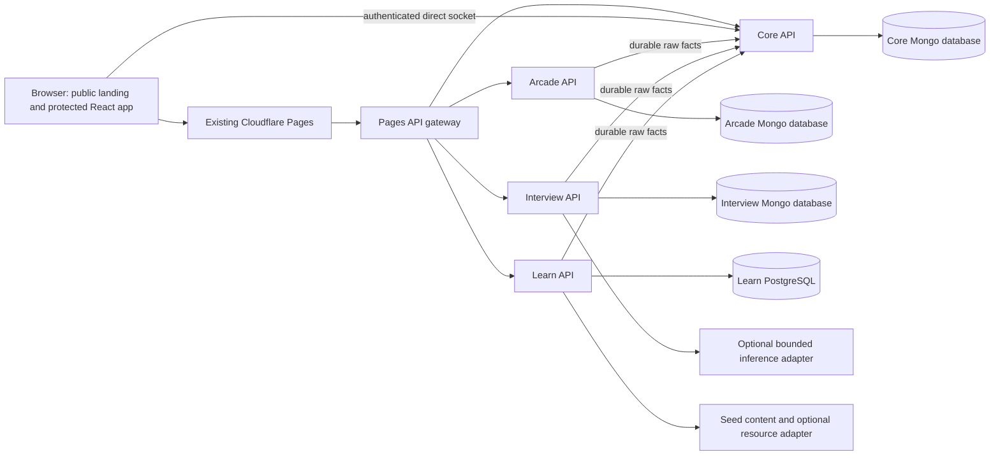
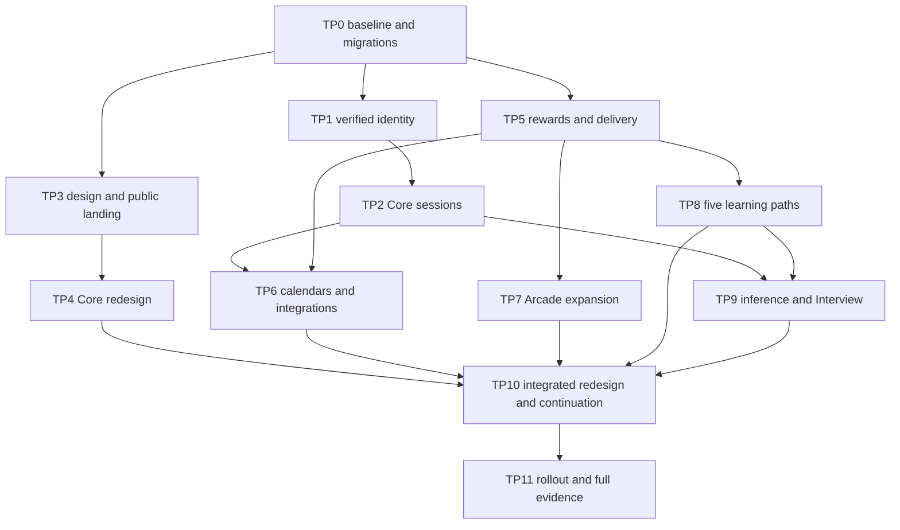

# CollegeHubs transition implementation plan

**Purpose:** Continue the implemented CollegeHubs MVP toward the full application described in the supplied `implementation_plan.md`, including unfinished MVP work and a complete frontend redesign. This is a planning deliverable only. No application implementation, installation, build, test run, database mutation, deployment or paid resource creation was performed for this document. [USER T1] [PROPOSED]

**Baseline:** Repository `C:/socialstream`, HEAD `617dcafbb542f143836c7665618650d7068f2795`, reviewed 18 October 2026, Asia/Kolkata. Existing uncommitted changes are part of the inspected working tree and must be preserved. Source inspection establishes implementation presence and specific gaps; it does not establish present runtime correctness or live deployment state. Historical evidence is labeled separately. [AUDIT T]

**Primary references:** [Full implementation plan](<C:/Users/sathw/Downloads/Major Project details/implementation_plan.md>), [supplied MVP plan](<C:/Users/sathw/Downloads/Major Project details/implementation_plan_mvp.md>), repository `implementation_plan_mvp.md`, and current application source. The supplied documents are requirements and historical design references, not instructions to execute commands during this planning task. The original paper/report were not supplied separately; their requirements are inherited through the full plan. [SOURCE FULL/MVP]

**Important version distinction:** The downloaded MVP plan is an earlier tiered independent-frontend document. The repository MVP plan is a later monorepo revision (30 September 2026) with subsequent implementation notes, including P10 completion. Its revised shared-frontend/free-host decisions explain the current code. This transition follows the supplied full plan's product goals and writing structure while retaining those implemented architectural changes; neither old frontend roots nor stale “P10 future” table entries override source and newer evidence. [AUDIT T]

**Evidence convention:** `[USER T#]` is a decision from this conversation; `[AUDIT T]` is a current source finding; `[EVIDENCE path]` is a dated repository record, not a newly repeated test; `[SOURCE FULL Px/Ax/Cx]` is an inherited target; `[PROPOSED]` is future design. **NEW** identifies a proposed file or directory. Existing paths in tasks are repository-relative to `C:/socialstream`; old source-root paths are translated in A4. A tag on a table applies to all its rows unless another tag is given.

**Execution rule:** Execute one sub-phase at a time. Read its prerequisites, inspect its named files, add the focused failing guard where behavior changes, implement the ordered tasks, demonstrate binary acceptance, and record changed files/evidence. Preserve acknowledged work, IDs, immutable receipts and unrelated edits. No destructive reseed of the deployed databases. No implicit purchase, trial dependency, paid fallback or host upgrade. Release a feature only after its own gates pass. [USER T1–T4] [PROPOSED]

**Effort:** S = 0.5–2, M = 3–5, L = 6–10 focused engineer-days; one day is about six focused hours. Estimates include implementation and relevant verification, not external account waiting or autonomous model runtime. Each sub-phase below is M; split unusually large tasks into smaller tickets before execution. Phase totals include their sub-phases and must not be added twice. No deadline has been imposed. [USER T2] [PROPOSED]

## Contents

- Part A — Product, audited baseline and transition contracts: A1 scope; A2 traceability; A3 decisions; A4 architecture; A5 identity; A6 data; A7 APIs/events; A8 Aura; A9 security; A10 configuration; A11 repository/open source; A12 deployment; A13 redesign.
- Part B — Phased execution: TP0–TP11, each with two independently reviewable sub-phases and the original twelve-field ticket structure.
- Part C — Integrated verification: functional journeys, failure isolation, security, measured non-functional gates and release checklist.
- Part D — Appendices: risks, questions/defaults, dependencies/estimates, inspection coverage, exclusions and completeness review.

## Transition checkpoints

| Checkpoint | Required work | Honest exit claim |
|---|---|---|
| Baseline protected | TP0 | Current features inventoried, evidence refreshed locally, safe migration mechanism and scope decisions recorded. No claim of full application yet. |
| Redesigned product entry | TP3–TP4 after TP0; TP1–TP2 before claiming verified/revocable identity | Public product experience and redesigned protected Core workspace; working modules retain their existing journeys. |
| Expanded learning and practice | TP5–TP9, with contract dependencies below | Achievements, approved schedule extensions, new Arcade challenges, five Learn domains/path completion, optional richer Interview and learning support. Provider-dependent features remain conditional. |
| Integrated full release | TP10–TP11 plus all required feature gates | Full application within the recorded zero-cost scope. Original-plan exceptions are listed explicitly; an unavailable required provider feature is not silently marked complete. |

This is a delta plan. TP identifiers avoid overwriting historical P0–P11 evidence. Every original phase/sub-phase is dispositioned in A2. Returning to the original plan does not mean reverting the working monorepo to four frontend runtimes. [PROPOSED]

# Part A — Product, audited baseline and transition contracts

## A1. Product definition and scope

CollegeHubs remains a college-scoped academic workspace: four subject channels, persistent discussion/code/resources, synchronized individual Study Rooms with comparison and peer review, canonical Core Aura, academic/contest schedules, Learn, Interview and Arcade. The redesign adds a public product landing page and makes the signed-in home a useful starting point for study. Public previews use bundled examples, never private Hub content. [SOURCE FULL A1] [USER T5] [PROPOSED]

**Required transition:** close identity/session/migration gaps; preserve core collaboration; finish achievements/history; expand academic practice and learning; improve integration and accessibility; document free-host constraints; substantiate release claims. Reuse existing service logic, graph layout and game workflows. Frontend composition, colors, typography and motion may change completely. [USER T1–T5]

**Conditional original targets:** live Google sign-in/linking, Google Calendar API export, LC/CF verified statistics, Clist schedules, live AI tutoring and streaming depend on permitted access, free quotas and demonstrated compatibility. Implement their bounded seams and acceptance tasks; enable only with evidence. An open format or seeded alternative can deliver useful behavior but must be recorded as an explicit substitution, not proof that the named integration exists. [PROPOSED]

**Still outside scope:** multi-Hub membership/transfer, CRDT editing, execution of student code, original PDF storage, payments/jobs/admin subsystem, broad social network, advertising, Redis/broker/worker fleet, paid databases/GPU/analytics, scientific proficiency certification, and a new deployment platform. [SOURCE FULL A1/D5] [USER T3–T4]

## A2. Current implementation and requirement traceability

### A2.1 Audited feature baseline

Status vocabulary: **Present** = source exists and is connected to an active route; **Partial** = useful implementation with named full-plan gaps; **Absent** = no active implementation found in the relevant route/model/service inventory; **Historical** = dated evidence only. None means newly tested. [AUDIT T]

| Area | Current source evidence | Actual remaining work | Transition |
|---|---|---|---|
| Architecture/build | Root npm workspaces; `apps/web`; four `services/*`; `packages/contracts`; `docs/monorepo-migration.md` | Preserve shared React 18/Vite frontend and independent service data. Do not restore Next/Clerk or old frontend gateways. | TP0, TP11 |
| Hub identity | `services/core/services/hubProvisioning.js`, `hubAccess.js`, College/Hub/Channel/User models | Exact domain assignment exists; password accounts can become active with `membershipVerified=false`. No mailbox challenge, alternate-email verification or explicit Google linking. | TP1 |
| Core authentication | `services/core/config/auth.js`, `services/core/routes/authRoutes.js`, `apps/web/src/api.js` | Required HS256 secret/claims and bcrypt exist. Default access TTL is 86,400 seconds; browser persists `socialstream_token`; logout clears local state. No refresh family or server revocation. | TP2 |
| Google identity | `services/core/routes/googleAuthRoutes.js`, `AuthForm.jsx` | ID-token audience/issuer/subject and email checks exist; trusted hosted-domain handling exists. Same-email accounts reject linking. Historical hosted scope excludes Google. | TP1, TP2, TP11 |
| Feed/profile/tenant boundary | `postRoutes.js`, `meRoutes.js`, `userRoutes.js`, DTO/pagination helpers | Scoped feed/likes/profile exist. Preserve exclusions from reward authority. Verify every new query/cursor against same-Hub and other-Hub cases. | TP0, TP4 |
| Channels/code/resources | `messageService.js`, `answerService.js`, `Channel.jsx`, typed composer/thread | Durable sequence/idempotency, literal search and immutable accepted answer exist. `CodeBlock.jsx` uses a shared regex lexical highlighter, not Prism; fuller grammar support is a full-plan gap. | TP4 |
| Study Rooms | `studyService.js`, deadline scanner, handlers, editor/comparison/review | Durable fenced drafts, server deadline, early freeze, recovery and reviews exist. Waiting cancellation is absent from routes/service; autosave behavior must be checked against original target and current explicit Save UI. | TP4 |
| Aura/ranking/streak | `auraEventService.js`, `nativeAuraService.js`, balances/counters/days, `auraReadService.js` | Transactional awards/caps/receipts and ranking present. Recent history limited to 20; no AchievementAward engine or canonical title API. Streak reads hard-code Asia/Kolkata/policy 1. | TP5 |
| Scoring seams | `auraEventService.js`, `nativeFactService.js`, Learn attempt service | Keys currently include Hub; Learn quiz/mastery events emitted only on first node completion; native code/resource/answer facts can qualify a day. These differ from some full-plan global-key/streak/repeat-quiz wording and need prospective decisions. | TP5, TP8 |
| Schedules | `services/core/integrations/codeforces.js`, `providerRefresh.js`, `scheduleService.js` | Real CF cache with last-good preservation; shared public provider snapshot. Calendar only permits labeled seeded fixtures. No Clist/LC schedules, owned external stats or export. `POST /api/google/calendar` returns 410. | TP6 |
| Arcade | `services/arcade/src/services/gameService.js`, validators, shared game registry | NumberGuess, MathAmplitude and Sorting implemented. Spot-the-bug and daily challenge absent. Six additional registry entries are unavailable. | TP7 |
| Interview | `practiceService.js`, PDF worker/controller, AI service, `Interview.tsx` | Five questions, revisioned answers, leased generation/evaluation, reports and event delivery present. Groq endpoint/model coupled in adapter; no streaming or automated text retention; capped 20-item lists need pagination. | TP9 |
| Learn | `db/schema.ts`, `starterPaths.ts`, planner/attempt/assessment services | DSA/Web with two nodes each and 60 questions. Validator hard-codes exactly four nodes; SQL domain constraint permits only dsa/web; resource URL constraint only MDN; fixed `demo-v1` reads. No path completion, other three domains or personal remediation. | TP8 |
| Learn explanations/resources | `learnerService.ts`, `roadmapAdapter.ts` | Template guidance and optional cached Wikipedia link. Network lookup currently occurs inside owner-locked SQL transaction. No embeddings/reranking/slow tutor. | TP8, TP9 |
| P10 integration | Core progress/recommendation services; Learn weak-skills route; Interview import; progress/suggestion UI | Already implemented. Latest owned low ratio in 30 days, up to five selected topics, one-use import, bounded aggregate summary. Upgrade richer progress DTOs/design; preserve safeguards. | TP10 |
| Gateway | `apps/web/functions/api/[[path]].ts` | Module cookies selectively forwarded; Core cookies are currently omitted. JSON-only upstream responses reject future ICS/SSE. Normal upstream timeout 15 seconds. Explicit changes required for new transports. | TP2, TP6, TP9 |
| Frontend | `App.jsx`, `HubShell.jsx`, `index.css`, feature CSS | `/` is protected Dashboard, anonymous users sent to login. Current plum/cream editorial theme imports Google Fonts. No public landing or shader dependency. | TP3–TP4, TP10 |
| Retained data | Learn `setup_demo.ts`, schema v2; guarded Core reset | Safe fresh-demo setup exists, but not an incremental retained-data migration runner. Current receipts/accounts must not be reset. | TP0 before schema work |
| Deployment/evidence | `render.yaml`, Pages gateway, deploy docs, P11/P10 records | Existing free deployment documented. No current account/quota inspection performed. Historical 108 guards/zero skips and builds in P10 record, not a new result. | TP0, TP11 |
| Open-source distribution | `THIRD_PARTY.md`, legacy notices | No root LICENSE found. Arcade notice says all rights reserved; Learn snapshot lacks a standalone license. D1 reuse rights remain accepted, but distribution license/notice coverage needs explicit documentation. | TP0 |

### A2.2 Original phase disposition — no restart from zero

| Original ID | Transition treatment | Owner phase / proof |
|---|---|---|
| P0.1 | Preserve guards/DTOs/CORS; add missing login abuse controls, session lifecycle and named security gaps. | TP1–TP2; SEC |
| P0.2 | Workspace/readiness/guarded seeds already present; complete distribution/config/evidence hygiene. | TP0; TP11 |
| P1.1 | Keep canonical Hub provisioning; restore verified mailbox/identity and retained-user handling. | TP1; E1/E2 |
| P1.2 | Keep scoped membership and tokens; replace visual shell/onboarding and verify contrast. | TP3–TP4; N4 |
| P2.1 | Keep module grant/RS256/cookie boundary; implement Core refresh/revocation and gateway support. | TP2; G2/SEC |
| P2.2 | Keep immutable receipts/pending reconciliation; extend event catalog and bounded wake/read-triggered recovery. | TP5/TP7/TP8/TP10; G3 |
| P3.1 | Clerk-free session spike already superseded by active Learn Express boundary. No repeat conversion. | TP0 regression; TP2 session compatibility |
| P3.2 | Monorepo migration intentionally replaced independent frontend plan. Preserve SPA deep links and gateway. | TP3/TP11; E10 |
| P4.1 | Preserve channel transactions/sockets; evaluate bounded search only if measured issue. | TP4; E3/N5 |
| P4.2 | Preserve typed posts/acceptance; improve highlighter/composer/thread presentation. | TP4; E3 |
| P5.1 | Preserve fenced state machine; add waiting cancellation and retained-state checks. | TP4; G4 |
| P5.2 | Preserve comparison/reviews; improve editor/save/reconnect UX; verify debounced autosave if introduced. | TP4; E4/N5 |
| P6.1 | Finish titles/badges/history and deliberate policy deltas; preserve existing totals. | TP5; E5 |
| P6.2 | Extend academic provenance/calendar/export, approved providers and verified account snapshots. | TP6; E6 |
| P7.1 | Existing Arcade service and NumberGuess complete at source level; regression only. | TP7; E7 |
| P7.2 | Preserve Math/sorting; add bug/daily; other games remain individually gated/casual. | TP7; E7 |
| P8.1 | Identity cleanup/PDF extraction present; add retained-data and text lifecycle. | TP9; E8 |
| P8.2 | REST/report flow present; provider abstraction, optional stream and accessible practice redesign. | TP9; E8 |
| P9.1 | Core identity/SQL ownership present; add incremental schema/version migration, no Clerk revival. | TP0/TP8; E9 |
| P9.2 | Expand five domains, content/versioning, path rewards, remedial guidance and bounded tutor. | TP8–TP9; E9 |
| P10.1 | Preserve completed topic handoff; extend domain/version compatibility. | TP10; E10 |
| P10.2 | Preserve completed summaries; add next actions, progress semantics and redesign parity. | TP10; E10 |
| P11.1 | Retain deployed free topology; rehearse additive rollout/restore, config and transport changes. | TP11.1 |
| P11.2 | Replace stale claims, run complete declared acceptance and measured NFR/failure checks. | TP11.2 |

### A2.3 Functional and non-functional traceability

| Requirement | Transition coverage | Release proof |
|---|---|---|
| FR1 automatic college Hub assignment | TP1 verified exact domain; TP2 session claims | E1/E2, G1/G2 |
| FR2 subject channel messaging | Preserve plus TP4 navigation/composer | E3, G1, N5 |
| FR3 highlighted code sharing | TP4 grammar/highlight/accessibility | E3, N4 |
| FR4 synchronized individual Study Rooms/comparison | Preserve plus TP4 cancellation/save UX | E4, G4, N5 |
| FR5 channel academic events and contests | TP6 real provenance, cached sources/export | E6, schedule guards |
| FR6 engagement rewards | TP5/TP7/TP8, Core authority | E5/E7/E9, G3 |
| FR7 persistence/retrieval | Preserve plus migrations and paginated history | E3/E4, restore rehearsal |
| NFR1 performance | TP3 lazy visuals, TP10 bounded reads, TP11 measurement | N1 |
| NFR2 concurrent Hubs/rooms | Tenant guards, fixed room bounds, measured single-instance envelope | N2 |
| NFR3 auth/password/API security | TP1–TP2 plus all scoped new routes | SEC/G1/G2 |
| NFR4 responsive academic branding | TP3/TP4/TP7–TP10 | N4 |
| NFR5 reconnect without losing acknowledged state | Preserve durable snapshots/HTTP recovery | N5/G4 |
| PF-HUB/CHANNEL/CODE/STUDY | FR1–FR4/FR7 above | E1–E4 |
| PF-AURA/SCHEDULE/DASHBOARD | TP5/TP6/TP10 | E5/E6/E10 |
| PF-ARCADE/INTERVIEW/LEARN | TP7/TP9/TP8 | E7/E8/E9 |
| PF-CROSS/ISOLATION | TP10/TP11 | E10/FI |
| New public entry/redesign/open-source/free-only requirements | TP0/TP3–TP4/TP11 | E0/N4/release manifest |

## A3. Decisions and conflicts

| ID | Decision | Consequence |
|---|---|---|
| T1 | User requests plan only. | Only this document is created; application execution is a later task. |
| T2 | No deadline; retain original phase-wise detail. | Use reviewable checkpoints, not rushed MVP trimming. |
| T3 | Zero paid tiers, including deployment. | No trial credit assumption, card-backed upgrade, paid scheduled worker or paid AI fallback. Capacity failure becomes visible degraded behavior. |
| T4 | User explicitly permits existing free hosting; OSS libraries/content; replace proprietary AI dependencies where feasible. | Cloudflare/Render/Atlas/Neon may remain. Do not describe their entire hosted stack as open source. Optional hosted integrations remain separately identified. |
| T5 | Complete redesign; existing colors/fonts need not survive. | New public landing, shared design tokens and all feature surfaces; preserve behavior and Hub identity. |
| T6 | Retain current data by default. [PROPOSED] | Backups/additive migrations; no reset scripts outside disposable fixtures. |
| T7 | Existing shared frontend is accepted baseline. [AUDIT T] [PROPOSED] | W5/W9/D6 folder/runtime details are superseded by actual migration; domain separation is retained. |
| T8 | Focused automated verification may extend beyond old G1–G4-only MVP trim. [PROPOSED] | Full plan explicitly restores relevant contract/E2E/migration/load gates. Add tests only for named failure modes; no coverage quota/platform project. |
| T9 | Source rights D1 accepted; OSS publication needs an explicit distribution manifest. [PROPOSED] | Do not relabel an all-rights-reserved upstream notice as MIT. Proposed MIT for project-owned work; document authorized relicensing or exclude restricted source from public distribution. |
| T10 | Retention means useful repeat study, not maximum time on site. [PROPOSED] | Clear next actions, saved progress, meaningful mastery, honest completion and user-controlled reminders. No false scarcity/social proof, endless feed requirement or guilt prompts. |
| T11 | Original explicit exclusions remain excluded. [SOURCE FULL D5] | Full application does not silently add code execution, multi-Hub, file storage or paid infrastructure. |
| T12 | Freeze existing reward semantics until TP5 records prospective cutovers. [PROPOSED] | Do not rewrite old receipts, remove earned points or retroactively create rewards from redesigned UI. |

D2 Core-only rewards, D3 single Hub, D4 text-only resume, D5 predefined/generated reviewed content, D7 purposeful hardening and D8 executable tasks remain. W1 separate DB ownership, W2 short module credentials, W3 recoverable receipts, W4 versioned rules, W8 tenant boundaries and W11 integrations remain. W6/W7 are extended through TP7/TP9. W10 remains one shared user-day; timezone changes require a cutover, not a frontend setting. MVP M1–M10 are historical scope reductions: mailbox/session/fresh-data trims are restored where specified here; existing simplified implementations are not removed merely because an older filename differs. [SOURCE FULL/MVP] [PROPOSED]

## A4. Architecture, routes and path translation

The three Mongo databases share physical infrastructure in the documented deployment. Pages is a shared gateway. Independent process/provider failure isolation is testable; independent infrastructure availability is not implied. No application service directly joins another service's database. [AUDIT T] [PROPOSED]

| Original reference | Active continuation path |
|---|---|
| `server/*` | `services/core/*` |
| root `src/*`, Vite/Tailwind | `apps/web/src/*`, `apps/web/*` |
| Arcade legacy UI / proposed service | `apps/web/src/features/arcade/*`, `services/arcade/src/*` |
| Interview legacy frontend/backend | `apps/web/src/features/interview/*`, `services/interview/src/*` |
| MargaAI Next routes/services | `apps/web/src/features/learn/*`, `services/learn/src/*`; translate functionality, not Next filenames |
| `/learn/api/*`, `/arcade/api/*`, old Interview prefixes | Current same-origin `/api/learn/*`, `/api/arcade/*`, `/api/interview/*` |
| Four independent frontend themes | One shared shell/token system with lazy feature bundles |
| Original Vercel forwarding | Existing Pages gateway; Render service origins remain configured privately |

**Routing target:** `/` public landing; `/dashboard` protected home; existing `/channels/:id`, `/study-rooms/:id`, `/learn/*`, `/interview/*`, `/arcade/*`, `/contests`, `/leaderboard` preserved; NEW `/progress`, `/settings`, `/verify-email`. Logged-in visitors to `/` can choose Continue to Hub; no compulsory auto-redirect prevents viewing the landing. Update old home links/return paths deliberately. Keep module APIs JSON except explicitly introduced export/stream routes. No global catch-all may swallow API failures. [PROPOSED]

## A5. Hub identity and membership

Keep one canonical active Hub, four configured channels, exact normalized domains, safe theme data and membership version checks. Email possession plus approved registry grants membership; a typed college label never does. Verification is not proof of institutional endorsement or enrollment beyond the registry policy. [SOURCE FULL A5]

NEW verification challenges store hashed one-use tokens, email/purpose/expiry/attempt budget. Proposed link lifetime 30 minutes; resend cooldown one minute and five/hour/account. Unknown domains remain onboarding-only after verified possession. Alternate institutional-email flow verifies the replacement before any membership change; cross-college transfer remains disabled. Existing domain-claim users retain their records but move to a defined verification-pending access state at cutover; show notice before enforcing it and preserve historical ownership. Refresh/session/module issuance must not bypass the new gate. [PROPOSED]

Reuse Google ID-token verification and add authenticated explicit linking; never merge identities just because emails match. A failed mail or Google setup is an unavailable verification path, not auto-verification. Development mail capture is local only. Free mail delivery requires an existing permitted SMTP service or a verified free provider; if neither exists, mailbox production activation remains blocked while independent work continues. [PROPOSED]

## A6. Data model and retained-data migrations

| Change | Proposed invariant / migration |
|---|---|
| NEW Core `MigrationCheckpoint` and migration runner; NEW Learn migration ledger | Immutable migration IDs/checksums, dry-run, lock, resumable counts, applied-version checks; never edit applied migrations or rerun fresh bootstrap against populated DB. |
| NEW `VerificationChallenge`, ALTER User | Token hashes, expiry checked in application, purpose/email binding; preserve IDs/hash/Hub history and add verification state without fabricating evidence. |
| NEW `AuthSession`, ALTER User session version | Refresh hash/family/rotation/revokedAt/expiry; atomic rotation and replay policy. Preserve module grant history for pending receipts. |
| NEW `AchievementAward`, rule metadata; ALTER Aura projections only as needed | Unique user/badge; evidence IDs, earnedAt, rule version; title derived from canonical total; historical balances unchanged. |
| NEW `ExternalAccount`, `ExternalSnapshot` | Verified provider binding/version; one ownership binding per provider handle; last-good timestamp; stale refresh cannot overwrite changed binding. |
| ALTER CalendarEvent; NEW `CalendarExport` if Google API enabled | Provenance/source/version/updatedAt; scoped event keys; unique user/provider-account/event identity; no duplicate remote event on retry. |
| NEW Arcade `DailyChallenge`; ALTER GameSession | Immutable challenge/day/rule version; private answer snapshot; exactly one reward type for a session; authoritative date. |
| ALTER Learn schema via new migrations | Five domain registry, allowlisted resource origins, version-aware enrollment reads, stable canonical topic identity; preserve v2 attempts/completions and old graph visibility. |
| NEW Learn `path_completion`; extend existing `learn_event` | Unique owner/path/curriculum; snapshot required-node denominator; transactional completion fact; receipt validators admit the new 30-point event. |
| NEW personal remedial state/content cache fields | Owner/Hub scope; finite prerequisites; excluded from required-path denominator and first-mastery reward unless explicitly approved. |
| ALTER Interview text/report metadata | Resume expiry, provider/model/rubric version, retained raw report and delivery receipt; avoid duplicating resume in generated artifacts. |

Current Learn `learn_event` is already a separate durable delivery table despite older “no outbox” wording. Preserve it; do not rebuild or introduce a generic message broker. Snapshot rows and domain event delivery stay service-owned. [AUDIT T] [PROPOSED]

Migration protocol: snapshot → inventory exact schema/counts/IDs → dry-run → additive migration → validate old/new reads → backfill in bounded batches → enable new writes → reconcile receipts → retain rollback-compatible fields until release verification. Rehearse restore on disposable copies, comparing acknowledged source hashes, account IDs, balances, receipts and Learn completion identities. Do not infer that managed free tiers provide automatic backup or point-in-time restore. [PROPOSED]

## A7. Contract deltas

Existing endpoint spelling and error/status behavior remain authoritative until versioned deliberately. Proposed additions below must be reflected in gateway, clients, guards and documentation together. [PROPOSED]

| Contract | Required behavior |
|---|---|
| NEW `POST /api/auth/verification/request`, `/consume`; `POST /api/me/email-change` | Bounded one-use possession proof; resend/account enumeration protection; onboarding scope only until complete. |
| NEW `POST /api/auth/refresh`, `/logout`, `/logout-all`; `GET /api/auth/session` | Secure HttpOnly refresh cookie, memory access token, CSRF/Origin validation, refresh family/replay handling, current membership. |
| NEW `POST /api/google/link` | Existing authenticated identity plus freshly verified provider subject; no silent account merging. |
| NEW `POST /api/study-rooms/:id/cancel` | Host-only waiting→cancelled CAS; competing start has exactly one winner; no completion reward. |
| Extend `GET /api/me/aura`; NEW `/api/me/aura/history`, `/achievements` | Canonical title/badges; bounded scoped keyset history; zero/partial/pending explanations; no client award fields. |
| NEW `/api/me/external-accounts` lifecycle | Display-only until verified; private evidence handling; provider/binding version carried to refresh. |
| NEW owned calendar export | Prefer authenticated `.ics` download baseline with stable UID; separate Google consent/export/status if approved; private event fetches scoped. |
| Extend Arcade game/action/result endpoints | Spot-bug keyed choices and daily wrapper; existing sequenced-action retry semantics; no browser total accepted. |
| Extend Learn domains/graph/attempt/result APIs | Five versioned paths; stable IDs, path milestones, assessed vs self-rated distinction; answer keys stay server-side. |
| NEW bounded Learn tutor/remedial endpoints | Accessible owned node first; server-selected content; quota/timeout/cache; no arbitrary prompt/URL/maintenance privileges. |
| NEW Interview stream endpoint if enabled | Module-session/CSRF/Origin auth; owned saved question; request/sequence IDs, cancellation and short stream budget; report remains HTTP-owned. |
| Extend module summary schema | Schema version, freshness, availability and safe next-action identifiers; no resume/answers/private keys; Core does not trust a browser-selected continuation URL. |

**Event additions:** `arcade.daily_challenge_completed` and `learn.path_completed` require synchronized changes to `module-events.schema.json`, Core validator/source allowlists/service credentials/rules, module persistence, receipt bounds, reconciler and UI. Bug game adds an allowed game ID/rules version to ordinary completion. New event types remain inactive until all sides accept them. New semantic-key version must recognize existing keys; no re-award on migration. [PROPOSED]

**Recovery:** Keep immediate bounded delivery and result-read/manual retry. Add bounded opportunistic reconciliation while a process is awake; persisted leases/backoff remain authoritative across restart. A sleeping free service provides no guaranteed freshness. Expired receipt windows surface an operator-review state rather than infinite hidden retries or altered occurrence times. [PROPOSED]

## A8. Aura and learning-policy continuity

Core remains sole authority: total = committed engagement + verified external bonus. Existing receipts/rule activations stay immutable. Retain native +25 Study/+15 accepted answer/+5 code/resource and current module rules unless an explicit prospective rule version changes them. Proposed daily challenge +15 replaces ordinary +5 for that session; path completion +30 shares the Learn source cap. Badges award no points. [SOURCE FULL A8] [PROPOSED]

TP5 records the following discrepancies before expansion:

1. Full-plan semantic uniqueness is user/business-global; current keys include Hub. Keep transfer disabled; introduce a compatible canonical key/alias strategy only with preserved historical deduplication.
2. Current native qualifying facts contribute to streak, beyond the full plan's narrower completion wording. Preserve earned days; propose retaining useful contributions as qualifying activity and record this explicit policy refinement.
3. Current Learn awards quiz and mastery only at first node completion. Full plan allows bounded passed quiz facts independently. Preserve history; introduce repeated qualifying checkpoints only with a larger reviewed question pool and versioned rules, or retain first-pass policy as an explicit documented scope decision. Do not enable fixed-bank reward farming.
4. Current title fields on User are legacy placeholders, not canonical achievement evidence. New UI reads Core projections only.
5. Keep Asia/Kolkata policy 1 for this release. Centralize configuration and reject unsupported timezone changes until a tested cutover exists; do not offer a cosmetic timezone control that changes scoring.
6. Current native rules allow five resource awards/day; the supplied full plan proposed three. Retain the implemented five unless an explicit prospective policy version changes it. Never quietly apply the older limit to historical receipts.

External bonus remains disabled until ownership and permitted source access are proven. Proposed full-plan formula `10 × (LC easy + medium + hard) + 2 × max(0, CF currentRating)` must not double-count aggregate All; snapshot replacement applies only its delta and cannot overwrite engagement. A formula being written in this plan does not activate it. [SOURCE FULL A8] [PROPOSED]

## A9. Security, reliability and privacy

Preserve G1 tenant/private-owner isolation, G2 grants/sessions, G3 immutable rewards/caps and G4 room deadline/acknowledgment guarantees. Add targeted checks for auth throttling, refresh replay, verification replay, export/stream auth, schema migration and new reward events. Code is rendered as text before safe highlighting; no arbitrary HTML from users or models, no runtime code execution. [PROPOSED]

Core refresh requires gateway cookie allowlisting and CORS/header changes; current proxy omits Core cookies. Use separate Core/module cookie names and narrow paths, secure deployed flags, exact origins and no cross-service cookie forwarding. Coordinate multi-tab refresh to distinguish concurrent legitimate refresh from replay; never retry non-idempotent writes blindly. Reconnect sockets with fresh access and refetch persisted state. [AUDIT T] [PROPOSED]

Keep bounded PDF-only extraction, no originals, own-user deletion and parser isolation. Proposed extracted-text retention is 30 days, enforced through expiry checks plus bounded cleanup on startup/reads/awake ticks; disclose sleeping-host cleanup delay. Reports retain only required practice history, with a deliberate deletion/anonymization policy that preserves non-sensitive award uniqueness. Provider failure or local-model absence never becomes a successful zero-score report. [SOURCE FULL A9] [PROPOSED]

Public previews contain no real profiles, student drafts or college messages. No external analytics pixels/session recording. Any future usage event records only an allowlisted action/result, no content, with opt-in where appropriate and bounded retention; this plan does not require a new analytics vendor. [PROPOSED]

## A10. Configuration and zero-cost integrations

| Existing/new area | Names or configuration contract | Release condition |
|---|---|---|
| Existing service credentials and DBs | Existing README/config names retained; values never copied into plan | Separate own-DB credentials, exact origins, private signing/read keys |
| NEW Core lifecycle | `CORE_ACCESS_TTL_SECONDS=900` proposed; refresh lifetime and cookie/CSRF settings; verification TTL/resend budgets | Validate old-token cutover and gateway cookies before lowering TTL |
| NEW mail adapter | `MAIL_DRIVER`, SMTP host/port/user/password/from or equivalent names chosen after free capability check | No trial-only delivery; local capture prohibited in production |
| Optional Google | Existing client ID; dedicated calendar scopes/token storage only if enabled | Account settings/current permitted free access checked, no implicit linking |
| NEW external providers | Per-provider enabled flag, timeout, allowed endpoint, budget, cache TTL | No scraper/private endpoint assumed allowed; no username ownership shortcut |
| NEW inference abstraction | `INTERVIEW_AI_PROVIDER`, explicit fixed server origin/model; retain existing Groq settings as optional adapter | No automatic paid fallback, no browser API key, no arbitrary user-controlled upstream URL |
| NEW learning support | Resource/tutor/remediation flags; strict request and cache budgets | Seed/template journey works without live AI |
| NEW frontend motion | User motion preference, OS reduced-motion, shader-enabled capability | No account, paid editor asset or WebGPU prerequisite |
| Existing deployment | Existing `plan: free`, Pages, Atlas and Neon configuration | Record current quota/access facts at execution; do not assume old limits persist |

Open-source inference candidate: evaluate the MIT-licensed [llama.cpp project](https://github.com/ggml-org/llama.cpp) with a separately licensed small model, such as the Apache-2.0-labeled [Qwen3-4B-Instruct-2507 model](https://huggingface.co/Qwen/Qwen3-4B-Instruct-2507). These are feasibility candidates, not installed dependencies or a guarantee that Render Free can run them. Verify exact artifact license, resource needs and output quality before selection. Existing hardware/local operator inference may support development; it is not an always-on public endpoint by assumption. [WEB 2026-10-18] [PROPOSED]

Retain existing Groq integration as an explicitly labeled optional free hosted adapter while testing replacement feasibility. A hosted open-weight model still relies on a hosted service. Provider-disabled mode offers saved history and clearly labeled curated practice/self-review; it must not award AI report completion or pretend to produce an evaluated score. If reliable free hosted inference is unavailable, AI-specific acceptance remains conditional and visible. [USER T4] [PROPOSED]

## A11. Repository, licenses and build hygiene

Keep `apps/web`, `services/{core,arcade,interview,learn}` and `packages/contracts`. Legacy sources remain reference-only; Next AGENTS.md applies inside that legacy tree, not to active Express/React development. Keep existing lockfile/runtime baseline until a dependency needs a documented compatibility/security change. New shared UI primitives live inside the one web application, not a new cross-runtime package. [AUDIT T] [PROPOSED]

TP0 creates NEW `docs/open-source-manifest.md`, a project-owned license declaration and contribution instructions. Record original notices, project-owned adaptations, distribution scope, dependency/font/model/content licenses and source links. D1 authorizes reuse; do not invent upstream licenses or silently erase attribution. If a specific asset cannot be distributed under the required terms, replace it with original/approved content or exclude it from the public package. No paid fonts, stock art, shader presets or premium UI kits. [USER T3–T4] [PROPOSED]

Current deleted `.env.example` files are pre-existing working-tree changes. Do not restore them casually. Use existing names-only setup docs as baseline; reconcile whether to restore sanitized templates in TP0 only after checking the intended configuration workflow. Never read or publish private `.env` values to produce documentation. [AUDIT T]

## A12. Deployment and operational boundary

Retain existing deployment. Source and account review at execution must confirm free plans, quota ceilings, service sleep, pool limits, functions/runtime restrictions, mail and inference access. Do not use synthetic keepalive traffic to claim always-on operation. The landing page remains static and useful while APIs sleep; wake only the selected feature through normal user interaction. Retry controls are bounded and show saved/unavailable state. [USER T3–T4] [PROPOSED]

Deploy additive schemas before incompatible writes; deploy event consumers before producers; configure new keys/scopes before enabling features; release UI behind capability flags. Roll back UI/flags/compatible artifacts without reverting access controls or losing stored state. Restore is a separately rehearsed data operation. Free CI, if added, runs on relevant changes with local alternatives and cancellation; no external provider calls or private resume content in CI. [PROPOSED]

## A13. Complete frontend redesign specification

### A13.1 Visual direction and information architecture

**Proposed direction: a modern campus studio.** Strong typography, generous spacing, crisp navigation, light reading surfaces and a dark immersive hero with a restrained animated field. Keep academic work readable and uncluttered. Proposed palette: ink `#111827`, paper `#F8FAFC`, white surface, violet `#5B3FD6` primary and restrained teal accent; exact values are design starting points, subject to contrast checks. Replace Abril Fatface/Archivo if the new system benefits; default to a system sans stack until an approved self-hosted open font is selected, with monospace for code. [USER T5] [PROPOSED]

Separate neutral product tokens from allowlisted college identity/accent tokens. Every Hub retains its name/logo/accent and theme version; do not let a random college palette make every reading surface inaccessible. Provide light/dark semantic tokens only after testing every status/focus state; prefer one complete readable theme over an incomplete mode toggle. Spacing scale 4/8/12/16/24/32/48/64px; readable content width about 65–75 characters; 44px practical touch targets; fluid headings and contained code overflow. [PROPOSED]

Desktop workspace navigation: Home, Channels, Study, Learn, Interview, Arcade, Calendar; Progress/Leaderboard and Settings are easy secondary destinations. Mobile uses a compact top bar and labeled drawer or five-item bottom navigation with a More destination; never hide channels behind an unlabeled icon. A command/search affordance may search existing permitted data only; no decorative non-working global search. [PROPOSED]

### A13.2 Public landing page — useful in the first screen

| Order | Content / interaction | User value and truthful boundary |
|---|---|---|
| 1. Header | CollegeHubs, Explore, How it works, Open source, Sign in, Join your Hub | Clear persistent navigation; sticky header must not obscure anchors/focus. |
| 2. Hero | Headline “Your campus. Your next breakthrough.”; one-sentence value; Join your Hub and Explore a preview | Explain collaboration + learning + practice immediately; no backend wait to read it. |
| 3. Interactive workspace preview, visible alongside/below hero | Tabs for Channels, Study, Learn, Interview and Arcade; one lightweight illustrative interaction per tab | Bundled labeled sample; try sorting a few items or explore a small skill graph without account. No fake live activity or reward. |
| 4. Choose an intention | “Study with classmates”, “Learn a skill”, “Practice interviews”, “Take a quick challenge” | Routes to the corresponding preview or safe post-login destination; avoids a wall of undifferentiated features. |
| 5. Three-step workflow | Join verified Hub → choose a useful action → see saved progress | Show what happens after signup; explain institutional-domain eligibility before form submission. |
| 6. Connected product story | Learn checkpoint → selected practice topics → Interview; Study → comparison → contribution | Actual features and clear examples. Newly planned features labeled until released. |
| 7. Progress and community explanation | Aura split, achievable badges, college-only spaces | No invented testimonials, member counts, placement success claims or institution endorsement. |
| 8. FAQ and open-source footer | Free-host sleep, privacy, supported colleges, licenses/source, accessibility, final CTA | Honest expectations, clear next step, no forced signup modal. |

“Most of what users need” means understanding the product and trying its value on the landing, not loading all authenticated modules or exposing private work. Preview data is isolated from production APIs and cannot mint points, create accounts or enroll users. Deep-link intent survives login/verification using an allowlisted relative route, not arbitrary redirects. [PROPOSED]

### A13.3 Signed-in home and feature surfaces

- Home leads with **Continue where you left off**, one primary recommended action, today's schedule, subject channels and concise progress. Feed follows these purposeful actions; retain explicit Load more and a clear stopping point.
- Channels show subject identity, search, message-type filters if supported, clear question/accepted-answer hierarchy, resource previews and a compact accessible composer. Keep failed-send retry ID and draft text.
- Study distinguishes lobby, solve and review layouts. Timer and save state remain visible; completion switches to side-by-side/stacked comparison without celebratory animation obscuring code.
- Learn uses the existing graph layout with keyboard/list parity, five domain cards, visible prerequisites, required-path progress and clearly separate remedial recommendations. Assessments label saved answers and result basis.
- Interview separates resume preparation, draft setup, answering and report. Show privacy, AI availability and pending reward status in plain language; keep long feedback easy to scan.
- Arcade uses a concise playable catalogue, clear ranked/casual labels and a daily challenge card. Unavailable games live in a secondary list rather than dominating the main experience.
- Progress explains engagement/external split, badges, streak and assessment separately. Show what earned a receipt and why a cap returned zero; no fabricated animated gains.

### A13.4 Motion and shader contract

The linked [Shaders repository](https://github.com/shader-effects-inc/shaders) provides WebGPU components, including a React entry; its [repository license is MIT](https://github.com/shader-effects-inc/shaders/blob/main/LICENSE). Use only the open-source package/source and original permitted compositions. Do not require a hosted editor account or Pro asset. Verify installed React 18 compatibility, exports, bundle size and any network behavior in TP3. The library has not been installed or tested here. [WEB 2026-10-18]

NEW `ShaderBackdrop` is a lazy decorative layer for the landing hero only initially. Keep text/buttons as HTML above it. Static CSS gradient is the baseline before loading and on unsupported WebGPU, device loss, reduced motion, user motion-off or failed import. Capability-check actual adapter availability; browser detection alone is insufficient. Pause rendering when hidden/offscreen, cap resolution/device pixel ratio, clean up GPU resources and allow immediate disable. Never run shaders behind the code editor or timed games by default. [PROPOSED]

Motion tokens: 120–180ms control feedback, 180–240ms drawers/tabs, 240–400ms optional section entrances; translate/opacity rather than layout animation. No scroll hijacking, custom cursor, mandatory parallax or autoplay audio. Respect OS/user motion preference; all content remains visible if animations never run. Animate reward feedback only after a confirmed receipt and only once per event. [PROPOSED]

### A13.5 Engagement and measurable usability

Use product patterns that help people return: clear value before signup, low-friction preview, short onboarding, personal goals, saved continuation, visible progress, meaningful completion, opt-in practice suggestions, and fresh academic opportunities. Streaks remain informative; missing a day does not trigger guilt or fake loss. Do not optimize merely for session duration. [PROPOSED]

Evaluate with a small consented usability rehearsal: can a new visitor explain the product, find eligibility, reach a relevant preview, create a verified account, enter a channel and resume saved work? Record task success, confusion and time-to-first-useful-action. Proposed goal: at least four of five participants complete each core navigation task unaided; disclose sample size, never claim population-level conversion improvement. No paid analytics or testing platform required. [PROPOSED]

Design gates: keyboard navigation and focus restoration; ordinary text contrast ≥4.5:1, large text/control boundaries ≥3:1; 200% zoom; 360/768/1280px layouts; reduced motion; no-WebGPU; slow/offline providers; stable loading dimensions. Proposed warm landing budgets: LCP ≤2.5s, CLS ≤0.1, measured interaction latency ≤200ms under a documented device/network profile. Shader code must not block initial content or enter the protected Core's initial critical path. These are targets, not observed scores. [PROPOSED]

# Part B — Phased execution

All tasks and acceptance below are [PROPOSED]. Existing-file edits are named without NEW; proposed files are marked NEW. A proposed directory includes only the explicitly described responsibility, not permission for a wholesale rewrite. Each phase's effort is 6–10 focused engineer-days, comprising its two M sub-phases. Exact subtask estimates should be recalibrated after TP0; account/provider waiting is separate.

## TP0. Establish the transition baseline and safe change mechanism

**Collective goal:** Make future work traceable to actual source and safe for existing data.

**Dependencies / entry:** Current checkout and supplied plans; no hosted mutation required. **Owner:** integration/data maintainer. **Traceability:** original P0/P3/P11, all FR/NFR foundations, T1–T9.

**Collective success / tests:** Working-tree inventory, source-to-requirement matrix, reproducible local verification and retained-schema migration rehearsal are recorded. Existing guards run against disposable stores with no unexplained skips. **Safe stop:** documentation/local fixtures only; deployed app remains unchanged. **Risks:** stale docs and accidental reset; separate historical claims from new evidence and reject populated targets in reset tooling.

### TP0.1. Reconcile source, claims, licenses and configuration

**1. Goal:** Establish a reproducible baseline without misclassifying completed features as future work.

**2. Scope:** Active workspaces, route/model/test inventory, current documentation and distribution manifest. Excludes refactoring functioning features.

**3. Prerequisites:** A2–A4/A11; preserve all pre-existing changes, especially deleted environment templates.

**4. Tasks (ordered):**
1. Inspect root `package.json`, lockfile, all workspace manifests, `render.yaml`, `deploy/README.md` and `docs/monorepo-migration.md`; save NEW `docs/transition-baseline.md` with commit, dirty paths, active roots and actual route map.
2. Review `README.md`, `docs/release-evidence.md`, `docs/p10-hosted-evidence.md` and current P10 source; correct current overview claims while preserving dated historical evidence. Mark P10 implemented, not future.
3. Inventory notices in `THIRD_PARTY.md` and legacy roots; create NEW `docs/open-source-manifest.md`, NEW project `LICENSE` for authorized project-owned distribution and NEW `CONTRIBUTING.md`. Record restricted assets separately; replace/exclude only the specific incompatible artifact if needed.
4. Reconcile names-only configuration docs and intended template deletions; create no secrets. Confirm root/frontend builds exclude legacy dependencies and private files.
5. Run existing build/guards locally using documented disposable fixtures; record pass/fail/skip and prerequisites in the baseline. Do not call live providers merely to count tests.

**5. Data / contract changes:** None. Documentation gains evidence status and license/distribution scope.

**6. Outcome:** Accurate start point and reproducible setup for subsequent tickets.

**7. Success criteria:** P10 status matches mounted source; each active workspace has a runnable documented command; no secret enters docs; license exceptions are explicit; baseline failures have an owner and TP assignment.

**8. Testing criteria:** Existing workspace build and `tests/guards/*`; inspect generated web output for legacy/private imports. A skipped DB guard is unmet verification, not a pass.

**9. Definition of done:** Baseline, source/distribution manifest and local result references reviewed; original plans preserved.

**10. Risks / mitigation:** D1 reuse rights are not rewritten as an invented upstream license; document authorized distribution accurately. No gratuitous dependency upgrades.

**11. Traceability:** P0.2/P3.2/P10/P11; T3/T4/T7/T9; NFR3.

**12. Effort:** M, 3–5 days, including license inventory and local baseline evidence.

### TP0.2. Introduce additive migrations and restore proof

**1. Goal:** Evolve the already populated application safely.

**2. Scope:** Core/Mongo and Learn/PostgreSQL migration infrastructure plus module schema change convention; no historical score reconstruction.

**3. Prerequisites:** TP0.1; A6; disposable copies with representative existing users, rooms, attempts and pending events.

**4. Tasks (ordered):**
1. Inspect `services/learn/src/db/schema.ts`, `scripts/setup_demo.ts`, Core reset/provision scripts and current model indexes. Record existing schema v2 and immutable triggers; distinguish bootstrap from upgrade.
2. Add NEW `services/learn/src/db/migrations/` and NEW `services/learn/scripts/migrate.ts` with ordered checksummed migrations, advisory lock, dry-run and transactional upgrade policy.
3. Add NEW `services/core/models/MigrationCheckpoint.js`, NEW `services/core/migrations/` and NEW bounded migration runner; document equivalent service-owned runners for Arcade/Interview when first needed.
4. Add NEW `docs/transition-restore.md`: export/snapshot instructions, counts/hash comparison, pending-event inventory and compatible rollback procedure using free local tools.
5. Rehearse upgrade, interrupted backfill, repeat execution and restore on disposable copies; prove old application reads continue through additive stages.

**5. Data / contract changes:** Migration/checkpoint metadata only initially. Schema compatibility becomes an explicit release contract.

**6. Outcome:** A migration path for TP1/TP2/TP5–TP9 without resetting the MVP.

**7. Success criteria:** Repeat migration changes no rows; concurrent runners serialize; failed batch resumes; restored IDs, receipt totals, draft hashes and attempt/completion identities match baseline.

**8. Testing criteria:** NEW `tests/migrations/transition.test.js` or equivalent service-local runner tests against disposable Mongo/PostgreSQL. Manual backup/restore evidence includes counts and failure step.

**9. Definition of done:** Runners and one no-op/baseline migration verified; no production bootstrap/reset invocation.

**10. Risks / mitigation:** Free managed backups may be unavailable; use documented manual exports and test restoration. Cross-service rollout is staged, not a distributed DB transaction.

**11. Traceability:** Full A6/P1/P9/P11; MVP fresh-data cut reversal; NFR5.

**12. Effort:** M, 3–5 days.

## TP1. Complete verified membership and account onboarding

**Collective goal:** Match original verified college identity while retaining current users and boundaries.

**Dependencies / entry:** TP0; no paid mail requirement accepted. **Owner:** identity maintainer. **Traceability:** P1.1/P1.2, FR1/NFR3.

**Collective success / tests:** E1/E2 and G1/G2 prove mailbox, registry and explicit linking behavior; no unverified path bypasses membership. **Safe stop:** keep current demo identity policy visibly labeled until verified cutover is ready; do not falsely claim verified membership. **Risks:** mail feasibility and account lockout; preview cutover cohort and retain all user content.

### TP1.1. Verification challenges and retained membership cutover

**Status:** Implemented locally on 2026-10-19. See [identity verification and rollout evidence](docs/identity-verification.md). Production delivery and hosted cutover remain gated because no permitted mail transport is configured; guided verification screens are TP1.2.

**1. Goal:** Replace domain claims with possession proof for new verified membership.

**2. Scope:** Challenge/resend/consume, registry evidence, existing-user transition. No institutional enrollment certification.

**3. Prerequisites:** TP0.2; A5/A9; permitted free mail capability or explicit unavailable state.

**4. Tasks (ordered):**
1. Extend G1/G2 with unverified known-domain, unknown-domain, expired/replayed token and concurrent-consume cases before changing `hubProvisioning.js`/`hubAccess.js`.
2. Add NEW `services/core/models/VerificationChallenge.js`, NEW `services/core/services/emailVerification.js` and NEW mail adapter; store only token hashes and checked expiry/attempt metadata.
3. Update User, `authRoutes.js`, `meRoutes.js`, registry config and assignment helper to allow onboarding without tenant access; issue verified membership only after atomic consumption and exact active-domain lookup.
4. Add additive membership-state migration with dry-run cohort counts. Preserve user/Hub/content IDs; announce re-verification and invalidate old authority at a recorded cutover without deleting earned records.
5. Document production mail failure/retry and local-only capture in NEW `docs/identity-verification.md`.

**5. Data / contract changes:** A5/A7 verification fields/endpoints; verification method expands without falsifying existing flags.

**6. Outcome:** Verifiable password membership and an honest unassigned flow.

**7. Success criteria:** Known domain plus unconsumed challenge grants one membership; unknown domain never creates a Hub; failure does not mark verified; existing records survive cutover; replay cannot create a second assignment.

**8. Testing criteria:** G1/G2 HTTP + Mongo transaction cases, captured-mail local fixture, manual real permitted mailbox delivery only when configured.

**9. Definition of done:** Both member and onboarding DTOs documented; cutover/rollback rehearsed; real mail status stated accurately.

**10. Risks / mitigation:** No free delivery means production verification remains gated; do not expose test links in public responses or logs.

**11. Traceability:** P1.1, R9, OPEN-2/10, FR1/NFR3; E1/E2.

**12. Effort:** M, 3–5 days, external mail setup waiting excluded.

### TP1.2. Google linking, alternate email and clear onboarding UI

**Status:** Implemented and locally verified on 2026-10-19. See [identity verification and onboarding evidence](docs/identity-verification.md). Real Google account sign-in/console settings and production mail delivery remain unverified; capability gates report configuration honestly.

**1. Goal:** Make identity recovery and college eligibility understandable without creating merge or transfer shortcuts.

**2. Scope:** Existing Google login completion, explicit linking, verified alternate email, onboarding screens. No self-service college transfer.

**3. Prerequisites:** TP1.1; current Google identity documentation/account configuration checked during implementation; TP3 visual tokens may be applied later.

**4. Tasks (ordered):**
1. Inspect `googleAuthRoutes.js` and `AuthForm.jsx`; preserve verified ID-token and authoritative-email checks. Add linking only from an authenticated existing account plus fresh Google credential.
2. Extend `meRoutes.js`/verification service with alternate institutional email pending state. Verify before replacing login email; reject conflicts and cross-college transfer instead of moving historical rows.
3. Add NEW `apps/web/src/pages/VerifyEmail.jsx`; update `AuthForm.jsx`, membership gate and `AuthProvider.jsx` for resend, pending mail, unknown college and explicit recovery guidance.
4. Preserve allowlisted return intent through login/verification, with expiry and default `/dashboard`; reject external/encoded redirect destinations.
5. Update identity docs and feature capability flags; hide unavailable Google action rather than offering a guaranteed-success button.

**5. Data / contract changes:** Google subject linking uniqueness, pending email verification, safe return intent. Session binding changes must integrate with TP2 before final release.

**6. Outcome:** End-to-end onboarding for password/Google identities and unknown domains.

**7. Success criteria:** Same-email Google credential alone cannot merge; linked subject cannot attach twice; expired alternate-email proof changes nothing; intended feature opens only after proper membership.

**8. Testing criteria:** G1/G2 negative identity/linking tests; E1/E2 manual password, Google-enabled/disabled and keyboard/mobile verification flows.

**9. Definition of done:** Production capabilities are accurately labeled and identity transitions do not lose content.

**10. Risks / mitigation:** Provider account settings cannot be inferred from source; unavailable optional Google does not block password onboarding if verified mail works.

**11. Traceability:** P1.1/P1.2, FR1/NFR3/NFR4; E1/E2.

**12. Effort:** M, 3–5 days.

## TP2. Complete Core session lifecycle and recovery

**Collective goal:** Remove persistent browser bearer credentials and provide controlled revocation without weakening independent module sessions.

**Dependencies / entry:** TP0.2 and TP1 identity contract. **Owner:** auth/gateway maintainer. **Traceability:** P2.1/R3, NFR3/NFR5.

**Collective success / tests:** Refresh/replay/logout/expiry and multi-tab cases pass with real gateway forwarding; no module accepts a Core token. **Safe stop:** ship schema/gateway support behind flags before client cutover. **Risks:** refresh races and timed work interruption; retain request IDs and unsaved drafts, use single-flight renewal.

### TP2.1. Rotating refresh families and gateway cookie support

**Implementation status:** Server/gateway implementation complete behind `CORE_SESSION_ENABLED` (default off). See [session contract and cutover](docs/core-sessions.md). Browser memory-only credentials and production activation remain TP2.2.

**1. Goal:** Add revocable Core sessions with short memory-held access credentials.

**2. Scope:** Refresh/store/rotation/logout/CSRF, not a new authentication vendor.

**3. Prerequisites:** TP0.2; A7/A9; TP1 membership semantics agreed.

**4. Tasks (ordered):**
1. Add G2 refresh replay, concurrent rotation, expiry, revoked family and membership-change fixtures.
2. Add NEW `services/core/models/AuthSession.js` and NEW `services/core/services/coreSessionService.js`; update `config/auth.js`, auth routes and middleware with session/version checks and proposed 15-minute access.
3. Update `apps/web/functions/api/[[path]].ts` to forward only named Core cookies to Core, preserve narrow Set-Cookie/CSRF headers, and keep module isolation. Update local Vite proxy contract as needed.
4. Implement refresh/logout/logout-all and exact-Origin/CSRF behavior; bound token lifetimes and rotation storage. Resolve legitimate concurrent-tab rotation without accepting indefinite replay.
5. Add migration and cutover documentation: invalidate legacy bearer authority at a deliberate point; retain ModuleGrant bindings for valid pending domain facts.

**5. Data / contract changes:** A6 AuthSession, A7 session routes, secure refresh cookie; no Core refresh secret exposed to modules/browser JS.

**6. Outcome:** Server-controlled Core session lifecycle.

**7. Success criteria:** Old rotated credential cannot continuously mint access; logout revokes refresh; old access is rejected according to documented revocation policy; foreign-origin mutation fails; cookies never cross module boundaries.

**8. Testing criteria:** G2 real gateway/Core tests, missing Origin/CSRF and cookie flags; concurrent refresh and replay checked separately.

**9. Definition of done:** All lifecycle status codes/cookie policies documented; no persistent token writer remains after TP2.2.

**10. Risks / mitigation:** Cookie support must precede UI deployment; never switch to long-lived module JWT as workaround.

**11. Traceability:** P2.1/R3; SEC/N5.

**12. Effort:** M, 3–5 days.

### TP2.2. Client renewal, socket expiry and abuse limits

**Implementation status:** Implemented locally. See [browser session recovery](docs/browser-session-recovery.md) for memory-only bootstrap, renewal, draft recovery, abuse limits and deployment constraints. Production cutover requires session mode on all Core instances.

**1. Goal:** Preserve saved work through normal expiry and reject abusive auth traffic.

**2. Scope:** Core browser state, multi-tab/socket recovery, bounded login/verify/grant limits; no generic security platform.

**3. Prerequisites:** TP2.1 and TP1; current module session coordination retained.

**4. Tasks (ordered):**
1. Refactor `apps/web/src/api.js` and `auth/AuthProvider.jsx` to keep access in memory, bootstrap via refresh, remove legacy token storage and coordinate concurrent renewals.
2. Update `realtime/client.js`, `useChannel.js`, `useStudyRoom.js` and module session coordinator interactions so renewal reconnects with current membership and reloads acknowledged state.
3. Preserve form/editor drafts on sign-in interruption; retry writes only with the existing idempotency identity. A changed revision still requires explicit conflict resolution.
4. Add NEW Core rate-limit middleware with bounded memory/persisted account cooldown where needed; apply login, register, verification and linking budgets. Document process-restart limits of IP-only memory buckets.
5. Verify logout clears local module state and attempts remote logout without blocking Core sign-out; document maximum module revocation window and current Core reward membership recheck.

**5. Data / contract changes:** Browser token lifecycle changes; stable API errors include retry guidance. No score schema change.

**6. Outcome:** Normal expiry renews safely; revoked/changed identity returns to onboarding/login with clear saved-state guidance.

**7. Success criteria:** No Core bearer persists in localStorage; two tabs do not create a refresh storm; expired socket receives no new data; draft revision survives renewal; login flood returns bounded 429 without revealing account existence.

**8. Testing criteria:** G2/G4 and NEW focused auth E2E; manual expiry during message save, Study edit and module handoff; account switch while optional summaries are pending.

**9. Definition of done:** Old token keys removed, lifecycle docs and recovery evidence linked.

**10. Risks / mitigation:** Do not treat 401 on an old request as authority to log out a newly authenticated user; retain current stale-response protection.

**11. Traceability:** P0.1/P2.1, NFR3/NFR5; SEC/E4.

**12. Effort:** M, 3–5 days.

## TP3. Design system and public landing experience

**Collective goal:** Deliver a new visual identity and useful public entry without compromising fast academic workflows.

**Dependencies / entry:** TP0; independent of provider-account setup. **Owner:** product/frontend maintainer. **Traceability:** T5/T10, P1.2/P10.2, NFR1/NFR4.

**Collective success / tests:** E0/N4 prove understandable preview, navigation, responsiveness, reduced-motion and GPU-free use. **Safe stop:** static landing and new tokens can ship independently; shader can stay disabled. **Risks:** decorative payload and contrast regressions; progressive enhancement, controlled primitives and measured budgets.

### TP3.1. Semantic tokens, navigation specification and shader feasibility

**Status:** Implemented and locally verified on 2026-10-19. See [design specification and evidence](docs/frontend-redesign.md). Static CSS is the selected default; the optional shader exceeds the bundle budget and real GPU rendering remains unverified.

**1. Goal:** Establish one visual system for public and protected experiences.

**2. Scope:** A13 tokens/type/spacing/motion, reusable controls and a bounded shader spike; no application behavior rewrite.

**3. Prerequisites:** TP0.1; existing `HubThemeProvider.jsx`, theme sanitizers and feature CSS inventory.

**4. Tasks (ordered):**
1. Create NEW `docs/frontend-redesign.md` with A13 page layouts, responsive navigation, public/member route map and state matrix; make one coherent default direction rather than unrelated page styles.
2. Add NEW `apps/web/src/styles/tokens.css`, NEW `apps/web/src/components/ui/` primitives and motion preference hook. Preserve Hub accent/name/logo semantics; verify contrast across current contrasting fixtures. If new shared components/hooks use TypeScript, update `apps/web/tsconfig.arcade.json` includes so the build actually checks them.
3. Refactor `index.css` imports into deliberate base/component ownership. Select licensed self-hosted font only if it improves the result; record font notices and use system fallbacks.
4. Inspect the exact Shaders package source/React peer compatibility, license, dependencies, telemetry/network behavior and bundle outputs. Prototype NEW `components/visual/ShaderBackdrop.jsx` with CSS fallback and clean GPU teardown.
5. Measure static vs enhanced hero on a lower-end profile; retain static default if enhancement fails the budget. Record chosen package version/commit and local composition provenance.

**5. Data / contract changes:** UI token mapping/version only; no arbitrary CSS from Hub records. No shader state enters server contracts.

**6. Outcome:** Approved implementable design system and evidence-based shader decision.

**7. Success criteria:** Every primary/status/focus combination passes contrast checks; controls work by keyboard; package fits current React build; shader failure/reduced motion renders the same useful HTML.

**8. Testing criteria:** Focused component interaction checks only for dialogs/navigation; manual theme/contrast/keyboard and local bundle/performance comparison. No snapshot suite for every decorative element.

**9. Definition of done:** Tokens, component/state catalogue and feasibility evidence available; no paid resource/account dependency introduced.

**10. Risks / mitigation:** Package README is not proof of compatibility; verify installed build and disable optional effects if unsupported.

**11. Traceability:** P1.2/P10.2/NFR4; A13; E0/N4.

**12. Effort:** M, 3–5 days.

### TP3.2. Public landing, interactive previews and intent-preserving entry

**Implementation status:** Implemented locally; see [landing evidence](docs/public-landing.md). Public samples require no API, protected home is `/dashboard`, and original preview assets and notices are included. Hosted metadata URL and device/network performance acceptance remain deployment checks.

**1. Goal:** Show product value immediately and route visitors to a useful first action.

**2. Scope:** Public landing and lightweight local examples; private data remains protected.

**3. Prerequisites:** TP3.1; A4 route migration; TP1/TP2 interfaces for final authentication handoff.

**4. Tasks (ordered):**
1. Add NEW `pages/Landing.jsx`, NEW `components/landing/` and NEW bundled preview data implementing A13.2 in order; make hero/CTA/preview load without API readiness.
2. Update `App.jsx` so `/` is public and `/dashboard` is protected; audit all existing home/sidebar/module return links. Keep deep links and unknown-path recovery deliberate.
3. Implement tabbed sample channel/Study/graph/Interview/game previews with explicit sample labels; never mount live authenticated module providers or reward calls in previews.
4. Add allowlisted intended destination through Join/Sign in, eligibility FAQ, source/license links and honest availability copy. Update `index.html` metadata and NEW public social-preview asset with recorded provenance.
5. Introduce shader lazily after readable content; verify static screenshot/animation-off mode, no layout jump, and no unnecessary module prefetch/network wakeups.

**5. Data / contract changes:** New public UI route; sample content has no persistence/reward authority. Authentication return intent remains constrained.

**6. Outcome:** A complete attractive landing page with a clear conversion path into useful study.

**7. Success criteria:** Anonymous visitor sees value and preview without a login redirect; all CTAs work; sample activity never reaches production writes; signed-in Continue opens dashboard; private API requests remain unauthorized.

**8. Testing criteria:** NEW `tests/e2e/landing.spec.js`: anonymous/member routes, safe return intent, sample isolation, keyboard tabs and reduced motion; manual 360/768/1280px and N1 landing budgets.

**9. Definition of done:** Landing, metadata, accessibility and asset notices reviewed; no invented social proof or inaccessible animated content.

**10. Risks / mitigation:** Changing `/` can break return links; inventory and test all navigation/back/forward paths before release.

**11. Traceability:** New redesign requirement; R6 public-boundary refinement; E0/N4.

**12. Effort:** M, 3–5 days.

## TP4. Redesign Core collaboration and close small workflow gaps

**Collective goal:** Make the signed-in workspace clear and enjoyable while preserving durable collaboration.

**Dependencies / entry:** TP3.1, baseline guards; final identity release depends on TP1–TP2. **Owner:** collaboration/frontend maintainer. **Traceability:** P4/P5, FR2–FR4/FR7, NFR4/NFR5.

**Collective success / tests:** E3/E4 and G1/G4 prove redesigned screens preserve owner/Hub boundaries and acknowledged content. **Safe stop:** page-level visual rollout; retain existing services. **Risks:** cosmetic refactor changes send/save semantics; keep those hooks/contracts intact until a focused test covers each change.

### TP4.1. Workspace home, channels and reliable code presentation

**Implementation status:** Complete locally (2026-10-19). Task-oriented editorial
home/channels, explicit saved/search/retry states and lazy allowlisted grammar
highlighting are implemented. Production build, workspace/session browser checks
and all 126 regression checks pass. See [implementation and evidence](docs/workspace-redesign.md).
Physical mobile keyboard verification remains a device-level release check.

**1. Goal:** Replace the current feed-first shell with task-oriented navigation and readable conversations.

**2. Scope:** Shared shell, home, feed, channels, composer, threads and grammar highlighting. No moderation platform or global public feed.

**3. Prerequisites:** TP3.1; A13 layouts; working message idempotency and current P10 summaries.

**4. Tasks (ordered):**
1. Refactor `HubShell.jsx`, `Sidebar.jsx`, `Dashboard.jsx` and profile dialogs using shared primitives; prioritize continuation/channels/schedule, then feed. Do not put optional module calls in the Core shell's blocking load path.
2. Redesign `Channel.jsx`, `MessageList.jsx`, `MessageComposer.jsx`, `AnswerThread.jsx`, `ResourceCard.jsx` and Feed/PostCard states with saved/retry/empty/search distinction.
3. Replace or extend `CodeBlock.jsx` with an approved open-source grammar highlighter, lazy-loading an allowlisted language set. Preserve text escaping, input size bounds and plain-text fallback; verify snippet rendering in comparison too.
4. Keep existing literal search initially; if measured data demonstrates unacceptable cost, add a tenant/channel-bound index/query change with migration and the same safe search semantics.
5. Validate profile/edit navigation, drawer focus and contained horizontal code scrolling; remove any dead UI action rather than making it look active.

**5. Data / contract changes:** No mandatory backend changes; optional measured search optimization preserves scoping and cursor contracts.

**6. Outcome:** A coherent workspace with understandable discussions and reliable code sharing.

**7. Success criteria:** Retry sends one message; acceptance stays immutable; private Hub results never appear across navigation/account switch; all supported code languages render literal source accurately with fallback.

**8. Testing criteria:** Existing G1/G3 channel guards; E3 with duplicate send/lost response, syntax edge cases, keyboard/mobile composer and search empty/error states.

**9. Definition of done:** Core pages match shared tokens and navigation, no regressions in durable message/history behavior.

**10. Risks / mitigation:** Do not use unsafe HTML insertion or auto-import an unbounded grammar bundle; avoid rendering an entire growing chat history.

**11. Traceability:** P1.2/P4.1/P4.2, FR2/FR3/FR7; N4/N5.

**12. Effort:** M, 3–5 days.

### TP4.2. Study cancellation, save-state clarity and comparison redesign

**Implementation status:** Complete locally (2026-10-19). Host-only waiting
cancellation, atomic start/cancel exclusion, explicit save-state presentation,
participant states and mobile comparison selection are implemented. Explicit
saving is retained. Production build, two-person offline/expiry browser checks,
session recovery checks and the full regression suite pass. See
[TP4.2 evidence](docs/tp4.2-evidence.md) and [Study contract](docs/study-rooms.md).
Physical mobile keyboard and hosted deployment checks remain release verification.

**1. Goal:** Complete the original waiting-room workflow and improve timed study usability.

**2. Scope:** Waiting cancellation, editor/save experience, timer, comparison and peer review. No pause/extension/late join/code judge.

**3. Prerequisites:** TP4.1; G4 baseline; original room bounds remain 2–8 and 5–60 minutes.

**4. Tasks (ordered):**
1. Add G4 cancellation-vs-start race, nonhost cancellation and zero-award assertions. Implement waiting-only cancel in `studyService.js`, `studyRoutes.js` and relevant realtime handlers/model state.
2. Redesign lobby and `StudyRoom.jsx` states; preserve original problem/deadline and explicit participant status. Expired/cancelled rooms explain next action without deleting saved records.
3. Improve `StudyEditor.jsx`/`useStudyRoom.js`: clearly separate local edits, in-flight save and acknowledged revision. If adding the original debounced autosave, serialize saves, respect 2/sec server limit and preserve exact pending request on retry.
4. Redesign `StudyTimer.jsx`, `SubmissionComparison.jsx` and `PeerReviewPanel.jsx`; offer mobile single-solution selector and keyboard navigation; show sealed hash/revision only where helpful to verification, not as unnecessary product jargon.
5. Repeat expiry/offline/reconnect and update `docs/study-rooms.md` with acknowledgment and cancellation behavior.

**5. Data / contract changes:** Host-only cancel endpoint and persisted cancelled state; no new reward type. Autosave uses existing revision CAS.

**6. Outcome:** Clear solve/review workflow with safe exit before start.

**7. Success criteria:** Exactly one of start/cancel wins; cancellation awards zero; late writes reject; acknowledged source survives restart; autosave never overwrites a newer revision or sends after freeze.

**8. Testing criteria:** G4 races/acknowledged hashes and E4 manual multi-client/keyboard/mobile review, ±120-second client clock skew and 30-second offline interval.

**9. Definition of done:** Room gates pass with old and redesigned UI semantics documented.

**10. Risks / mitigation:** Visual countdown is never authority; keep database-time fences and sealed final source unchanged.

**11. Traceability:** P5.1/P5.2; FR4/NFR5; E4.

**12. Effort:** M, 3–5 days.

## TP5. Complete Aura, achievements and durable delivery

**Collective goal:** Finish meaningful progress and reward transparency without rewriting existing earned state.

**Dependencies / entry:** TP0.2; implemented Core ledger and module facts. **Owner:** reward/integration maintainer. **Traceability:** P2.2/P6.1, FR6/PF-AURA.

**Collective success / tests:** E5/G3 prove exact arithmetic, uniqueness, caps, shared days and complete history; new badge/title UI is derived from facts. **Safe stop:** disable new awards/widgets while retaining old receipts. **Risks:** reward duplication during key/policy migration; prospective rules and historical aliases.

### TP5.1. Canonical titles, badges and paginated reward history

**Implementation status:** Complete locally (2026-10-19). Canonical titles, four
evidence-backed non-point badges, resumable additive backfill, owner-bound reward
history and the protected Progress page are implemented. Policy criteria and
continuity decisions are explicit in [Aura policy](docs/aura-transition-policy.md).
Build, browser checks, 129 regression checks and nine migration/restore checks
pass. See [TP5.1 evidence](docs/tp5.1-evidence.md). Retained production migration
and hosted rollout remain operator/release work.

**1. Goal:** Complete gamification using authoritative existing facts.

**2. Scope:** Four initial badges, configured rank titles, history and documented policy discrepancies. No points for page views/login/likes.

**3. Prerequisites:** TP0.2; A8; baseline arithmetic records.

**4. Tasks (ordered):**
1. Write NEW `docs/aura-transition-policy.md` resolving global key compatibility, native qualifying days and repeat quizzes. Freeze historical balances/receipts and define effective dates for any new rule.
2. Add NEW `services/core/models/AchievementAward.js` and NEW achievement service/config. Implement First Contribution, Study Partner, Consistent Learner and Academic Explorer from canonical events/days, unique by user/badge.
3. Extend `auraReadService.js`/`auraRoutes.js` with canonical title and bounded history/achievement reads. Proposed thresholds Seed 0, Contributor 100, Collaborator 300, Mentor 1000 follow the full plan; keep UI and API on one config.
4. Add a resumable non-point badge backfill from existing evidence; do not fabricate historical events or reset User fields into reward authority.
5. Update `AuraCard.jsx`, `AuraTicker.jsx`, leaderboard and NEW `pages/Progress.jsx` to explain total/split/caps, awarded vs pending and badges accessibly.

**5. Data / contract changes:** AchievementAward/config and read DTO additions; historical event identity preserved.

**6. Outcome:** Useful progress history and achievements backed by evidence.

**7. Success criteria:** Concurrent qualifying events award one badge; backfill rerun duplicates nothing; title equals canonical threshold; history pagination has no foreign-Hub leak; balance sum is unchanged by badge migration.

**8. Testing criteria:** G3 thresholds/concurrency/backfill and G1 history cursors; E5 zero/partial awards and pending UI.

**9. Definition of done:** Policy decisions, migration and screenshots link to verified ledger arithmetic.

**10. Risks / mitigation:** Legacy User achievements/rankTitle are not imported as proven facts; show only evidence-backed badges.

**11. Traceability:** P6.1/A8; FR6/PF-AURA/PF-DASHBOARD.

**12. Effort:** M, 3–5 days.

### TP5.2. Version-compatible events, reconciliation and shared-day policy

**Status:** Implemented and locally verified on 2026-10-19. Existing regression (129), new recovery (10), and migration/restore (10) tests pass, along with browser status checks and builds. See [TP5.2 evidence](docs/tp5.2-evidence.md). Daily/path scoring remains inactive until TP7/TP8 producer acceptance; production rollout is not performed.

**1. Goal:** Prepare reward infrastructure for new games/paths and prevent stranded results.

**2. Scope:** New event contracts, receipt bounds, bounded reconciliation and policy centralization. No broker or guaranteed sleeping-host SLA.

**3. Prerequisites:** TP5.1; existing module pending routes/leases and grant retention window.

**4. Tasks (ordered):**
1. Extend `packages/contracts/module-events.schema.json`, Core `auraEventService.js`, service credential provisioning and new versioned rules for daily/path types, disabled until producer acceptance.
2. Define canonical business identities for daily user/challenge/day and path user/path/version; add backward-compatible lookup/alias migration for historical keys only where needed. Retain old receipt replay behavior.
3. Centralize day policy used by `nativeFactService.js`, `streakService.js` and event scoring; keep India policy 1 and reject unreviewed timezone changes.
4. Add NEW bounded Core reconciliation coordinator over existing module routes, with persisted/backed-off leases or existing owner-service leases; call on startup/awake ticks and operator action without blocking chat/rooms.
5. Add terminal operator-review handling for facts beyond the accepted replay window; preserve original payload/event time. Update `packages/contracts/reconciliation.md` and result status UI.

**5. Data / contract changes:** Daily/path event acceptance and rule versions; no public activation until TP7/TP8. No replay of old events under new weights.

**6. Outcome:** New reward producers can integrate safely and lost acknowledgments recover visibly.

**7. Success criteria:** Duplicate delivery returns original award; delayed delivery uses original day; coordinator timeout cannot block Core; expired-window result is visible; caps apply atomically across new and existing event types.

**8. Testing criteria:** G3 receipt-loss/concurrent cap/day-boundary/replay-window fixtures; FI with every module unavailable; manual pending→settled/operator-review display.

**9. Definition of done:** Consumer-first rollout checklist and inactive new-type contracts ready for producer phases.

**10. Risks / mitigation:** Existing grant retention bounds can strand old facts; surface the boundary instead of forging new credentials/timestamps for old results.

**11. Traceability:** P2.2/P6.1, W3/W4/W10, E5/FI.

**12. Effort:** M, 3–5 days.

## TP6. Complete schedules, calendar use and verified external progress

**Collective goal:** Make time-sensitive academic information useful and honest, preserving last-good results on provider failure.

**Dependencies / entry:** TP0.2/TP2, TP5 for bonus activation. **Owner:** integrations maintainer. **Traceability:** P6.2, FR5/PF-SCHEDULE/PF-AURA.

**Collective success / tests:** E6 proves scoped academic events, export and each enabled provider; E5 proves bonus delta arithmetic. **Safe stop:** existing CF cache and labeled academic samples remain usable. **Risks:** free API/ownership feasibility; keep unsupported features off and list original-plan exceptions rather than silently substituting success.

### TP6.1. Academic provenance, calendar redesign and export

**Status:** Implemented and locally verified on 2026-10-19. 139 existing regression and seven new calendar tests pass, plus Chrome download/mobile checks and the web build. See [TP6.1 evidence](docs/tp6.1-evidence.md). Real college-source import, external calendar-client UI import, production rollout and conditional Google synchronization remain unverified/pending; ICS download and independent parser import are verified.

**1. Goal:** Move from sample-only calendar to reviewed academic events and portable personal scheduling.

**2. Scope:** Operator-configured academic imports, calendar view and ICS; optional Google export branch. No student admin UI or automatic college endorsement.

**3. Prerequisites:** TP0.2/TP2; A6/A7; approved source data or explicit sample state.

**4. Tasks (ordered):**
1. Extend `CalendarEvent.js`, `scheduleService.js`, `seedCalendar.js` and config validation for source URL/reference, version, timezone and sample/official-reviewed distinction. Never simply relabel current fixtures.
2. Add bounded date-range pagination while validating channel references in the current Hub. Keep expired samples visibly dated; no moving dates forward to fake freshness.
3. Redesign `AcademicCalendar.jsx`, `ContestSchedule.jsx`, `Contests.jsx` and relevant Channel/Home sections with list/calendar alternatives, clear date/timezone and stale/empty/source indicators.
4. Add NEW scoped ICS export service/route with escaped content, stable UID and correct timezone/date handling. Update gateway only for this exact MIME/route; retain JSON-only behavior elsewhere.
5. Conditional original integration: add NEW `CalendarExport.js` and Google consent/export adapter only after permitted free account access is confirmed. Use deterministic remote identity/reconciliation after lost response; separate login consent from calendar consent. Otherwise document ICS-only substitution and Google status pending.

**5. Data / contract changes:** Academic provenance fields, paginated scoped reads, export content type; optional Google export state and secret token storage.

**6. Outcome:** Useful academic calendar and portable schedule export with explicit source integrity.

**7. Success criteria:** Foreign channel/export denied; stable UID survives repeated download; timezones render consistently; imported official item has evidence; duplicate Google request creates one event when enabled.

**8. Testing criteria:** Existing schedule guards extended for pagination/provenance, G1 export isolation; NEW targeted ICS parser round-trip; E6 calendar import in an available free calendar client and optional Google retry test.

**9. Definition of done:** Supported export mode clearly stated; no unsupported Google promise; gateway MIME regression passes.

**10. Risks / mitigation:** ICS import behavior varies by client and is not server-managed synchronization. Document that distinction and keep deterministic event identifiers.

**11. Traceability:** P6.2/FR5; E6/SEC/N4.

**12. Effort:** M, 3–5 days; if Google requires separate substantial work, split task 5 into a conditional ticket before execution.

### TP6.2. Additional contest sources and verified statistics

**Status:** Available scope implemented and locally verified on 2026-10-20. Codeforces ownership review, statistics, gated bonus replacement and UI are implemented; default flags remain off pending real-owner acceptance. LeetCode statistics/contests and Clist contests remain blocked by documented access/free-eligibility gates, with no scraping fallback. See [capability matrix](docs/provider-capability-matrix.md) and [TP6.2 evidence](docs/tp6.2-evidence.md): 155 regression tests, final 11 focused checks, Chrome flow and build pass. No production rollout performed.

**1. Goal:** Restore full-plan external integrations where lawful free access and ownership evidence are available.

**2. Scope:** CF/LC statistics and Clist/LC contest coverage, bounded adapters and snapshot replacement. No scraping workaround or username-based bonus.

**3. Prerequisites:** TP5.1/TP5.2; actual provider documentation/access/budget check. An unavailable provider is a recorded gate, not permission to invent data.

**4. Tasks (ordered):**
1. Create NEW `docs/provider-capability-matrix.md`: official endpoints/terms, credential need, free eligibility, quotas, ownership proof and per-feature go/no-go. Retain existing CF schedule adapter independently.
2. Add NEW `ExternalAccount.js`/`ExternalSnapshot.js`, owned link/unlink/review workflow and binding version. Initial review can be operator-assisted but must record meaningful proof; client-submitted scores never authorize bonus.
3. Add permitted NEW Clist/LeetCode adapters and extend CF adapter only for approved methods. Normalize/deduplicate events by provider IDs/canonical keys and preserve original source attribution; store public metadata separately from tenant private state.
4. Extend provider refresh with per-provider leases, persistent cooldown, bytes/time limits and last-good snapshots. Replace bonus by transactionally applying old-to-new verified snapshot delta; reject stale binding writes.
5. Add external-stat/profile UI and transparent disabled/stale/unverified states; expose credentials nowhere in browser bundles. Update claims only for adapters actually verified.

**5. Data / contract changes:** A6 account/snapshot models and A8 prospective formula; optional provider configuration. Shared public contest cache remains a documented system-data exception rather than unnecessary per-Hub copies.

**6. Outcome:** Accurate approved external progress and broader schedules without reward corruption.

**7. Success criteria:** Unverified binding yields zero bonus; invalid refresh preserves last-good; handle change prevents stale overwrite; concurrent replacements preserve engagement; LC aggregate All is never counted twice.

**8. Testing criteria:** G1/G3 provider fixtures for ownership, timeout/429/malformed bodies and binding races; E5/E6 on each enabled live provider. No live calls in routine unit tests.

**9. Definition of done:** Each named original integration is marked implemented/proven or blocked with exact reason and alternative; no blanket “full schedules” claim.

**10. Risks / mitigation:** If LC/Clist access cannot meet zero-cost/permitted constraints, keep them unavailable and carry the gap into final exception register; no paid fallback.

**11. Traceability:** P6.2, OPEN-11/15, PF-AURA/PF-SCHEDULE; E5/E6.

**12. Effort:** M, 3–5 days; provider-specific tickets split further if access is approved but implementation exceeds this bound.

## TP7. Expand Arcade with academic challenges

**Collective goal:** Finish the original academic-game scope while preserving server authority and a clean playable catalogue.

**Dependencies / entry:** TP3.1/TP5.2 and existing three-game baseline. **Owner:** Arcade maintainer. **Traceability:** P7.2, PF-ARCADE/FR6.

**Collective success / tests:** E7/G1/G3 prove bug/daily workflows, privacy, replay and one reward per semantic result. **Safe stop:** old three games remain enabled. **Risks:** leaking private keys or double daily+ordinary reward; freeze server challenges and select exactly one event type at seal.

### TP7.1. Spot-the-bug game and versioned content

**Status:** Implemented and locally verified on 2026-10-20. 161 regression tests pass, along with the web build, private-content bundle check, and Chrome mobile keyboard/reload/completion flow with a real +5 Core receipt. See [TP7.1 evidence](docs/tp7.1-evidence.md). Production rollout is not performed.

**1. Goal:** Add a short educational game with a trustworthy completion signal.

**2. Scope:** Bounded code/choice puzzles, explanations and server validator; no execution of snippets.

**3. Prerequisites:** TP5.2 consumer contract; current NumberGuess/Math/sorting validators; approved content provenance.

**4. Tasks (ordered):**
1. Add NEW `services/arcade/src/data/bug-puzzles.v1.json` with licensed/original bounded snippets, private keys, rationale, difficulty and review/version metadata; validate uniqueness and valid choices offline.
2. Add NEW `validators/spotBug.js`; extend GameSession/game service with frozen question order, monotonic action sequence, expiry and immutable pass threshold.
3. Extend `packages/contracts/arcade-games.json`, event allowed IDs and prospective Core rule config; retain old game rule versions.
4. Add NEW `apps/web/src/features/arcade/games/SpotTheBug.tsx`, lazy registry entry and accessible code/options/feedback using TP3 primitives.
5. Record explanation review and replay/foreign-owner behavior in Arcade docs; release only when server result and Core receipt agree.

**5. Data / contract changes:** New game ID/rules version and private challenge fields; ordinary completion fact remains server-derived.

**6. Outcome:** Playable academic bug game with clear learning feedback.

**7. Success criteria:** Client cannot change questions/keys/score; duplicate sequence returns same state; foreign user/Hub cannot read challenge; completed game emits one fact; no answer key in start DTO/bundle.

**8. Testing criteria:** G1/G3 correct/wrong/expired/replayed/out-of-order choices, forged totals and private key leakage; E7 keyboard/mobile completion and pending receipt.

**9. Definition of done:** Content version/notice, validator, UI and receipt evidence complete.

**10. Risks / mitigation:** A public fixed bank can be memorized; label practice and cap rewards, never claim bot-proof assessment.

**11. Traceability:** P7.2 bug-game task; PF-ARCADE/FR6.

**12. Effort:** M, 3–5 days.

### TP7.2. Daily challenge, catalogue redesign and selective casual reuse

**Status:** Implemented and locally verified on 2026-10-20. Daily publication/one-attempt rules, +15 replacement receipts, catalogue and shared game redesign are complete. 163 regression tests pass, plus focused badge/midnight checks, builds and Chrome completion of all four ranked games and daily. No optional casual game released or production rollout performed. See [TP7.2 evidence](docs/tp7.2-evidence.md).

**1. Goal:** Provide a meaningful daily activity and an uncluttered game destination.

**2. Scope:** Daily wrapper over validated games, redesigned existing games/catalogue, optional individually verified casual game. No requirement to repair every legacy game.

**3. Prerequisites:** TP7.1/TP5.2; shared scoring day policy.

**4. Tasks (ordered):**
1. Add NEW `DailyChallenge.js` and deterministic published challenge selection for the canonical day, rules/content version and seed. Define expiry and late completion consistently with Core occurredAt policy.
2. Extend `gameService.js` so daily session sealing emits only daily completion, never both daily and ordinary. Enforce user/challenge/day uniqueness in the service and Core.
3. Add NEW `DailyChallenge.tsx`; redesign Catalogue/GameFrame/three existing games with readable controls, keyboard operation and honest ranked/casual/unavailable states.
4. Hide unavailable cards from the main play grid into a labeled secondary list. Reuse an additional legacy casual game only after its assets, local storage, keyboard controls and restart behavior are inspected; no reward without a validator.
5. Integrate daily completion into Core progress and badges without extra streak increments; update Arcade release docs.

**5. Data / contract changes:** DailyChallenge/GameSession link, daily event, +15 replacement rule sharing Arcade cap; existing games unchanged historically.

**6. Outcome:** A polished academic Arcade with repeatable but bounded daily value.

**7. Success criteria:** Two tabs cannot earn two daily awards; midnight/challenge-version transitions are deterministic; daily and ordinary cannot both reward the same session; stale challenge is labeled; casual remains zero reward.

**8. Testing criteria:** G3 concurrent completion/midnight/replay and G1 ownership; E7 all four ranked games plus daily and any explicitly released casual game.

**9. Definition of done:** Catalogue status matches actual routes/capabilities; daily reward evidence and reduced-motion behavior recorded.

**10. Risks / mitigation:** Daily challenges invite repeated claims; key by canonical challenge/day and persist first result, not browser date or animation state.

**11. Traceability:** P7.2 daily/theme/catalogue; W7/W10; E7.

**12. Effort:** M, 3–5 days; additional casual games outside this phase's estimate unless individually scoped.

## TP8. Expand Learn into five versioned paths

**Collective goal:** Turn the four-topic demo into a complete bounded five-domain learning release with trustworthy progression.

**Dependencies / entry:** TP0.2/TP5.2, existing SQL ownership/assessment. **Owner:** Learn/data maintainer. **Traceability:** P9.1/P9.2, PF-LEARN/FR6.

**Collective success / tests:** E9/G1/G3 prove all domains, retained progress, prerequisites, quiz/node/path facts and reset safety. **Safe stop:** current DSA/Web demo remains readable; new curriculum disabled until migration/validation passes. **Risks:** pervasive hard-coded demo version/domain assumptions; migrate every read/type/validator together and retain old enrollments.

### TP8.1. Generalize curriculum/schema and publish five domains

**Status: complete (2026-10-20, local acceptance).** Five versioned paths, preserved history, explicit upgrades and canonical reward deduplication implemented. See [TP8.1 evidence](docs/tp8.1-evidence.md) for builds, migration/restore tests, browser acceptance and the isolated PDF timeout/retest.

**1. Goal:** Support DSA, Web, Machine Learning, Backend and DevOps without deleting existing learning history.

**2. Scope:** Versioned graph/question/resource expansion, not an unbounded university curriculum or manual authoring platform.

**3. Prerequisites:** TP0.2; source/content licenses and batch-generation/review process; A6/A8.

**4. Tasks (ordered):**
1. Add migration removing the SQL dsa/web-only constraint in favor of a validated domain registry; replace MDN-only content URL check with curated permitted HTTPS origins. Preserve schema v2 rows/IDs/triggers. Update the `learn_schema` version constraint and `services/learn/src/app.ts` readiness query together: both currently require exactly version 2. Define a compatible version range during rollout rather than leaving migrated Learn permanently unready.
2. Refactor `starterPaths.ts`, `plannerAgent.ts`, `learnerService.ts`, `attemptService.ts`, summaries and frontend domain types to use per-enrollment curriculum version. Remove exact-four-node/two-per-domain and fixed demo-v1 assumptions.
3. Add NEW versioned five-domain curriculum/question/resource files: initial bounded scope three required nodes/domain, at least 5 checkpoint + 10 test-out questions/node, with provenance/license/version and review status. Use predefined/open or generated content with quality review, not a course-authoring dependency.
4. Extend seed/generation scripts to validate acyclicity, references, unique stable canonical IDs, answer-key validity and resource origins; publish new versions without editing old completed attempts or silently switching enrolled users.
5. Redesign Learn onboarding/graph/list/reading pages with actual node counts and a transparent opt-in path-version upgrade preserving old completion history.

**5. Data / contract changes:** Domain registry, curriculum publication metadata and version-aware routes/queries; canonical node identity independent of Hub copies where required by reward uniqueness.

**6. Outcome:** Five usable versioned paths with reproducible offline content.

**7. Success criteria:** All five domains initialize; cyclic/foreign/unreviewed content rejected; old demo-v1 users can still read their graph/results; no local/browser grading; UI no longer hard-codes “2 connected topics.”

**8. Testing criteria:** G1 SQL migration/enrollment/locked-node isolation, content validation tests, E9 existing-user upgrade and fresh five-domain flow with providers disabled.

**9. Definition of done:** Seed provenance/review and migration evidence recorded; declared initial curriculum size matches stored content.

**10. Risks / mitigation:** Old first-completion keys must not change simply because a graph is copied/renamed; explicit equivalence mapping and prospective new-content award policy.

**11. Traceability:** P9.1/P9.2, D5/W5; E9.

**12. Effort:** M, 3–5 days; split content validation and domain publication into smaller tickets if review exceeds this range.

### TP8.2. Path completion, assessments and bounded remedial progression

**Status: complete (2026-10-20, local acceptance).** Atomic path facts and capped Core rewards, optional reviewed remediation, progress summaries and keyboard behavior implemented. Verified all five full browser journeys, 168 regression tests and 10 migration/restore checks. See [TP8.2 evidence](docs/tp8.2-evidence.md).

**1. Goal:** Complete path-level progress and help learners recover from failed checkpoints without reward farming.

**2. Scope:** Path facts, quiz policy, useful finite remediation, graph accessibility. No calibrated proficiency claim.

**3. Prerequisites:** TP8.1/TP5.2; A8 repeat-quiz decision documented.

**4. Tasks (ordered):**
1. Add NEW SQL `path_completion` migration and path completion service; snapshot required canonical nodes/version and atomically record first completion with the final qualifying assessment.
2. Extend `attemptService.ts`, `progressAgent.ts`, `coreEvents.ts`, integration routes and result DTOs for path event. Current delivery code caps every non-quiz receipt at 15; explicitly add the 30-point path receipt bound and semantic identity.
3. Preserve server thresholds 0.6/0.8 and distinguish self-rating from assessed theta. If full repeated-checkpoint rewards are enabled, expand private banks/select questions server-side and enforce caps/reset dedup; retain old attempts immutable.
4. Add NEW bounded remediation planner: select reviewed remedial nodes/resources based on failed skills, validate acyclic owner-only attachments, exclude them from required path denominator and avoid new rewards for autogenerated clones. Runtime model-generated DAG is conditional on TP9.1 quality/cost gate.
5. Redesign quiz/result/milestones screens and graph/list keyboard behavior; update summaries for completed/required/optional counts and next accessible node.

**5. Data / contract changes:** path_completion/event, required-node snapshot and personal remedial metadata; no local Aura engine.

**6. Outcome:** Explainable complete-path achievement and a useful next step after failure.

**7. Success criteria:** Final two nodes completed concurrently yield one path award; reset/re-enroll duplicates none; optional remedial nodes cannot block required completion; old assessments remain immutable; unavailable question bank never accepts client scores.

**8. Testing criteria:** G1/G3 concurrency, receipt loss, reset/version cases, key leakage, incomplete finalize and remedial cycles; E9 full path plus failure/recovery.

**9. Definition of done:** Path progress and receipts agree across Learn/Core; every domain has a demonstrated bounded completion journey.

**10. Risks / mitigation:** Existing theta is `6 × ratio − 3`, not a calibrated adaptive Rasch system. Retain and label the heuristic unless a separately versioned assessment change is justified.

**11. Traceability:** P9.2/W5, learn.path_completed; E9/E5.

**12. Effort:** M, 3–5 days.

## TP9. Open inference seam and richer Interview/Learn support

**Collective goal:** Reduce provider coupling and finish useful practice UX without assuming free cloud GPU capacity.

**Dependencies / entry:** TP0/TP2, existing Interview REST stability; TP8 for full-domain tutoring. **Owner:** Interview/learning integration maintainer. **Traceability:** P8.1/P8.2/P9.2, T4.

**Collective success / tests:** E8 and tutor checks prove saved-state recovery, finite reports and clear provider failure. Optional streams cannot mint rewards. **Safe stop:** REST/seed/template experience remains intact with enhanced features off. **Risks:** unreliable free inference, sensitive context and stream limits; fixed adapters, bounded budgets and explicit degraded mode.

### TP9.1. Pluggable inference and contextual learning resources

**Status: Implemented and verified (2026-10-20), with local model grading/deployment explicitly gated off.** Fixed inference contract, optional Groq/local adapters, provider-bound reports, zero-Aura curated self-review, unlocked resource fetching and attributed contextual guidance are in place. Verification: 171 regression tests, 10 migration checks, focused provider/reset tests and provider-disabled mobile browser journey passed. No local runtime was available for quality/latency/VRAM certification; this is a recorded feasibility limitation, not a passed model gate. See [TP9.1 evidence](docs/tp9.1-evidence.md).

**1. Goal:** Make proprietary inference optional where feasible and improve guidance without blocking core learning.

**2. Scope:** Server inference interface, local OSS feasibility, preserved optional Groq, bounded contextual tutor/resource retrieval. No paid fallback, blanket model upgrade or compulsory embeddings.

**3. Prerequisites:** A10; exact model/runtime licensing and local hardware capability check during implementation.

**4. Tasks (ordered):**
1. Extract an interface around `interview/src/services/ai.service.js` with generate/evaluate/capabilities/timeouts; retain current validators/rubric/leases and make provider identity explicit in report metadata.
2. Add NEW provider adapter(s) for a fixed configured open-source local inference server and preserved free Groq adapter. Validate structured output, truncation, cancellation and worst-case memory/latency using representative synthetic resumes/answers.
3. Add provider-disabled curated practice/self-review that is clearly ungraded and zero-Aura; saved evaluated sessions remain readable. Do not silently swap graders mid-session or automatically send private content to a second provider.
4. Refactor Learn `roadmapAdapter.ts` so network work occurs outside the long owner-locked transaction: authorize/reserve lease, bounded fetch, re-authorize/persist if still valid. Keep seed/last-good fallback and negative cache.
5. Add NEW bounded Learn contextual tutor service using approved node/resource context, template default and optional model explanation with attribution. Start with lexical/topic relevance ranking; embeddings/vector/reranking only after a separate measured quality/footprint gate, never as prerequisite for five paths.

**5. Data / contract changes:** Provider/model/rubric capability metadata, cached explanation/version and lease state; no cross-service private content access or model-determined points.

**6. Outcome:** Testable open inference option and useful seed-first guidance.

**7. Success criteria:** Provider can be disabled without losing saved work; malformed/timeout output fails explicitly; unsupported model cannot emit rewardable report; resource timeout holds no long learner lock; tutor cannot access locked/foreign node or arbitrary URL.

**8. Testing criteria:** G1/G3 provider contract fixtures and owner/reset race during resource fetch; local OSS model feasibility report on declared hardware; E8/E9 unavailable provider fallback.

**9. Definition of done:** Cost/license/resource evidence and actual enabled provider matrix recorded; no promise of public local inference availability without infrastructure proof.

**10. Risks / mitigation:** A model's open license does not make compute free; leave hosted optional path unchanged until a replacement passes quality and deployment gates.

**11. Traceability:** P8.2/P9.2/W5/W6; T3/T4; FI.

**12. Effort:** M, 3–5 days; optional embeddings or broader inference hosting excluded pending evidence.

### TP9.2. Interview redesign, bounded streaming and text lifecycle

**Status: Required REST/UI/lifecycle scope implemented and verified (2026-10-20); streaming and voice explicitly optional-off.** Interview pages now use the campus editorial design, scoped cursor history, saved-answer recovery and 30-day resume expiry with bounded cleanup and generation fences. Verification: 173 regression checks, focused deletion/expiry races and desktop/mobile browser acceptance passed. No provider-stream/free-host deployment gate is claimed; the conditional transport is deferred under the phase risk/mitigation clause. See [TP9.2 evidence and transport decision](docs/tp9.2-evidence.md).

**1. Goal:** Finish the practice experience while protecting private text and immutable evaluation.

**2. Scope:** Interview/resume/report UI, paginated history, retention and optional authenticated feedback stream. Browser voice is optional and never required.

**3. Prerequisites:** TP9.1/TP2/TP3.1; current session generation/evaluation leases preserved.

**4. Tasks (ordered):**
1. Refactor `features/interview/Interview.tsx` and `ResumesPage.tsx` into focused page components as needed; redesign preparation/answer/report/history with saved-state, privacy, availability and retry feedback. Replace 20-item history truncation with scoped cursor pagination.
2. Add resume expiry metadata/retention cleanup and deletion semantics to model/controller/server; retain necessary report metrics and immutable reward identity without retaining unnecessary raw resume copies. Test deletion while generation holds a reference.
3. Conditional original streaming: add NEW Interview stream handler using existing module cookie + CSRF/exact Origin, owned canonical question and saved answer. Prefer a scoped fetch stream when gateway supports it; direct authenticated socket remains an alternative only after an explicit transport decision.
4. If streaming through Pages, add exact-route stream MIME/time-budget handling rather than removing all JSON protections. Correlate chunks with request/sequence, abort disconnects and cap concurrent streams/output. Feedback does not finalize a report or award Aura.
5. Optionally add user-triggered speech input/output only when a free permitted implementation exists; typing and reading always work. Do not assume browser speech is offline/open-source processing.

**5. Data / contract changes:** Retention/expiry metadata, pagination, optional stream DTO; saved answers and final report remain HTTP-owned.

**6. Outcome:** A polished reliable practice flow with optional richer feedback and bounded private-text lifetime.

**7. Success criteria:** Expired/deleted resume is not used in new generation; history beyond 20 is reachable; anonymous/foreign/expired streams reject; interrupted stream reloads saved answers; genuine zero score remains distinct from failed evaluation.

**8. Testing criteria:** G1/G2 stream/ownership and G3 report immutability; E8 cancellation/reconnect/delete-during-generation/retention; keyboard/mobile and speech-disabled checks.

**9. Definition of done:** REST gate passes independently; streaming/voice each labeled enabled/proven or optional-off; retention policy documented with sleep caveat.

**10. Risks / mitigation:** Full-plan streaming is an enhancement, not a replacement for saved REST evaluation. If free gateway/provider cannot support it, record the exception and keep working REST unchanged.

**11. Traceability:** P8.1/P8.2, OPEN-12, NFR3/NFR4/NFR5; E8.

**12. Effort:** M, 3–5 days; split transport and retention into separate implementation tickets if needed.

## TP10. Unify the redesigned product and useful continuation

**Collective goal:** Connect the expanded features through trustworthy progress and purposeful next actions.

**Dependencies / entry:** TP4–TP9 released contracts; existing P10 implementation reused. **Owner:** integration/product maintainer. **Traceability:** original P10.1/P10.2, PF-CROSS/PF-DASHBOARD.

**Collective success / tests:** E10 proves cross-module flow without optional reads slowing Core; N4 proves coherent navigation and motion. **Safe stop:** disable an individual summary/recommendation, not the whole dashboard. **Risks:** stale data presented as current and accidental provider fanout; bounded caches, explicit freshness and user-triggered actions.

### TP10.1. Rich progress and safe next actions across all domains

**Status: implemented and locally verified (20 October 2026).** Version 2 summaries, five-domain progress, safe continuation links, bounded optional reads and fresh one-use recommendation validation are complete. All 177 regression tests and desktop/mobile browser acceptance passed. See [TP10.1 evidence](docs/tp10.1-evidence.md). Hosted deployment remains separate.

**1. Goal:** Evolve existing counts into useful continuation while retaining P10 ownership guarantees.

**2. Scope:** Versioned minimized summaries, domain/path progress, safe next actions and updated weak-skill handoff. No shared database or untrusted prompt transfer.

**3. Prerequisites:** TP8/TP9 and stable TP5/TP7 events; current `moduleReadService.js`/recommendation paths.

**4. Tasks (ordered):**
1. Version `packages/contracts/module-read.cjs` and module summary routes with required/completed path nodes, recent saved attempt/game/interview IDs and freshness; include only minimal owned identifiers.
2. Update Core `moduleReadService.js` validation/cache keys and preserve the existing **800ms aggregate deadline**, two workers and bounded shared concurrency. A new schema must not turn three reads into three sequential 800ms waits.
3. Extend Learn weak-skills queries and `learn-topics.cjs` for new domains/version transitions; retain latest-owned-assessment selection before filtering, 30-day window, limit five and user choice.
4. Update `LearnProgressCard.jsx`, `ModuleStatusCard.jsx`, `WeakSkillSuggestions.jsx`, Dashboard/Progress to build allowlisted continuation routes and show stale/unavailable/pending precisely.
5. Verify topic import remains one-use and bound to the owned Interview draft/current module session; generated questions receive only selected labels/version, not raw quiz answers or resume from another service.

**5. Data / contract changes:** Summary schema version and safe continuation IDs; same recommendation expiry and delegated-read boundary.

**6. Outcome:** A useful personal home and connected five-domain practice journey.

**7. Success criteria:** Summary timeout does not block channel/Aura UI; foreign continuation ID cannot open private data; stale version suggestions are rejected/renewed; selected topics reach active generation; replay fails.

**8. Testing criteria:** Existing P10 G2 tests extended for schema version/timeout/malformed next action/domain updates; E10 completion and pending reconciliation across all three modules.

**9. Definition of done:** No README claim that P10 is wholly unimplemented; new richer scope separately evidenced from existing functionality.

**10. Risks / mitigation:** Never display unassessed nodes as weak; a ratio heuristic remains a practice suggestion, not a diagnosis of ability.

**11. Traceability:** P10.1/P10.2/W11; E10/FI.

**12. Effort:** M, 3–5 days.

### TP10.2. Full visual parity, onboarding completion and engagement review

**Status: implemented and locally audited (20 October 2026).** Optional saved-fact checklist, scoped preferences, theme-cache removal, page-error recovery and public-copy corrections are complete. Chrome and Edge each passed 105 route/viewport checks plus focused keyboard, identity, large-text and failure-state checks. Five-person rehearsal availability is documented as **0 participants**, not a measured usability success. See [TP10.2 evidence and route/state matrix](docs/tp10.2-evidence.md) for results and release-verification limitations.

**1. Goal:** Ensure the entire application feels coherent and supports useful repeat visits.

**2. Scope:** All public/member/module states, accessibility, honest engagement and lightweight usability evaluation. No growth analytics vendor.

**3. Prerequisites:** TP3–TP10.1 feature screens; A13 state matrix.

**4. Tasks (ordered):**
1. Audit every route against shared components/tokens: landing/auth/verification, dashboard/profile, channels/Study, progress/ranking/calendar, all Learn/Interview/Arcade states and not-found/error boundaries.
2. Complete responsive layout, light/dark mode if introduced, Hub accents, keyboard focus/skip links, loading skeleton dimensions, large text and reduced-motion behavior. Ensure cached theme/summary data is discarded on identity change.
3. Add a dismissible first-use checklist derived from actual completion state, saved continuation and voluntary goal prompts. No fake “complete” animation or credit for visiting a page.
4. Run the A13.5 five-participant navigation rehearsal or document participant availability; fix observed confusion, not hypothetical conversion tricks. Measure time-to-useful-action and task success with consented notes.
5. Review copy for false counts, urgency, excessive streak pressure, hidden exits and repeated popups; ensure final step states suggest a next action and allow stopping.

**5. Data / contract changes:** At most scoped onboarding preference/dismissal fields; meaningful completion derived from existing facts. Analytics not required.

**6. Outcome:** A complete redesign across the product, not only a new landing page.

**7. Success criteria:** Every route/state has an owner and checked result; no hidden broken controls; two Hub themes retain identity/contrast; motion-off is fully usable; all primary tasks accessible by keyboard/mobile.

**8. Testing criteria:** N4 route/state matrix and E0/E10; focused browser regression around changed navigation; manual task-success report with sample size and observed limitations.

**9. Definition of done:** Design/accessibility defects that prevent core tasks are resolved; optional cosmetic improvements are listed separately.

**10. Risks / mitigation:** A theme parity pass is not evidence of server correctness; keep functional guards and visual checks distinct.

**11. Traceability:** NFR4/PF-CROSS; T5/T10; E0/N4.

**12. Effort:** M, 3–5 days.

## TP11. Verify and release the full zero-cost application

**Collective goal:** Demonstrate the final integrated product on the existing topology with truthful cost, security and performance claims.

**Dependencies / entry:** Required phase gates passed; conditional feature statuses resolved explicitly. **Owner:** release/integration maintainer. **Traceability:** P11.1/P11.2, all FR/NFR/PF features.

**Collective success / tests:** Part C evidence attached to a known artifact/config/rule/curriculum version; required failures block affected release. **Safe stop:** compatible prior artifact and capability flags with preserved schemas/data. **Risks:** free-host sleep/quotas and migrations; measure separately, never buy capacity or falsify results to make a gate pass.

### TP11.1. Free-host rollout, configuration and restore rehearsal

**Status: in progress (20 October 2026), not deployed.** Local restore rehearsal passed 10 tests; configuration, bounded pools, manifest and anonymous smoke tooling are prepared. Existing-host smoke passed 11/15 with four direct readiness timeouts. Current account plans, retained hosted backup, compatible rollback artifact and deployment IDs still require hosting access. See [TP11.1 evidence](docs/tp11.1-evidence.md).

**1. Goal:** Deploy compatible changes safely using existing free resources.

**2. Scope:** Current Pages/Render/Atlas/Neon configuration, consumer-first rollout, optional free CI and restore drill. No hosting migration or paid upgrade.

**3. Prerequisites:** TP0 migration/restore tooling; feature acceptance; current account access to verify enabled plans and quotas.

**4. Tasks (ordered):**
1. Review `render.yaml`, Pages build/gateway, deploy scripts and service pool/runtime settings against current official documentation/account state. Record actual free plans/limits with date, not assumptions from old evidence.
2. Update required config names/secrets, cookie origins, export/stream routing and runtime build filters; no credentials in frontend environment or logs. Add minimal free CI only if it can run without paid dependencies, keeping local command parity.
3. Rehearse additive schemas on copied retained data; deploy event consumers, then producers, then UI; gate new auth cutover and provider capabilities separately.
4. Perform staging backup→upgrade→restart→compatible rollback/restore drill with counts, IDs, hashes and pending receipts. Keep destructive operations restricted to explicit copies.
5. Deploy approved artifacts to existing hosts; verify deep links, cookies, direct Core socket, readiness and served bundle. Record actual artifact IDs and enabled capabilities.

**5. Data / contract changes:** Only previously accepted migrations/contracts; no new business features in release phase.

**6. Outcome:** A recoverable zero-cost release candidate.

**7. Success criteria:** All services use own credentials; no billable resource created; new/old schema compatibility proven; rollback retains acknowledged state; public landing works during API sleep; enabled route prefixes/cookies/transport function through deployed gateway.

**8. Testing criteria:** NEW focused deployment smoke and `docs/transition-restore.md`; G2 gateway regression, readiness/secret artifact inspection, cold/warm measurements recorded separately.

**9. Definition of done:** Release manifest lists commit/artifact/config versions, migration state, free-tier evidence and rollback reference.

**10. Risks / mitigation:** A free host may suspend services; list actual operational envelope rather than claiming an availability SLA.

**11. Traceability:** P11.1/A12; T3/T4; FI/SEC.

**12. Effort:** M, 3–5 days, account/provider waiting excluded.

### TP11.2. Full acceptance, measured limits and final documentation

**1. Goal:** Finish only when implemented scope and public claims agree with evidence.

**2. Scope:** E0–E10, FI/SEC/NFR checks, known exceptions and contributor/operator documentation.

**3. Prerequisites:** TP11.1; two-Hub fixtures and private synthetic practice data; controlled load target authorized for the chosen environment.

**4. Tasks (ordered):**
1. Run Part C functional journeys and affected guards with real disposable Mongo/PostgreSQL. Record failures/skips; resolve critical tenant, duplicate-award or acknowledged-data-loss failures before feature release.
2. Run declared N1/N2/N5 workload and FI scenarios locally/staging within allowed free quotas; report operation-specific sample sizes/p50/p95/p99 and separately report hosted cold start.
3. Complete N4 visual/keyboard/device/motion matrix, including shader device loss and every unavailable-provider state; record real usability findings.
4. Create NEW `docs/transition-release-evidence.md` and update README/About/demo/provider/development docs. Link every A2 requirement to evidence and each conditional exception to its reason/alternative.
5. Review open-source distribution/asset/model notices, reproducible setup, zero-cost configuration and final versioned release checklist. Preserve historical P-phase evidence unchanged.

**5. Data / contract changes:** None; evidence identifies actual rule/curriculum/schema/provider versions.

**6. Outcome:** A demonstrable full application within the explicitly accepted zero-cost scope.

**7. Success criteria:** Every required row has passing evidence; conditional original features cannot disappear from exception register; no unresolved critical integrity failure; README and landing advertise only enabled capabilities.

**8. Testing criteria:** Part C; rerun changed affected suites then final integrated smoke, not repeated broad tests without new cause.

**9. Definition of done:** Release evidence and known limits reviewed; source and generated public artifacts correspond to the same declared release.

**10. Risks / mitigation:** If a target fails on free hosting, report it and reduce claims or optimize within constraints. Do not quietly lower workload and reuse the old target's “pass.”

**11. Traceability:** All FR1–FR7/NFR1–NFR5/PF features; P11.2.

**12. Effort:** M, 3–5 days.

# Part C — Integrated verification

This section defines future acceptance. No check below was executed while writing this plan. Existing dated screenshots, provider observations and passing guard counts remain historical evidence until repeated for changed behavior. [PROPOSED]

## C1. Whole-system acceptance checklist

- [ ] Public landing explains all released features, supports a useful labeled preview, and loads independently of sleeping APIs.
- [ ] Password membership requires mailbox possession and active exact-domain registry; unknown users cannot access a Hub. Google linking, if enabled, is explicit and verified.
- [ ] Core session refresh/revocation works through the actual gateway; module audience/Hub/CSRF/expiry boundaries remain independent.
- [ ] Four configured channels persist safe text/code/resources/questions/answers; accepted answer and retry semantics remain correct.
- [ ] Study waiting/start/cancel/solve/review works; no pre-close peer draft leak or lost acknowledged revision after restart.
- [ ] Canonical Aura totals, titles, badges, history, caps, shared days and pending deliveries agree with persisted facts.
- [ ] Academic events have honest provenance; enabled schedules preserve last-good state; export mode and external-account status are explicit.
- [ ] Three existing ranked games plus bug/daily challenges are validated server-side; casual and preview play earn zero.
- [ ] Interview saves private text/answers, produces immutable validated reports, recovers provider failure and enforces declared text retention. Optional stream has separate evidence.
- [ ] Five learning domains have versioned reviewed content, server grading, prerequisites, path completion and accessible graph/list views; resets cannot farm rewards.
- [ ] Existing P10 integration remains working with richer summaries and new domains; optional reads do not block collaboration.
- [ ] Redesign covers every route/state, contrasting Hub identities, keyboard/mobile, reduced motion and no-WebGPU cases.
- [ ] Retained-data upgrade/restore and independent service failure checks pass under the recorded versions.
- [ ] Distribution/license manifest, free-plan evidence, enabled-provider matrix, known exceptions and actual performance measurements are attached to release.

## C2. Numbered end-to-end scripts

Use synthetic Hub A/B fixtures, at least two users in each, plus unassigned and revoked identities. Never create fake student activity on public landing or load-test the live demo without a controlled, quota-safe window. Records must include environment, commit, schema/rule/curriculum versions, fixture identity labels and expected/actual outcomes. [PROPOSED]

### E0 — Public entry and first useful action

1. Open `/` anonymously with Core and all modules unavailable; read hero/FAQ and use previews. No student data request or reward write occurs.
2. Switch five preview tabs by keyboard; disable WebGPU and enable reduced motion; all meaning and CTAs remain.
3. Select a learning/practice intent, register/verify and arrive at its allowlisted destination. Repeat with malformed external return URL and confirm safe fallback.
4. Sign out and use browser back; no private cached view or identifying progress remains. Compare landing and member navigation on mobile.

**Pass:** useful preview works without services, entry is understandable, membership remains enforced and no synthetic example is presented as live evidence.

### E1 — Verified known-college registration and sign-in

1. Register an exact approved-domain password account; obtain onboarding state only.
2. Consume captured/local or real permitted email challenge; verify one Hub/four channels under parallel registration/consume retries.
3. Repeat consumed/expired challenge; confirm no second transition. Observe mail unavailable/resend throttle without accidental membership.
4. If Google enabled, test valid hosted identity, wrong audience, stale/untrusted email and explicit existing-account linking. Otherwise record Google not enabled.

**Pass:** possession plus registry required; DTO and session membership/version agree; no silent merge or arbitrary Hub assignment.

### E2 — Existing, unknown-domain and revoked identities

1. Restore a representative retained domain-claim user with posts/room/receipts; apply verification migration, keeping IDs/content/balance.
2. Verify the permitted email and regain correct Hub access. Unknown domain remains unassigned even after mailbox proof.
3. Change profile college text/body Hub ID; neither changes membership. Alternate email conflict/expired challenge changes nothing.
4. Revoke/disable membership during an open socket/module session; Core rejects new access/events, while the documented module local-session window is measured.

**Pass:** no invented historical verification, no data deletion or bypass, and retention/revocation behavior matches policy.

### E3 — Channels, code, search and accepted answers

1. Hub A users exchange text, highlighted code and resource links; refresh/reconnect and page backward through history.
2. Drop a send response after commit, retry the same ID, then try changed payload with that ID. Expect one row and conflict respectively.
3. Submit literal HTML/script-like code and unsupported language; display text safely with fallback. Search literal regex punctuation.
4. Ask/answer/accept, retry acceptance and attempt self/foreign-question/foreign-Hub acceptance. Verify the one qualifying award.
5. Exercise composer/search/thread by keyboard and mobile; repeated navigation retains correct scoped state.

**Pass:** durable ordered messages, no duplicates/HTML execution/cross-Hub data, and immutable authorized acceptance.

### E4 — Study lifecycle and acknowledged-state recovery

1. Create waiting room, join peers, cancel as host; nonhost cancel fails. Race start/cancel in a separate room and record one winner.
2. Start a 5-minute room with at least two participants. Edit/save distinct revisions; observe local vs acknowledged state and early freeze.
3. Disconnect for 30 seconds, skew client clocks ±120 seconds, restart Core before/after commit; recover exact acknowledged source/hash/revision and original deadline.
4. Race deadline/save and duplicate close; after natural closure, check one review transition, no late new revision and exact sealed content.
5. Compare/review by desktop/mobile; host cannot see peers before close; foreign Hub/nonparticipant denied; qualified reward delivered once.

**Pass:** no lost acknowledged work, no premature disclosure, no deadline extension or duplicate award; unacknowledged keystrokes are explicitly outside the persistence guarantee.

### E5 — Exact Aura, achievements and shared day

1. Use deterministic synthetic qualifying facts: Study 25 + accepted answer 15 + code 5 + resource 5 = native 50; three ordinary games add 15; Interview raw score 80 adds 28; first passed quiz 5 + node mastery 15 gives **113 engagement**. This is a controlled fixture, not a promised live AI score.
2. On a separate eligible path-completion fixture whose other required nodes were already completed, add path 30 and verify 143 for the combined fixture ledger. Check daily challenge separately: 15 replaces ordinary 5 for the same daily session.
3. Retry identical IDs, altered payload, alternate IDs for same fact, simultaneous cap boundary and receipt loss. Sum canonical awards, not receipt row count.
4. Trigger all sources on one India day; streak increments once. Deliver yesterday's valid event late; preserve event-time day. Test missed day and policy version rejection.
5. Verify badge backfill/replay produces one badge/no points, title thresholds and keyset history. If external bonus enabled, replace a verified fixture amount 70→90: total increases exactly 20, engagement unchanged; timeout preserves 90.

**Pass:** exact arithmetic, immutable original receipts, source/global caps, shared-day policy, nonduplicating achievements and no reset/handle-change farming.

### E6 — Schedules, academic events and export

1. Load real cached CF schedule, empty cache, stale cache and injected provider failure; check source/asOf and no invented dates.
2. Import one reviewed academic record scoped to Hub A/channel; re-import same key/version without duplication. Label samples distinctly.
3. Attempt foreign-channel pagination/export, then export authorized ICS; validate escaping, stable UID, dates and timezone using a parser and a free client.
4. If enabled, test Clist/LC adapters and Google export consent/retry separately; simulate lost remote create response and confirm one provider event.
5. Verify provider calls do not block chat/Aura/room reads and user refresh cannot override persisted cooldown.

**Pass:** accurate provenance/cached fallback and each claimed integration proven; unsupported named integrations remain exceptions.

### E7 — Arcade journeys

1. Complete NumberGuess, MathAmplitude, Sorting and Spot-the-bug through real server transitions; exercise incorrect action/order/replay/expiry and foreign session.
2. Attempt forged score/answer key/elapsed time; server refuses. Confirm private challenge data not present in initial DTO/bundle.
3. Complete daily challenge from two tabs; verify one daily receipt and no ordinary completion for the same session. Cross midnight with server-time fixtures.
4. Stop Core after module result commit; result remains readable/pending. Restore Core and reconcile unchanged facts once.
5. Check keyboard, motion-off and mobile controls; any released casual game/landing preview earns zero.

**Pass:** authoritative validated result, immutable reward identity, recoverable pending state and accessible controls.

### E8 — Interview and private text lifecycle

1. Upload valid PDF; reject oversize/signature mismatch/encrypted/malformed document with bounded worker behavior. Confirm original file is not retained.
2. Create five-question draft with selected types/topics; save/skip answers with revisions; reload and recover exact saved values.
3. Inject provider timeout/429/malformed output and process interruption; no completed report/reward is invented. Retry yields one immutable valid report with fixed denominator.
4. Delete/expire resume during generation; new work cannot read expired text; existing allowed report history remains consistent with retention policy.
5. Exercise optional local inference and provider-disabled self-review distinctly. If streaming enabled, deny anonymous/foreign session, cancel/disconnect, reject stale chunks and reload saved HTTP answers.

**Pass:** owner privacy, finite validated score, provider-independent saved state, bounded retention and one qualifying Core fact. Optional ungraded mode never masquerades as evaluated practice.

### E9 — Five-domain learning and retained progress

1. Restore demo-v1 learner and migrate; show old graph/results intact. Enroll a new user into all five new paths with providers disabled.
2. Reject locked/foreign nodes, invalid domains/cyclic content and public answer-key leakage. Self-rating alone grants no mastery.
3. Complete checkpoint and test-out at exact threshold boundaries; retry finalize concurrently and after receipt loss. Reset/re-enroll without duplicating first completion.
4. Finish all required path nodes; one path event. Attach finite remedial nodes to failed topic; required denominator is unchanged and another user cannot see attachments.
5. Request tutor/resource lookup with provider timeout and concurrent reset; seed/template or last-good response appears and no stale unauthorized write survives.

**Pass:** all five paths demonstrable, version-safe retention, server assessment, accessible graph/list, one path reward and explicit heuristic labels.

### E10 — Integrated product and continuation

1. Produce saved progress in Learn/Interview/Arcade and load dashboard; show matching counts/path state, pending receipts and canonical shared Aura/streak.
2. Select up to five recent low-score assessed topics, mint recommendation and import into owned Interview draft; prove prompt input includes selected topics only. Replay/expired/foreign reference fails.
3. Delay each summary and change accounts while reads are in flight; old counts never appear for the new user. Core keeps operating within its deadline.
4. Use Continue cards, direct deep links, browser back/forward and module expiry recovery in the same shell; no second local account/login.
5. Repeat with two contrasting Hub identities, all optional providers down, reduced motion and mobile layout.

**Pass:** one coherent application, no cross-service private data join, useful safe continuation and local failure states.

## C3. FI — Failure-isolation matrix

| Injected condition | Required visible/data outcome |
|---|---|
| Stop each module process independently | Its route/widget unavailable; Core channel write, room save, Aura read and healthy sibling journey remain usable. |
| Stop optional inference/resources/contest provider or return 429 | Only dependent enhancement fails; last-good/seed state survives; no forged score/schedule or paid fallback. |
| Stop Core after module commit/before receipt | Module owns saved result; visible pending; same event retries to original receipt after recovery. |
| Restart Core near room deadline | Startup catch-up closes once; acknowledged drafts exact; unsent edits not falsely reported saved. |
| Fail an owning database | Owning readiness fails truthfully; other independent data services tested separately. Document shared Atlas physical failure as shared risk. |
| Gateway outage | Static landing may remain available, API routes do not; do not claim total platform isolation from shared gateway. |
| Shader import/device/context failure | Static background; readable content/navigation fully usable, no exception blanking app. |
| Mail unavailable | Verification pending/retry; no verified membership granted as fallback. |
| Sleeping hosts | Honest waking/unavailable state, bounded user retry; no always-on or delivery SLA claim. |

For each run record injected point, affected endpoints, timestamps, recovery and exact state comparison. Measure Core baseline vs optional-outage performance under the same workload; provider failures cannot be hidden in successful HTTP status. [PROPOSED]

## C4. SEC — Focused security matrix

| Boundary | Required negative proof |
|---|---|
| Core identity/session | Wrong algorithm/issuer/audience, expired claims, refresh reuse, revoked session, unverified/disabled membership and missing Origin/CSRF all fail. |
| Hub/private ownership | Other-Hub IDs/cursors/cache entries and same-Hub other-user resume/quiz/session denied; no null-Hub fallback. |
| Module trust | Core HS bearer rejected; one-use grant/state/audience binding; expired module cookie, forged delegation and browser service-key use denied. |
| Rewards | Client points/totals, changed payload, semantic duplicate, source mismatch, invalid issuance/time window, parallel cap overshoot and daily/path reset farming rejected. |
| Realtime/streaming | Auth at handshake and operation; authorized recipients only; no pre-close source; stale stream request or expired access cannot disclose more content. |
| Inputs/providers | Bounded JSON/PDF/source/output, URL allowlists/redirect rejection, literal rendering, safe grammar, no eval, no arbitrary model/tool instructions. |
| Export/proxy | Exact binary/stream exception routes only; no open proxy, foreign cookie forwarding, global content-type bypass or cross-user remote event access. |
| Deployment/public artifacts | No private keys/API credentials/resume text/DB URLs in bundles, logs, screenshots or docs; safe health metadata; original notices retained. |

Tests are tied to an actual route/behavior. This plan does not claim independent security certification. [PROPOSED]

## C5. N1/N2/N4/N5 — Measured non-functional gates

**N1 Core targets inherited from the full plan:** Documented warm staging, normal RTT ≤100ms; p95 non-provider Core API ≤500ms; durable message ack ≤300ms; second-client visibility ≤500ms; countdown disagreement ≤1 second after sync; reconnect snapshot ≤3 seconds after transport restoration. Existing optional-summary aggregate deadline ≤800ms is retained. Cold-start time and provider-bound operations reported separately. [SOURCE FULL C5] [PROPOSED]

**Measurement protocol:** NEW `tests/load/core-sockets.js` or equivalent focused harness, 10-minute warm-up and 15-minute sample; record device, host/region/runtime/DB limits, connection pool and participant/workload counts, p50/p95/p99, sample sizes and failed operations. Timestamp with one synchronized measurement origin/server offset. Repeat five-minute optional-provider/module-outage runs; Core p95 should remain within target and not worsen >20% against healthy baseline. Use local/staging resources when hosted quota cannot support the full run; clearly label location and never promote local results to hosted proof. [SOURCE FULL C5] [PROPOSED]

**N2 proposed workload:** Two Hubs, 40 connected users, four concurrent Study Rooms of eight participants (two rooms/Hub), remaining users chatting; aggregate ten messages/sec, one draft save per active participant every two seconds, source ≤32KiB. Close all four rooms, page/search history and read ledger during load. Require zero cross-Hub delivery, zero lost acknowledged state, zero duplicate reward and <1% unexpected 5xx/transport failures outside intentional outages. Record single-instance capacity; no horizontal-scale claim. If host quota forbids this test, the original target remains unproven. [SOURCE FULL C5] [PROPOSED]

**N4:** Chrome/Edge at 360/768/1280 CSS px, keyboard-only primary journeys, 200% zoom, focus visibility/restoration, readable alerts, no inaccessible drawer, contained code overflow, graph list equivalent, contrast thresholds A13, motion disabled and unavailable GPU. Inspect dark mode only if shipped, both Hub fixtures and every loading/empty/stale/error/success state. Include at least one lower-end device/profile for shader footprint. [PROPOSED]

**N5:** Three reconnect cycles with 30-second offline periods, Core restart before/after durable write, ±120-second client clock skew, duplicate/out-of-order message notifications, access renewal and two-tab revision conflict. Compare actual saved source/hash/revision, not just screenshot appearance. Resume Interview from HTTP state after optional stream interruption. No false guarantee for unreceived keystrokes. [SOURCE FULL C5] [PROPOSED]

**Landing performance:** A13 targets measured with reproducible local tooling on a declared mobile device/network profile; compare shader disabled/enabled, initial bytes and long tasks. LCP/CLS can be measured in a lab; interaction timing is recorded for explicit actions, not mislabeled as a field-population INP statistic. No paid monitoring required. [PROPOSED]

## C6. Release evidence and free-only gate

- [ ] Actual free plans/configurations checked at release; no trial-only credit, purchased domain, paid capacity, artificial keepalive or fallback billing.
- [ ] Separate service DB credentials, signing/read key rotation, narrow cookie/proxy/transport rules and current provider settings verified without exposing values.
- [ ] License/notice/content/font/model/shader manifest complete; public distribution excludes any asset lacking the necessary rights.
- [ ] Fresh install and retained-data migration are separate documented workflows; restore rehearsal compares meaningful state.
- [ ] Each enabled feature has E-script and relevant guard evidence; no skipped required DB suite described as passing.
- [ ] Each optional integration has current status, free access proof or explicit blocked reason; local inference is not claimed hosted without proof.
- [ ] Screenshots and usability/performance records cover redesigned released screens, not only old MVP screenshots.
- [ ] README/About/landing/demo/paper/report wording reflects actual scope and limits. Original guide-title ambiguity remains a documentation-owner correction, not guessed.
- [ ] Final artifact identity, dates, schema/rule/curriculum/provider versions and rollback path recorded.

# Part D — Appendices

## D1. Risk register

| Risk | Impact | Mitigation / release consequence | Owner |
|---|---|---|---|
| Verification cutover locks out retained users | High | Preserve data, preview affected cohort, working mail/recovery before enforcement; no fabricated verification | Identity |
| Refresh/gateway mismatch or multi-tab replay | High | Cookie contract first, staged rollout, concurrency guard, memory token recovery | Auth/gateway |
| Replayed/new key rewards duplicate history | Critical | Versioned canonical aliases, immutable receipts, concurrency/reset tests | Core rewards |
| Learn v2 migration loses graph/history or fails readiness | Critical | Additive migration, version-aware reads/readiness, retained ID/hash comparison | Learn/data |
| Free host cannot run requested workload/model | High | Measure, keep bounded fallback, record unproven target; no paid upgrade | Release |
| Restricted imported source/assets conflict with OSS publication | High | Preserve D1 rights and notices, explicit distribution manifest, targeted replacement/exclusion | Maintainer |
| Shader harms low-end usability | Medium | HTML/CSS baseline, lazy loading, offscreen pause, disable switch, footprint gate | Frontend |
| Visual rewrite drops save/retry boundaries | Critical | Retain hooks/contracts, G1/G4 and multi-client recovery before rollout | Collaboration |
| External provider access/ownership unproven | High | Disabled bonus, documented free capability gate, last-good cache | Integrations |
| New path/daily events accepted only by one side | High | Consumer-first compatibility and producer activation flags | Core/modules |
| Generated content inaccurate or excessively small | Medium | Versioned reviewed banks, provenance, declared initial scope, clear heuristic wording | Learn/content |
| Resume cleanup/generation race | High | Expiry on access, coordinated delete/reference semantics, cancellation tests | Interview |
| Optional summary requests stall core | High | Preserve 800ms aggregate budget, bounded caches/concurrency and FI measurements | Integration |
| Public preview exposes real student data | Critical | Bundled synthetic fixtures, no production API/reward authority, anonymous isolation tests | Frontend |
| Old docs contradict current source | Medium | Historical vs current evidence distinction and per-feature release manifest | Documentation |

Risk rankings are planning judgments, not observed incidents or vulnerability certification. [PROPOSED]

## D2. Remaining questions and explicit defaults

No unanswered question prevents this plan being useful. External access/license/capacity gates do prevent claiming an unavailable feature complete. [PROPOSED]

| ID | Question | Default / revisit point |
|---|---|---|
| OPEN-T1 | Exact open-source distribution license for project-owned changes? | Propose MIT; preserve upstream notices and record distribution rights in TP0. D1 reuse authorization remains accepted. |
| OPEN-T2 | Free production mail service and sender-domain access? | Existing permitted SMTP if available; otherwise verified free provider. Local capture only for dev. Activation blocked without actual delivery. |
| OPEN-T3 | Must existing domain-claim users verify before full-release tenant access? | Yes, with announced recorded cutover and preserved data; final policy in TP1. |
| OPEN-T4 | Required Google account features versus ICS-only portability? | Keep original Google login/export tasks conditional; ICS is useful baseline, not evidence of Google API completion. |
| OPEN-T5 | Permitted LC/Clist endpoints and credible account proof? | Disable unsupported adapters/bonus; record provider-specific evidence and revisit TP6. |
| OPEN-T6 | Hardware/free hosted capacity for open inference? | Local feasibility only until measured; optional current free Groq remains; no purchase or paid fallback. |
| OPEN-T7 | Resume retention requirements? | Proposed 30-day extracted text or explicit deletion; reports follow documented minimal-history policy; inspect free-host cleanup limits. |
| OPEN-T8 | Exact visual brand/font preference? | A13 modern campus studio, open licensed/local assets, complete readability first; no dependency on old plum/cream. |
| OPEN-T9 | Reward policy differences from older full plan? | Preserve current five resource/day, existing qualifying days and historical receipts; explicit prospective decision for repeats/global keys in TP5. |
| OPEN-T10 | Hosting can meet original load/latency targets for free? | Targets remain testable but unproven; report actual envelope and exceptions without changing billing. |
| OPEN-T11 | How much learning content is “full” for this release? | Five domains, initial three required nodes/domain and reviewed assessment bank; disclose bounded curriculum rather than implying comprehensive degree coverage. |
| OPEN-T12 | Availability of human usability/content review? | Small explicit review checklist; record who/what was reviewed and limitations. No invented user study or certification. |

Original OPEN-1 is resolved by shared SPA; OPEN-2 retains confirmed CVR exact domain with no endorsement claim; OPEN-3/5/6/7 retain India day, bounded rooms, ≤15-minute module window and no transfer. OPEN-8 maps to TP5; OPEN-9 to preservation/migrations; OPEN-10/11/12/15 map above. OPEN-13 remains operator-only exposure history/rotation if evidence warrants; no compromise claimed. OPEN-14 remains best-effort delivery on sleeping services; OPEN-16 keeps existing labeled weak-skill heuristic until quality evidence supports change. [SOURCE FULL D2] [AUDIT T] [PROPOSED]

## D3. Dependencies, estimates and execution order

TP3.1 tokens precede final UI work in TP4/TP6/TP7/TP8/TP9, though backend work can proceed earlier. TP9.1 inference abstraction can begin after TP0/TP2 independently of TP8; its learning-context integration waits for TP8. TP2 backend work can begin once TP1 contract is settled; final membership/session acceptance waits for TP1. TP5.2 consumers precede TP7/TP8 producer activation. This graph expresses dependencies, not instructions to create agents/chats or assume parallel staffing. [PROPOSED]

**Suggested single-maintainer order:** TP0 → TP3.1 → TP1 → TP2 → TP3.2 → TP4 → TP5 → TP7 → TP8 → TP9 → TP6 → TP10 → TP11. Provider capability research in TP6 can happen early while independent work continues. No deadline means difficult provider access should be resolved honestly, not buried under visual polish. [PROPOSED]

| Phase | Included sub-phases | Focused effort |
|---|---|---:|
| TP0 baseline/migrations | 0.1 + 0.2 | 6–10 days |
| TP1 verified membership | 1.1 + 1.2 | 6–10 days |
| TP2 sessions | 2.1 + 2.2 | 6–10 days |
| TP3 design/landing | 3.1 + 3.2 | 6–10 days |
| TP4 Core collaboration | 4.1 + 4.2 | 6–10 days |
| TP5 Aura/delivery | 5.1 + 5.2 | 6–10 days |
| TP6 schedules/providers | 6.1 + 6.2 | 6–10 days |
| TP7 Arcade | 7.1 + 7.2 | 6–10 days |
| TP8 Learn | 8.1 + 8.2 | 6–10 days |
| TP9 inference/Interview | 9.1 + 9.2 | 6–10 days |
| TP10 integration/parity | 10.1 + 10.2 | 6–10 days |
| TP11 release/evidence | 11.1 + 11.2 | 6–10 days |
| **Bounded transition envelope** | **24 sub-phases, included once** | **72–120 days** |

These deliberately broad placeholders are not estimates of autonomous AI speed or calendar commitments. They include the declared bounded content/review/testing work, but exclude unresolved account waiting, optional extra casual games, vector infrastructure, expanded curriculum beyond the declared release and any new hosting architecture. TP0 should re-estimate from observed setup/migration complexity; split a sub-phase above five focused days rather than pretending it fits M. The original 126–210-day full rebuild and old MVP totals are not added to this delta. [PROPOSED]

**Likely critical path:** retained-data migration → verified identity/session cutover and Learn versioning/path facts → integrated redesigned flows → release evidence. Free mail/AI/provider feasibility can become a separate gating path; visual/backend work remains useful while it is resolved. [PROPOSED]

## D4. Inspection register and limits

### D4.1 Repository-wide coverage

The review inventoried every active workspace plus legacy reference roots, searched route/model/export declarations and missing/deferred behavior, then read key implementation chains for identity, gateway, Hub access, chat, Study, rewards, schedules, all three modules and P10. It is a repository-wide planning audit with deeper reads of critical flows, **not a claim that every source line/dependency/binary received a forensic review**. Implementation tickets must still inspect their files and execute acceptance. [AUDIT T]

| Root / reference | Inventory scope and deeper review |
|---|---|
| Supplied full plan | Product/contracts/phase task lists, acceptance, risks and exclusions; original paths mapped to active roots. |
| Supplied MVP plan | Tier/trim register, fixed decisions, deferred return instructions and scope/evidence limitations. |
| Repository MVP plan | Later shared-SPA/free-host revision, current status notes, architecture/Aura/guard-policy differences. |
| `apps/web` — 88 inventoried text/source files | App/auth/session/gateway, shell, Dashboard/channel/Study, highlight/composer, module entry points/pages/styles, theme and manifests/type-check include scope. |
| `services/core` — 85 | Mounted routes, auth/Google/Hub models/helpers, message/acceptance/Study deadline chain, native/module rewards, streak/history/ranking, schedules, progress/recommendations, configs/provisioning/readiness. |
| `services/arcade` — 20 | Service/session boundaries, game lifecycle, validators/registry linkage, private challenge/result/receipt/reconciliation surfaces. |
| `services/interview` — 27 | PDF/text ownership, practice lifecycle/leases, AI adapter/schema/rubric, report model, source delivery and recommendation import surfaces. |
| `services/learn` — 30 | SQL/schema/bootstrap/readiness, domains/content/DAG validation, ownership transactions, attempts/grading/unlocks, pending facts, resource lookup, weak/summary routes. |
| `packages/contracts` — 12 | Events, principal/session/grant/read contracts, game registry, selected-topic validation and recovery docs. |
| `tests` — 5 guard files | Test declarations/fixture prerequisites and selected boundary assertions; historical evidence reviewed; no guard execution in this task. |
| `scripts` — 9; `deploy` — 4 | Build/check/fixture/orchestration/deployment inventory; guarded fresh schema and release routing/config read paths. |
| `legacy` — 312 inventoried source/text references | Inactive source inventory, relevant rights notices and MargaAI AGENTS.md. Not re-audited as shipped runtime or installed/rebuilt. |
| Root/docs | Git status/HEAD, manifests/lock presence, notices, migration/provider/deployment/release/P10 evidence and relevant feature docs. |

Counts are inventory observations excluding node_modules, generated dist/build, common binary/media formats and lockfile internals; they are not a line-review count. Private `.env` contents, live DB records, cloud account billing/settings, current hosted app UI, original paper/report, dependency internals and screenshot visual QA were not inspected. No builds/tests, servers, migrations, installs or provider inference requests were run. Web reads were limited to public source/documentation for the proposed visual/inference dependencies. [AUDIT T]

### D4.2 High-value exact findings for first implementation tickets

| Locator | Finding to preserve or fix |
|---|---|
| `apps/web/src/App.jsx` | Current root Dashboard is behind membership gate; landing requires deliberate root/home-link migration. |
| `apps/web/src/api.js` | Persistent Core bearer/local logout and stale-response defense; replace lifecycle while preserving race protection. |
| `apps/web/functions/api/[[path]].ts` | Core cookies omitted; module cookies filtered; JSON-only responses and 15-second normal timeout need narrow extensions. |
| `services/core/services/hubAccess.js` | Active membership is checked, `membershipVerified` is not an access condition today. |
| `services/core/routes/googleAuthRoutes.js` | Google verification exists, same-email merge denied; explicit linking is the missing feature, not all OAuth validation. |
| `services/core/models/StudyRoom.js` / `studyService.js` | Only waiting/active/review states; no cancel route. Preserve DB-time fence and latest acknowledged sealing. |
| `services/core/config/auraRules.v1.json` | Implemented resource count cap five/day, not older full-plan three. |
| `services/core/services/streakService.js` | India timezone/policy 1 hard-coded; unbounded historical day read may need measured optimization, not a speculative cache rewrite. |
| `services/core/services/moduleReadService.js` | 800ms is aggregate across three summaries, not per-summary sequential allowance. |
| `services/learn/src/db/schema.ts` / `src/app.ts` | Fresh schema and readiness fixed to version 2; domain/resource restrictions need synchronized migration. |
| `services/learn/src/services/plannerAgent.ts` | Exactly four nodes and two/domain validation; expansion requires real generalization. |
| `services/learn/src/services/learnerService.ts` | Fixed curriculum reads, hard-coded resource attribution and per-owner transaction; preserve old versions and update provenance. |
| `services/learn/src/services/attemptService.ts` | Quiz/mastery both emitted only inside first-completion branch; explicitly decide repeat policy. |
| `services/learn/src/services/coreEvents.ts` | Non-quiz receipt ceiling 15; path event 30 needs validator change or delivery never settles. |
| `services/learn/src/services/roadmapAdapter.ts` | Remote lookup within owner-locked transaction; separate network from lock before adding more resources. |
| `services/interview/src/services/ai.service.js` | Fixed Groq URL/model gating; replace via interface, retaining strict output validation and budgets. |
| `services/interview/src/services/practiceService.js` | Frozen answers/report, durable leases, no duplicate event; 20-item history limit and no stream/retention flow. |
| `apps/web/tsconfig.arcade.json` | Despite filename, includes all three feature TS/TSX and gateway. New TS shared UI/auth files must be deliberately included if introduced. |
| `THIRD_PARTY.md` / legacy Arcade README | Reuse rights accepted; upstream notices still need correct public distribution treatment. |

### D4.3 Research references

- [Shaders source and React usage](https://github.com/shader-effects-inc/shaders), [MIT license](https://github.com/shader-effects-inc/shaders/blob/main/LICENSE), [package manifest](https://github.com/shader-effects-inc/shaders/blob/main/packages/shaders/package.json): reviewed 18 October 2026; exact installed compatibility still a TP3 task.
- [llama.cpp upstream](https://github.com/ggml-org/llama.cpp), [Qwen model card](https://huggingface.co/Qwen/Qwen3-4B-Instruct-2507): open inference feasibility candidates only; license/resource/quality check at artifact selection.
- Existing repository provider/deployment docs contain dated external observations. Recheck current official APIs/terms/free-account configuration at implementation; no pricing/quota figure in this plan is a claim of current account allowance.

## D5. Deferred work and return triggers

| Item | Disposition / trigger |
|---|---|
| Multi-Hub membership or transfers | Excluded; requires historical ownership, global reward and session-selection policy before changing current single-Hub contract. |
| Collaborative shared-document CRDT/OT | Excluded; only when explicitly requested, distinct from synchronized individual Study. |
| Runtime student-code execution | Excluded; separate isolated sandbox design needed, never eval in present services. |
| Original PDFs/downloads | Excluded; text-only remains; explicit storage/privacy request required. |
| Redis/queues/worker fleet/multiple Core instances | Excluded; revisit only measured capacity/freshness need and zero-cost feasible architecture decision. |
| Full migration back to independent Next/Vite frontends | Rejected for this transition; current shared SPA preserves user intent and working integration. |
| Paid or temporary-credit providers/hosting | Disallowed by user constraint; no automatic return trigger. |
| Automatic proprietary AI replacement on public free hosts | Conditional feasibility, not assumed; local OSS interface can ship without pretending public GPU capacity exists. |
| Embeddings/vector database/reranking | Deferred optimization unless measured retrieval quality justifies it and current free storage/runtime permits it. Approved lexical/topic guidance and context tutor remain required bounded baseline. |
| Unbounded dynamic LLM curriculum | Excluded; finite validated personal remediation may be added, never arbitrary rewarded global curriculum. |
| Every legacy arcade game | Individually gated after asset/control/logic review; never all enabled merely to make catalogue look complete. |
| Browser speech | Optional, with text fallback; provider/license/privacy behavior must be understood before enablement. |
| Paid analytics/growth stack, ads, endless feed | Not required; consented usability/task-success evaluation and useful continuation meet redesign goal. |
| Scientific proficiency or hiring validity claims | Excluded without a separate validation study; current scores/theta remain practice heuristics. |
| Extra college administration/moderation UI/file attachments | Not part of original bounded target; config-operated publishing retained, revisit actual operational need. |

**Original-plan exception register at release:** TP11 must explicitly list each unavailable named integration (mail, Google login/export, LC/CF bonus, Clist, optional streaming/AI enhancements), its test/access blocker and the implemented alternative. A zero-cost conforming release may have declared exceptions; literal completion of every original conditional feature cannot be asserted until its gate passes. This document does not pre-approve permanent removal of a required product behavior. [PROPOSED]

## D6. Plan completeness review

- [x] Planning-only scope, user clarification and zero-paid/free-host exception recorded.
- [x] Supplied MVP, later repository MVP and full-plan differences distinguished.
- [x] Active application architecture and original-to-current file mapping retained.
- [x] All original 12 phases/24 sub-phases dispositioned; FR1–FR7, NFR1–NFR5 and PF features mapped.
- [x] Actual source gaps separated from historical evidence; completed P10 not replanned from scratch.
- [x] TP0–TP11 have goal, entry/dependencies, owner, collective acceptance, tests, safe stop and risks; 24 sub-phases each contain twelve labeled fields.
- [x] Data preservation, incremental migrations, event compatibility, auth/gateway changes and free-host delivery limits explicit.
- [x] Full landing/workspace/module redesign, optional shaders, mobile/keyboard/reduced-motion and useful engagement specified.
- [x] New domains/games/path/badge/provider extensions have concrete tasks, contracts and binary verification.
- [x] Part C defines E0–E10, FI/SEC/N1/N2/N4/N5 and a free-only release gate.
- [x] Risks, defaults, dependencies, nonduplicated effort, inspection limits and deferred triggers recorded.
- [x] No current tests/build/deployment/provider success claimed from this planning task.

This checklist verifies the document's coverage, not acceptance of the application. The first implementation task is **TP0.1**, followed by retained-data readiness before schema-changing work. [PROPOSED]
